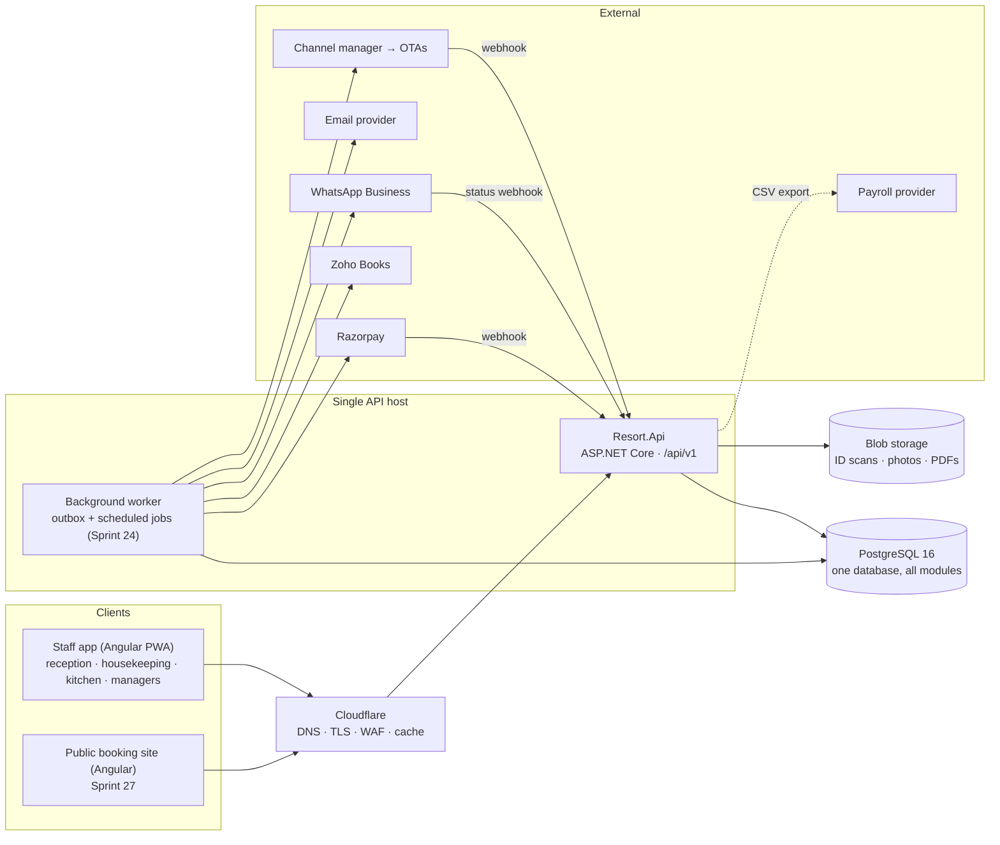
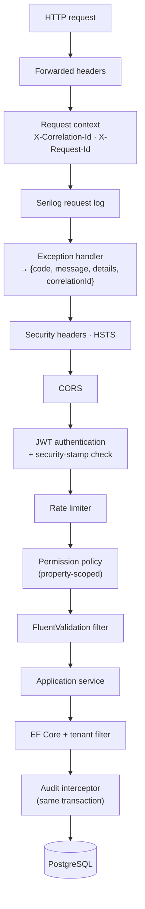
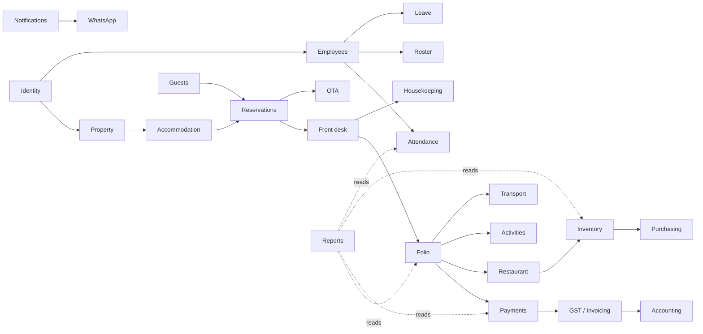

# Architecture

> Status: **proposed — awaiting owner approval (Sprint 0)**. Sections marked *built* exist in code today; everything else
> is the agreed design that later sprints implement. Decisions are recorded in [architecture/decisions.md](architecture/decisions.md).
> How the built parts actually work, sprint by sprint, is in [architecture/system-design.md](architecture/system-design.md).

## A. System architecture

A **modular monolith**: one ASP.NET Core API, one PostgreSQL database, one Angular staff app (PWA) and, later, a
separate public booking app. External specialists (payments, accounting, payroll, OTAs, messaging) are reached only
through adapters. No microservices, Kafka, Redis or Kubernetes (brief §76).



### Backend layers *(built)*

```
backend/
  Resort.Domain          Entities and domain rules. No framework dependencies.
  Resort.Contracts       Request/response records shared by API, tests and (later) generated TS types.
  Resort.Application     Use-case services per module, validators, permission codes, abstractions.
  Resort.Infrastructure  EF Core DbContext, SQL migrator, audit interceptor, JWT, hashing, external adapters.
  Resort.Api             Minimal-API endpoints, auth policies, error mapping, middleware, Program.cs.
  Resort.Tests           Unit + integration tests (real PostgreSQL).
```

Dependency direction: `Api → Infrastructure → Application → Domain/Contracts`. Business rules live in Application/Domain,
never in endpoints or Angular components (brief §84).

Each **module** is a folder in every layer (`Application/Reservations`, `Infrastructure/Reservations`,
`Api/Endpoints/ReservationEndpoints.cs`, …). Modules talk to each other through application services or domain
events, not by writing each other's tables.

### Request pipeline *(built)*



### Cross-cutting rules

| Concern | Rule | Where |
|---|---|---|
| Tenancy | Every business row has `organization_id` (+ `property_id`). Global EF filter scopes reads to the caller's org; anonymous = nothing. | `AppDbContext` *(built)* |
| Time | Store UTC (`timestamptz`). Business dates come from `properties.timezone` (Asia/Kolkata). Never the server clock's zone. | `Property.LocalDate` *(built)* |
| Money | `decimal` in C#, `numeric(12,2)` in SQL. Never float. Tax rule id + rate stored on every taxed line. | Sprints 8–12 |
| Concurrency | Optimistic (`xmin` → `version`) for edits; pessimistic row locks + exclusion constraints for inventory. | *(built)* / Sprint 5 |
| Idempotency | `Idempotency-Key` header on money and booking POSTs; webhook event-id dedupe. | Sprints 5, 11 |
| Audit | Interceptor writes old/new values, user, IP, device, reason, correlation and request id in the same transaction. Append-only. | *(built)* |
| Errors | `{code, message, details, correlationId}`; no stack traces, SQL or infrastructure details. | *(built)* |
| Integrations | Interface per capability (`IPaymentGateway`, `IAccountingProvider`, `IChannelManager`, `IMessageSender`, `IFileStore`); outbox for anything outbound. | Sprints 11, 24–26 |

## B. Module map

The 32 modules from brief §7, where they live, and when they're built.

| # | Module | Owns (main tables) | Sprint | Status |
|---|---|---|---|---|
| 1 | Identity | users, roles, permissions, user_roles, refresh_tokens, login_events | 1 | built |
| 2 | Property management | organizations, properties, property_settings | 1 | built |
| 3 | Accommodation | accommodation_types, accommodation_units, beds, unit_blocks | 2 | built |
| 4 | Reservations | reservations, reservation_units, idempotency_keys, rate_plans, packages | 4–6 | built |
| 5 | Guests | guests, guest_documents, guest_preferences | 3 | built |
| 6 | Front desk | unit_housekeeping_status, unit_housekeeping_history (uses reservations; folios from Sprint 8) | 7 | built |
| 7 | Folio | folios, folio_items, folio_item_taxes | 8 | built |
| 8 | Payments | payments, payment_allocations, refunds, cash_drawers, cash_drawer_sessions, cash_drawer_movements (Sprint 10); payment_gateway_orders, webhook_events (Sprint 11) | 10–11 | built (desk payments, cash drawer, Razorpay links and webhook) |
| 9 | GST / invoicing | gst_registrations, tax_categories, tax_rules, tax_rule_slabs (Sprint 9); invoices, credit_notes, receipts (Sprint 12) | 9, 12 | tax engine built; invoices planned |
| 10 | Housekeeping | housekeeping_tasks, unit_housekeeping_status | 13 | planned |
| 11 | Maintenance | maintenance_assets, maintenance_tickets | 13 | planned |
| 12 | Restaurant / POS | restaurant_tables, orders, order_items, kots | 14 | planned |
| 13 | Menu | menu_categories, menu_items, modifiers | 14 | planned |
| 14 | Inventory | inventory_items, stock_movements, recipes | 15 | planned |
| 15 | Purchasing | purchase_orders, goods_received_notes, supplier_invoices | 16 | planned |
| 16 | Suppliers | suppliers | 16 | planned |
| 17 | Employees | employees, employee_compensation, departments | 17 | planned |
| 18 | Attendance | attendance_events, geofences, timesheets | 18 | planned |
| 19 | Roster | shift_templates, roster_shifts | 17 | planned |
| 20 | Leave | leave_types, leave_balances, leave_requests, holidays | 19 | planned |
| 21 | Activities | activities, activity_schedules, activity_bookings | 20 | planned |
| 22 | Transport | vehicles, vehicle_trips, trip_passengers | 21 | planned |
| 23 | Equipment | equipment, equipment_assignments | 20 | planned |
| 24 | Expenses | expenses, expense_categories, cost_centres | 22 | planned |
| 25 | Budgeting | budgets, budget_lines | 22 | planned |
| 26 | Accounting integration | accounting_sync_records | 25 | planned |
| 27 | OTA integration | ota_channels, ota_reservations, ota_events | 26 | planned |
| 28 | WhatsApp | whatsapp_messages, message_templates | 24 | planned |
| 29 | Notifications | notifications, outbox_messages | 24 | planned |
| 30 | Reports | reporting.* views | 23 | planned |
| 31 | Audit | audit_logs | 1 | built |
| 32 | System administration | system_settings, schema_migrations | 1 | built |

### Module dependencies



## V. Security architecture (summary)

Full detail in [SECURITY.md](SECURITY.md). In short: short-lived JWT in memory + rotating HttpOnly refresh cookie;
security-stamp check on every request; permission codes (never role names) with property scoping and an escalation
guard; tenant query filters; append-only audit; secrets only in environment/secret store; OWASP Top 10 test pack
(Sprint 28).

## W. Deployment architecture (summary)

Full detail in [DEPLOYMENT.md](DEPLOYMENT.md). Three environments (development, staging, production). One small VM or
App Service for API + worker, managed PostgreSQL with point-in-time recovery, blob storage, Cloudflare in front,
GitHub Actions for CI/CD with a manual approval gate for production.

## Frontend

Route map, screen list and component conventions: [architecture/frontend.md](architecture/frontend.md).

## Lifecycles

Booking, guest, payment, GST/invoice, Razorpay, Zoho Books, OTA, employee, attendance, leave, restaurant, inventory and
activity/transport lifecycles (brief §91 I–U): [architecture/lifecycles.md](architecture/lifecycles.md).
