# Database

PostgreSQL 16. One database for all modules. The schema is owned by plain SQL migrations in
[`database/migrations`](../database/migrations); EF Core only maps onto it.

- Local setup, reset, backup/restore: [SETUP.md §6](SETUP.md#6-the-database)
- Every planned table and the sprint that creates it: [database/tables-by-sprint.md](database/tables-by-sprint.md)
- Column-level definitions of built tables, one file per sprint:
  [Sprint 1 — foundation](database/schema-sprint-01.md) ·
  [Sprint 2 — accommodation](database/schema-sprint-02.md) (rooms, dorm beds, blocks, dev seed data) ·
  [Sprint 3 — guests](database/schema-sprint-03.md) (profiles, encrypted ID documents, consents, demo guests) ·
  [Sprint 4 — rates and packages](database/schema-sprint-04.md) (rate plans, nightly rate grid, packages and their revenue split, reservation sources, demo rates) ·
  [Sprint 5 — reservations](database/schema-sprint-05.md) (reservations, held rooms and beds with the double-booking guard, nightly prices, status history, idempotency keys, demo bookings) ·
  [Sprint 6 — reservation calendar](database/schema-sprint-06.md) (calendar index, room moves as superseded rows, demo maintenance block) ·
  [Sprint 7 — front desk](database/schema-sprint-07.md) (check-in/out times, room cleaning state and its history, demo in-house guests) ·
  [Sprint 8 — folio](database/schema-sprint-08.md) (folios, immutable bill lines and reversals, the room-night guard, demo charges) ·
  [Sprint 9 — GST](database/schema-sprint-09.md) (GST registrations, tax categories, dated tax rules and their slabs, the seeded rules, tax on bill lines) ·
  [Sprint 10 — payments](database/schema-sprint-10.md) (payments and their status machine, allocations to bills, refunds that can't overspend, cash drawer shifts and their ledger, demo payments) ·
  [Sprint 11 — Razorpay](database/schema-sprint-11.md) (payment links as Razorpay orders, webhook events deduplicated by event id, online payments and refunds) ·
  [Sprint 12 — invoices](database/schema-sprint-12.md) (gap-free number series, GST invoices with their lines and taxes, credit and debit notes, credit lines on the folio, receipts, e-invoice placeholders) ·
  [Sprint 13 — housekeeping and maintenance](database/schema-sprint-13.md) (cleaning tasks made once per state change, checklists, equipment, repair tickets with their timeline and encrypted photos, out-of-order blocks, demo tickets) ·
  [Sprint 14 — restaurant](database/schema-sprint-14.md) (the menu with portions and choices, tables, orders with their versions, kitchen tickets, voids and discounts, room charges on the folio, restaurant cash in the drawer, demo menu) ·
  [Sprint 15 — inventory](database/schema-sprint-15.md) (units, stores and stock items, the append-only stock ledger and on hand kept from it, adjustments and counts with their reason, recipes per dish or portion, demo stock and recipes) ·
  [Sprint 16 — suppliers and purchasing](database/schema-sprint-16.md) (suppliers with GSTIN, requests, orders with approval, goods received into the stock ledger, supplier bills with input GST, payments, demo suppliers) ·
  [Sprint 17 — employees and roster](database/schema-sprint-17.md) (departments and job titles, employees with an optional account, pay apart behind its own permission, encrypted documents, shift templates, the roster with its clash constraint, ten demo employees) ·
  [Sprint 18 — attendance and timesheets](database/schema-sprint-18.md) (geofences, append-only clock events with where the phone was or a manager's reason, weekly timesheets worked out per day, corrections that keep the old times, locked for payroll, last week's demo timesheets) ·
  [Sprint 19 — leave and payroll](database/schema-sprint-19.md) (kinds of leave and policies, requests with the days they count and an overlap guard, the append-only leave ledger and balances kept from it, holidays, payroll files with their SHA-256, demo leave)

## Conventions (every table)

| Rule | Detail |
|---|---|
| Names | `snake_case`, plural table names, `ix_` indexes, `ux_` unique indexes, `ck_` checks, `fk` via `REFERENCES` |
| Primary keys | `uuid`, generated by the API as UUIDv7 (time-ordered). Append-only logs use `bigint GENERATED ALWAYS AS IDENTITY` |
| Tenancy | `organization_id NOT NULL` on every business table; `property_id` where the row belongs to one property |
| Time | `timestamptz` in UTC. Business dates (stay dates, shift dates, report dates) are `date` in the **property's** timezone |
| Money | `numeric(12,2)`; quantities `numeric(12,3)`; percentages `numeric(5,2)`. Never `float`/`real`/`money` |
| Audit columns | `created_at`, `updated_at`, `created_by`, `updated_by` on mutable tables (filled by the API) |
| Soft delete | `deleted_at` on master data only; partial unique indexes `WHERE deleted_at IS NULL` |
| Financial rows | Never deleted or updated in place: invoices, payments, folio items, stock movements, ledgers. Corrections are new rows (reversal, credit note, adjustment). Enforced by triggers |
| Concurrency | Optimistic via `xmin` (API `version` field). Inventory-type conflicts via row locks + `EXCLUDE` constraints |
| Enums | `text` + `CHECK (col IN (...))`, not PostgreSQL enum types (easier to extend in a migration) |
| Classification | Every column holding personal data gets `COMMENT ON COLUMN … IS 'class: sensitive'` (public / internal / confidential / sensitive — brief §59) |

## Migrations

```
database/migrations/
  V001__foundation.sql
  V002__seed_permissions_roles.sql
  V003__audit_request_context.sql
  V004__accommodation.sql
  V005__guests.sql
  V006__rates.sql
  V007__reservations.sql
  V008__reservation_calendar.sql
  V009__front_desk.sql
  V010__folio.sql
  V011__tax.sql
  V012__payments.sql
  V013__razorpay.sql
  V014__invoicing.sql
  V015__housekeeping.sql
  V016__<next>.sql   ← you add this
database/seed/dev/
  S001__accommodation.sql   ← demo rooms; Development only
  S002__guests.sql          ← 20 demo guests; Development only
  S003__rates.sql           ← BAR with weekend uplift, 2 packages; Development only
  S004__reservations.sql    ← 6 demo bookings (R00001–R00006); Development only
  S005__calendar.sql        ← Room 106 blocked for maintenance from tomorrow (calendar demo); Development only
  S006__front_desk.sql      ← R00007/R00008 in house, Room 101 dirty (front desk demo); Development only
  S007__folios.sql          ← main folios, room nights, dinner/pick-up on R00008, laundry on R00007; Development only
  S008__gst.sql             ← the demo property's GST registration (Goa); Development only
  S009__payments.sql        ← yesterday's closed drawer shift with a ₹500 cash payment (R00007), a ₹2,000 UPI advance (R00002); Development only
  S010__housekeeping.sql    ← departure checklist, Room 101's cleaning task, 3 pieces of equipment, tickets M00001 (pool pump) and M00002 (tap in Room 104); Development only
```

1. **Pick the next number** after the highest on `develop`. If two PRs collide, the second to merge renumbers.
2. **One concern per file**, named `V###__lower_snake_description.sql`.
3. **Never edit a merged migration.** The API stores a SHA-256 checksum of each applied file and refuses to start
   if it changes. Fix forward with a new migration.
4. Write it **re-runnable in a transaction**: the migrator runs each file inside one transaction under an advisory
   lock (safe when several API instances start together).
5. **Backwards-compatible first.** Add columns as NULL or with defaults; backfill; only then add NOT NULL in a later
   migration. Never drop or rename a column in the same release as the code that stops using it.
6. **Seed reference data** (permissions, roles, tax categories) goes in migrations. **Demo/dev data** goes in
   `database/seed/dev/S###__name.sql`, which only runs in Development (`DevSeed__Enabled`), must be idempotent and
   may use the placeholders `{{ORGANIZATION_CODE}}` and `{{PROPERTY_CODE}}` (the bootstrap organisation/property).
7. **New permission?** Add it in a migration (`INSERT INTO permissions …`) and grant it to roles there, then
   regenerate [security/permission-matrix.md](security/permission-matrix.md).

The API applies pending migrations at start-up (`Database__MigrateOnStartup=true`, the default). In production the
pipeline runs them as a separate step before deploying the new API version (Sprint 29).

## Money and rounding

Amounts are `numeric(12,2)` in SQL and `decimal` in C# — never `float`/`double`. Two rules keep totals exact:

- **Quotes** multiply a 2-decimal price by whole numbers (rooms, beds, extra guests, nights), so no rounding happens.
- **Splitting an amount** (a package price into revenue categories; later a package price per night) uses the
  **largest-remainder rule**, implemented once in `Resort.Domain/Rates/QuoteEngine.cs → MoneySplit` (and mirrored in the
  web form for the live preview): work in paise; give each part the whole paise of its exact share, rounded down; hand
  the paise left over, one each, to the parts whose discarded fractions were largest — ties go to the earlier part.
  The parts add up to exactly the total and none is more than one paisa from its exact share.
  Example: ₹999.99 split 33.33 % / 33.33 % / 33.34 % → ₹333.30 + ₹333.30 + ₹333.39.
  A deferred trigger on `package_components` refuses any package whose amounts don't add up to its price.

## C. Entity-relationship diagram (whole system)

Built tables are in Sprint 1. The rest is the target model. Line tables (invoice items, KOT items, etc.) are omitted
for readability.

```mermaid
erDiagram
  organizations ||--o{ properties : owns
  organizations ||--o{ users : employs
  users ||--o{ user_roles : has
  roles ||--o{ user_roles : granted
  roles ||--o{ role_permissions : includes
  permissions ||--o{ role_permissions : in

  properties ||--o{ accommodation_types : offers
  accommodation_types ||--o{ accommodation_units : has
  accommodation_units ||--o{ beds : "dorm only"
  accommodation_units ||--o{ unit_blocks : blocked_by
  properties ||--o{ rate_plans : prices
  rate_plans ||--o{ rate_plan_prices : per_date
  properties ||--o{ packages : sells
  packages ||--o{ package_components : split_into
  accommodation_types ||--o{ rate_plan_prices : priced

  organizations ||--o{ guests : knows
  guests ||--o{ guest_documents : has
  properties ||--o{ reservations : takes
  reservations ||--o{ reservation_units : allocates
  accommodation_units ||--o{ reservation_units : booked_as
  beds |o--o{ reservation_units : booked_as
  reservations ||--o{ reservation_guests : includes
  guests ||--o{ reservation_guests : stays
  reservations ||--o{ reservation_status_history : tracks
  ota_reservations |o--|| reservations : imports

  reservations ||--o{ folios : bills
  folios ||--o{ folio_items : charges
  tax_rules ||--o{ folio_item_taxes : applied
  folio_items ||--o{ folio_item_taxes : taxed
  payments ||--o{ payment_allocations : allocated
  folios ||--o{ payment_allocations : settled_by
  payments ||--o{ refunds : refunded
  folios ||--o{ invoices : invoiced
  invoices ||--o{ credit_notes : corrected_by
  invoices ||--o| einvoice_records : registered
  gst_registrations ||--o{ invoices : issued_under
  webhook_events }o--|| payments : confirms

  accommodation_units ||--|| unit_housekeeping_status : status
  accommodation_units ||--o{ housekeeping_tasks : cleaned
  maintenance_assets ||--o{ maintenance_tickets : raises

  menu_items ||--o{ order_items : ordered
  orders ||--o{ order_items : has
  orders ||--o{ kots : sends
  orders |o--o| folio_items : charged_to_room
  menu_items ||--o| recipes : costed_by
  recipes ||--o{ recipe_ingredients : uses
  inventory_items ||--o{ recipe_ingredients : in
  inventory_items ||--o{ stock_movements : ledger
  suppliers ||--o{ purchase_orders : supplies
  purchase_orders ||--o{ goods_received_notes : received
  suppliers ||--o{ supplier_invoices : bills

  users |o--o| employees : "signs in as"
  employees ||--o{ roster_shifts : works
  employees ||--o{ attendance_events : clocks
  employees ||--o{ timesheets : submits
  employees ||--o{ leave_requests : requests
  employees ||--o{ leave_balances : has

  activities ||--o{ activity_schedules : runs
  activity_schedules ||--o{ activity_bookings : booked
  equipment ||--o{ equipment_assignments : issued
  vehicles ||--o{ vehicle_trips : drives
  vehicle_trips ||--o{ trip_passengers : carries

  expense_categories ||--o{ expenses : groups
  budgets ||--o{ budget_lines : plans

  message_templates ||--o{ outbox_messages : renders
  outbox_messages ||--o| whatsapp_messages : delivered_as
  invoices ||--o{ accounting_sync_records : synced
  users ||--o{ audit_logs : acted
```



## D. Table list

All 148 candidate tables, grouped by the sprint that creates them: [database/tables-by-sprint.md](database/tables-by-sprint.md).
Each sprint confirms its tables at design review. Line/detail tables can be merged where a separate table isn't
justified (brief §11: "do not create artificial tables").

## E. Key relationships and rules

| Relationship | Rule |
|---|---|
| organization → everything | Tenant boundary. No query crosses it; enforced by EF filters and tested. |
| user ↔ property (user_roles) | `property_id NULL` = all properties. A user may hold different roles at different properties. |
| accommodation_type → unit → bed | `inventory_mode` UNIT sells the unit; BED sells beds. Beds exist only under BED-mode units. |
| reservation → reservation_units | One row per room, or per dorm bed, per stay range `[start, end)`. `EXCLUDE USING gist (unit_id WITH =, stay WITH &&)` (and the same on `bed_id`) over rows that hold inventory is the final guard against double booking; a change of dates supersedes rows instead of deleting them. Details: [schema-sprint-05.md](database/schema-sprint-05.md), [booking-algorithm.md](architecture/booking-algorithm.md). |
| reservation → reservation_status_history | Every status change with who, when and why; moves are limited to the rows of `reservation_status_transitions` (trigger). Reservations are never deleted. |
| reservation → folio | Created on confirmation. A reservation can have several folios (split billing). |
| folio_item → folio_item_taxes → tax_rules | The rule id and rate used are copied at posting time. Changing a rule never changes history (brief §86). |
| payment → payment_allocations → folio | A payment can settle several folios; a folio can have several payments. |
| invoice → credit_note | The only way to cancel or reduce an invoice. Invoice numbers are gap-free per series and financial year. |
| order → folio_item | "Charge to room" posts one folio item (source `RESTAURANT`) per order, linked back to the order (`orders.folio_item_id`, unique). |
| inventory_item → stock_movements | On-hand quantity is the sum of movements (ledger). Never an editable column. |
| employee → employee_compensation | Separate table, separate endpoint, `employee_salary.read` only. |
| ota_reservations → reservations | Unique `(channel, ota_reservation_id)`, so re-delivered webhooks update, never duplicate. |

## Reporting

Dashboards read from a `reporting` schema of views and materialised views refreshed by background jobs, not from raw
transaction tables. A read-only database role is provided for Power BI (Sprint 23, brief §88).

## Backups

Production: daily full backup + point-in-time recovery (WAL), retained 30 days, with a monthly restore drill.
RPO ≤ 15 minutes, RTO ≤ 4 hours (to be confirmed by the owner). See [OPERATIONS.md](OPERATIONS.md).
