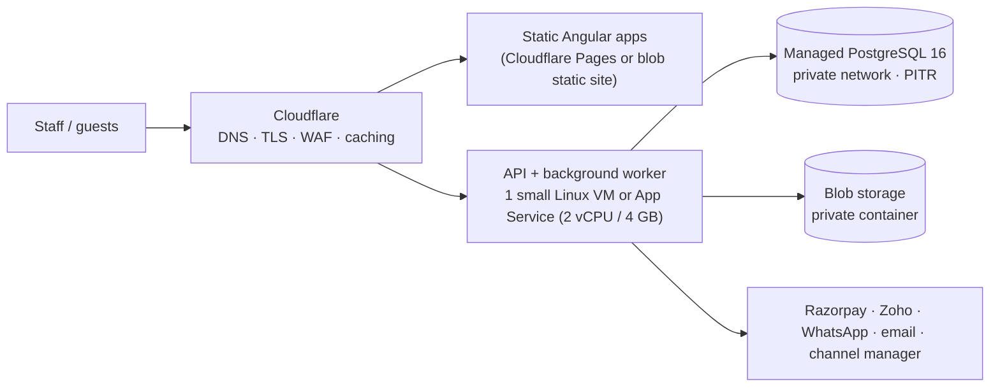

# Deployment

> Status: **design**. CI (build/test/scan) is live from day one; staging and production deployment are built in
> Sprint 29. Until then only the Development environment exists.

## W. Environments

| | Development | Staging | Production |
|---|---|---|---|
| Who | each developer's machine | team + owner for sprint reviews | the resort |
| Deployed by | `dotnet run` / `npm start` | automatically on merge to `develop` | manually approved run on a `sprint-NN` tag from `main` |
| Database | Docker PostgreSQL | managed PostgreSQL, small tier, seeded demo data | managed PostgreSQL with PITR, daily backups |
| Integrations | fakes or test-mode keys | Razorpay **test** mode, Zoho sandbox, WhatsApp test number | live keys |
| Data | synthetic | synthetic (never copies of production) | real |

Never develop or test against production (brief §77).

## Target hosting (low cost, brief §76)

Starting point: one API instance + one managed database is enough for a 7-unit property and well beyond. Scale
(second instance, shared cache, read replica for reports) only when monitoring shows the need. Kubernetes, Kafka,
Redis and API Management are out of scope unless usage requires them.

Region: an Indian region (e.g. Central India / Mumbai) for latency and data residency. Owner to confirm the cloud
provider in Sprint 0 (see [architecture/risks-and-open-questions.md](architecture/risks-and-open-questions.md)).

## Configuration

All configuration comes from environment variables; names are in [`.env.example`](../.env.example).

| Variable | Notes |
|---|---|
| `ASPNETCORE_ENVIRONMENT` | `Staging` / `Production` (never `Development` on a server: it enables Swagger and `.env` loading) |
| `DATABASE_URL` | app role, no DDL rights |
| `Jwt__SigningKey` | unique per environment, ≥ 32 random bytes |
| `Encryption__Key` | field-level encryption key; back it up separately from the database |
| `Razorpay__*`, `ZohoBooks__*`, `WhatsApp__*`, `Email__*`, `ChannelManager__*`, `Storage__*` | from the secret store |
| `Cors__Origins__0` | only if UI and API are on different origins |
| `ReverseProxy__KnownProxies__0` | the proxy/load balancer IP, so client IPs are correct in audit logs and rate limits |
| `OTEL_EXPORTER_OTLP_ENDPOINT` | optional tracing endpoint |
| `Bootstrap__*` | only for the very first production start; remove afterwards |

Secrets live in the provider's secret store and GitHub *Environments* (`staging`, `production`) with required reviewers.

## CI/CD (brief §78)

Built now: everything up to *Build artefacts* (`.github/workflows/ci.yml`). Sprint 29 adds `deploy.yml` with the
`staging` and `production` environments.

### Database migrations in deployment

1. Take an on-demand backup (production).
2. Run migrations with the **migration role** as a separate pipeline step (`Database__MigrateOnStartup=false` on servers).
3. Deploy the new API version. Migrations are always backwards-compatible with the previous version, so a rollback of
   the app doesn't need a schema rollback.
4. Smoke test `/health/ready` and a sign-in.

### Rollback

Redeploy the previous artefact. Never roll back a migration by hand. If data needs fixing, write a forward migration.
