# GST

> Status: **tax engine built (Sprint 9)** — invoices Sprint 12, e-invoice reconciliation Sprint 25.
> This is engineering documentation, not tax advice. Every rule entered into the system must be verified by the
> property's accountant/CA against current CBIC notifications. The seeded rules are marked unverified until someone
> presses **Verify** in Settings → GST.

## Principles (brief §23, §86)

1. **No GST rate, threshold or HSN/SAC mapping in code.** Everything is data in `tax_categories`, `tax_rules` and
   `tax_rule_slabs`, with `effective_from` / `effective_to` (both days included).
2. **Versioned:** when a charge is posted, the rule id and rate used are copied onto `folio_item_taxes`. Invoices copy
   from folio lines; they never recalculate. A future rule change never alters history.
3. **One tax engine** (`TaxCalculator` in `Resort.Application/Tax`) used by the folio now and by POS, purchasing and
   invoices later. No duplicated tax logic (brief §84). The arithmetic is `TaxMath` in `Resort.Domain/Tax`.

## Data model

| Table | Purpose |
|---|---|
| `gst_registrations` | The GSTIN a property bills under, its state, legal name, `REGULAR` or `COMPOSITION`, from/to a date |
| `tax_categories` | What is being taxed (accommodation, restaurant service …) with its SAC/HSN code and the folio charge category it covers |
| `tax_rules` | For a category: from/to dates, `FLAT` or `SLAB`, the notification it comes from, verified by whom |
| `tax_rule_slabs` | The rates of a rule: value up to (included; none = no limit) → rate, input tax credit yes/no |

Column by column: [schema-sprint-09.md](database/schema-sprint-09.md).

### Seeded rules (every organisation; unverified)

| Category (SAC) | Covers | From → to | Rates | Source |
|---|---|---|---|---|
| Accommodation (996311) | ROOM | 18 Jul 2022 → 21 Sep 2025 | up to ₹7,500: 12% · above: 18% (both with ITC) | Notification 03/2022-CT(Rate) |
| Accommodation (996311) | ROOM | 22 Sep 2025 → open | up to ₹7,500: 5% (no ITC) · above: 18% (ITC) | Notification 05/2025-CT(Rate) |
| Restaurant service (996331) | FOOD | 15 Nov 2017 → open | 5% (no ITC) | Notification 46/2017-CT(Rate) |

A restaurant in "specified premises" (a hotel with any room above ₹7,500 a night) charges 18% with ITC instead: such a
property adds an 18% restaurant rule. Beverages, laundry, transport, activities and equipment have **no tax category
yet**, so they carry no GST until the accountant adds one (Settings → GST → Add category, then a rule).

## Calculation

```
for each charge line:
    day          = the line's service date (a room night is its stay date)
    registration = the property's gst_registration on that day
    category     = the tax category covering the line's charge category
    rule         = the category's tax_rule effective on that day
    no category                         -> no GST ("no tax category covers them")
    no registration / COMPOSITION       -> no GST (an unregistered or composition supplier charges none)
    registered, taxed, but no rule      -> the charge is refused: 422 TAX_RULE_MISSING
    otherwise, for each part of the line (one per room or bed type of a night; the whole line otherwise):
        slab = first slab with up_to >= the part's unit value (value of one unit for one night, or one item's price)
    add up the parts that fall in the same slab, then:
        place of supply == supplier state:  CGST = SGST = round(taxable × rate / 2 / 100)
        else:                               IGST = round(taxable × rate / 100)
    round = 2 decimals, half away from zero, per tax per rate on the line
store on folio_item_taxes: tax_code, rate, taxable_value, amount, tax_rule_id; folio_items.tax_amount = their sum
```

- **Prices are before GST.** The taxable value is the line's amount (quantity × price); rate-plan discounts are already
  in the booked nightly price. The bill shows `amount + GST = total`.
- **Place of supply** for accommodation and anything consumed at the property is the property's state, so it is
  CGST + SGST. The preview (`POST /api/v1/tax/calculate`) takes another state to show IGST; invoices (Sprint 12) use it
  for B2B customers where the rules say so.
- **Slab basis** is the value of one unit (room or dorm bed) for one night, not the total of the stay. A night line
  that covers several rooms is taxed room type by room type.
- **Packages:** one line per component; the room part's unit value is its price divided by the package's nights.
- **The rate must be a multiple of 0.02%** so CGST and SGST are equal whole paise rates (the database checks it too).
- **Reversals and moved lines** copy the tax rows of the line they come from; they never recalculate.

## Worked examples

All at the demo property in Goa (state 30), registered from 1 Jul 2017, with the seeded rules. The first four can be
reproduced in Settings → GST → *Try a charge*; the rest are what the bill shows.

**1. A room night before and after the 22 Sep 2025 change** (the sprint's review demo). Room 104 at ₹3,500:

| Night of | Rule | Tax rows | GST | Total |
|---|---|---|---|---|
| 21 Sep 2025 | 18 Jul 2022 rule, up to ₹7,500 | CGST 6% ₹210.00 · SGST 6% ₹210.00 | ₹420.00 | ₹3,920.00 |
| 22 Sep 2025 | 22 Sep 2025 rule, up to ₹7,500 | CGST 2.5% ₹87.50 · SGST 2.5% ₹87.50 | ₹175.00 | ₹3,675.00 |

**2. The ₹7,500 boundary.** "Up to" includes the limit:

| Value of one room for one night | Slab | Tax rows | GST |
|---|---|---|---|
| ₹7,500.00 | up to ₹7,500 → 5% | CGST 2.5% ₹187.50 · SGST 2.5% ₹187.50 | ₹375.00 |
| ₹7,500.01 | above → 18% | CGST 9% ₹675.00 · SGST 9% ₹675.00 | ₹1,350.00 |

**3. Rounding per tax.** A dinner of ₹999 at 5%: 2.5% of 999 is 24.975, rounded half away from zero to ₹24.98 for
CGST and again for SGST: GST ₹49.96 (not ₹49.95, which rounding the 5% once would give). The invoice shows the two rows
exactly as stored.

**4. Inter-state (preview only).** The same ₹1,450 dinner with place of supply Maharashtra (27): IGST 5% ₹72.50
instead of CGST 2.5% ₹36.25 + SGST 2.5% ₹36.25. Same total, different heads.

**5. One night, two rooms in different slabs.** A booking with a garden room at ₹6,000 and a suite at ₹9,000 has one
night line of ₹15,000. Each room is taxed by its own value:

| Part | Slab | CGST | SGST |
|---|---|---|---|
| Garden room ₹6,000 | 5% | 2.5% ₹150.00 | 2.5% ₹150.00 |
| Suite ₹9,000 | 18% | 9% ₹810.00 | 9% ₹810.00 |

The line's GST is ₹1,920.00 (four tax rows). Charging 18% on the whole ₹15,000 because the line is above ₹7,500 would
be wrong.

**6. Dorm beds.** Three beds at ₹800 a night: line ₹2,400, unit value ₹800 → 5% → CGST ₹30.00 + SGST ₹30.00.

**7. A package.** "Goa getaway", 2 nights, ₹12,000 for one room: room part ₹8,000 and meals ₹4,000. The room part's
unit value is ₹8,000 ÷ 2 = ₹4,000 → 5% → ₹400.00; the meals are restaurant service → 5% → ₹200.00. Two lines, each with
its own CGST and SGST rows.

**8. The accountant changes a rate next month** (the sprint's acceptance criterion). On 18 Oct 2026 the accountant adds
a Restaurant service rule of 18% from 1 Nov 2026, citing the notification. No deployment: the 2017 rule is ended on
31 Oct 2026 automatically and the screen says so.

| Dinner ₹1,450 dated | Rule used | GST |
|---|---|---|
| 31 Oct 2026 | 15 Nov 2017 rule, 5% | ₹72.50 |
| 1 Nov 2026 | 1 Nov 2026 rule, 18% | ₹261.00 (CGST 9% ₹130.50 + SGST 9% ₹130.50) |

A dinner posted on 30 Oct keeps its ₹72.50 for good, and if it is reversed in November the reversal copies ₹72.50 back.
A rule can't start in the past and can't be edited once saved; a mistake is fixed by adding a rule from the right date.

**9. When no GST is charged.**

| Case | What happens |
|---|---|
| The property has no GST registration on the day | No GST; the preview says "… has no GST registration on …" |
| COMPOSITION registration | No GST; the guest gets a bill of supply (Sprint 12) |
| Laundry (no tax category covers LAUNDRY) | No GST until a category and a rule are added |
| Registered, FOOD is taxed, but no rule covers the day | The charge is **refused** with "There is no GST rule for Restaurant service on … Until then food charges dated … can't be posted." |

## Invoices, credit and debit notes (Sprint 12)

```mermaid
stateDiagram-v2
  [*] --> Issued: check-out, or Issue invoice on the bill (number taken, gap-free per series + FY)
  Issued --> PartlyCredited: REDUCE credit note (some lines or part of them; reason)
  PartlyCredited --> PartlyCredited: more REDUCE notes
  PartlyCredited --> Credited: nothing left on it
  Issued --> Cancelled: CANCEL credit note (reason; its charges can be invoiced again)
  PartlyCredited --> Cancelled: CANCEL credit note
  Issued --> Issued: debit note (charges posted after it)
  Cancelled --> [*]
```



- **Issued once, never edited or deleted** (database triggers). There is no draft: the invoice preview on the bill shows
  what will be issued. Status is worked out from the credit notes, never stored.
- **Check-out issues it**: the invoice of every folio of the booking that has charges not yet billed, to the bill-to
  guest on file (their company and GSTIN make it B2B), plus a receipt for each payment. A property can switch this off
  (`property_settings` key `invoice.issue_at_checkout` = `false`); without a GST registration nothing is issued. If one
  folio can't be invoiced (a wrong GSTIN on the guest's profile) the check-out still goes through and a note on the
  booking says why; reception issues it from the bill.
- **Numbering**: an `invoice_series` row per property, document type and financial year, taken with
  `INSERT … ON CONFLICT DO UPDATE last_number + 1 RETURNING` in the issuing transaction (the row stays locked until
  commit), so numbers are consecutive, unique and gap-free under concurrency. Format: up to 5 letters and digits of the
  property code, a letter for the type (none for invoices; `B` bill of supply, `C` credit note, `D` debit note, `R`
  receipt), the year (`2627`) and the number: `BEACH/2627/00001`, `BEACH/C2627/0001`. At most 16 characters of
  `A-Z 0-9 / -` (rule 46(b)).
- **Taxes are copied, never recalculated**: each line carries the rule, rate and amount posted on the folio (Sprint 9).
  A credit note takes tax off at each line's own rates, rounded per tax; crediting what is left of a line takes exactly
  what is left, so a line always credits to the paisa.
- **Place of supply** for accommodation (and the food and services of the stay) is where the property is (IGST Act
  s.12(3)): CGST + SGST even for a company from another state. The customer's state is still printed.
- **B2B**: the customer's GSTIN is validated (format, state code, PAN, check digit); its state must match the state
  given. **B2C**: name, and address and state if known.
- **Composition scheme**: a **bill of supply** with no GST and the line "Composition taxable person, not eligible to
  collect tax on supplies." A taxed charge on such a folio has to be reversed and posted again first.
- **Corrections**: `REDUCE` credit notes take chosen lines, or part of them, off the invoice and add a `CREDIT` line on
  the folio so the guest owes less; `CANCEL` credits everything left and leaves the bill as it is, so a new invoice can be
  issued (e.g. in a company's name), which shows earlier REDUCE credits as a discount. Charges posted after the invoice go
  on a **debit note** of it. A charge on an invoice that stands can't be reversed or moved on the folio.
- **PDFs** are drawn on the server with PDFsharp/MigraDoc **6.2.x** (MIT; it must stay below 6.5, which changed to AGPL)
  and the embedded DejaVu Sans font (it has the ₹ sign), so they look the same on any machine.
- e-Invoice: when the organisation's turnover makes it mandatory, B2B invoices are sent to the IRP through the
  accounting/e-invoicing provider (Zoho or a GSP). `einvoice_records` already holds IRN, Ack No, Ack Date, signed QR and
  status (empty until Sprint 25, which adds retry and daily reconciliation).

**Open questions for the owner's accountant** (defaults chosen so the sprint could be built; each can change later):
GST on advances received before the stay (a receipt voucher with tax under s.31(3)(d)) is not issued: the receipt has no
tax; refunds of advances (refund vouchers) are not numbered documents yet; one series per property (not per GSTIN or per
counter); invoices of a stay are dated on the day they are issued (check-out), not per night.

## Fields printed on an invoice

Title (TAX INVOICE or BILL OF SUPPLY), number and date, supplier legal and trade name, address, GSTIN and state, customer
name (+ GSTIN for B2B, else "Unregistered (B2C)"), address and state, place of supply, reverse charge (No), booking and
folio; per line: description, service date, HSN/SAC, quantity, rate, discount, taxable value, each tax with its rate and
amount, total; a tax summary by SAC and rate; payments received with their receipt numbers; taxable value, CGST, SGST,
IGST, cess and the invoice total in figures and words (lakh and crore); notes; "For <legal name> · Authorised
signatory"; CANCELLED across a cancelled one. IRN and QR follow in Sprint 25.

## Tests

- **Sprint 9 (built):** `TaxUnitTests` — slab boundaries (₹7,500.00 and ₹7,500.01), CGST/SGST vs IGST, rounding per
  tax, several parts on one line, the 0.02% rule, GSTIN check digits. `TaxTests` — a rule change doesn't change an
  already-posted charge or its reversal, the next-month rule closes the running one, a rule can't start in the past or
  overlap, TAX_RULE_MISSING, unregistered and composition properties, permissions, specific field errors.
- **Sprint 12 (built):** `InvoiceUnitTests` — financial year, series prefixes within 16 characters, amounts in words
  (lakh and crore), part credits at each tax's rate and the exact remainder, totals with CGST/SGST and IGST, what is
  printed (B2B, B2C, cancelled, bill of supply). `InvoiceTests` — the demo (check-out issues invoice, receipt and PDFs;
  cancel and re-issue B2B), 20 parallel invoices numbered 1–20 with no gap or repeat, B2B intra- and inter-state, the
  database refusing UPDATE and DELETE of totals, REDUCE and debit notes, a wrong GSTIN at check-out, receipts,
  idempotency and permissions.
