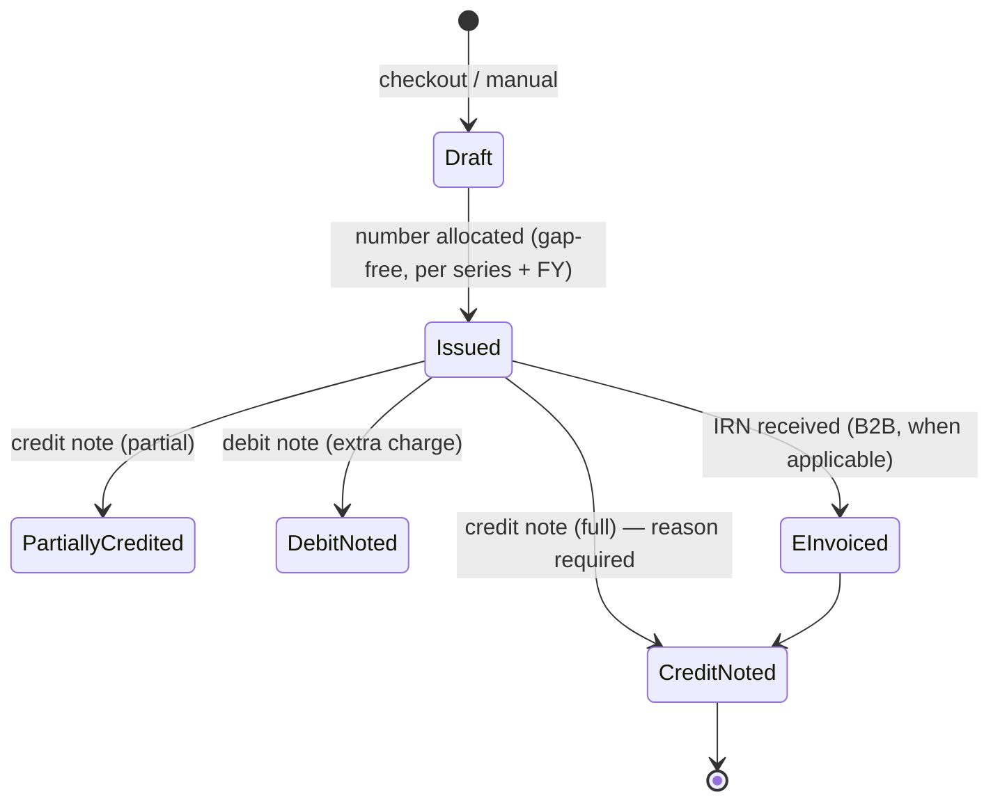

# GST

> Status: **design** — tax engine Sprint 9, invoices Sprint 12, e-invoice reconciliation Sprint 25.
> This is engineering documentation, not tax advice. Every rule entered into the system must be verified by the
> property's accountant/CA against current CBIC notifications.

## Principles (brief §23, §86)

1. **No GST rate, threshold or HSN/SAC mapping in code.** Everything is data in `tax_categories`, `tax_rules` and
   `tax_rule_slabs`, with `effective_from` / `effective_to`.
2. **Versioned:** when a charge is posted, the rule id and rate used are copied onto `folio_item_taxes`. Invoices copy
   from folio lines; they never recalculate. A future rule change never alters history.
3. **One tax engine** (`ITaxCalculator` in Application) used by folio, POS, purchasing and invoices. No duplicated tax logic (brief §84).

## Data model

| Table | Purpose |
|---|---|
| `gst_registrations` | GSTIN(s) per organisation/property, state code, legal name, registration type, valid dates |
| `tax_categories` | What is being taxed: accommodation, restaurant service, transport, activities, goods… with HSN/SAC code |
| `tax_rules` | For a category: effective dates, whether input tax credit applies, rule type (flat / value slab) |
| `tax_rule_slabs` | For slab rules: value range (e.g. per-unit-per-night tariff band) → GST rate |

## Calculation

```
for each charge line:
    taxable_value = (unit_price × qty) − allocated discount
    rule          = tax_rules where category = line.category and effective on line.service_date
    rate          = slab matching the rule's basis (e.g. declared tariff per unit per night) or the flat rate
    if place_of_supply_state == supplier_gstin_state:  CGST = SGST = taxable × rate / 2
    else:                                              IGST = taxable × rate
    round each tax component to 2 decimals (half-up), per line
store: rule_id, rate, taxable_value, cgst, sgst, igst on folio_item_taxes
```

- **Place of supply** for accommodation is the property's location (so normally CGST+SGST). For other services and
  B2B invoices the rule comes from the customer's state where applicable. Each case gets a test in Sprint 9.
- **Slab basis:** where accommodation GST depends on the tariff, the engine uses the value the rule specifies (for
  example declared tariff per unit per night), not the discounted total of the stay.
- **Packages:** tax is computed per component after the revenue split (room/food/transport/activity).

## Invoice lifecycle (brief §91 L)



- Invoices are never deleted or edited after issue (DB triggers). Cancellation = credit note.
- Numbering: `invoice_series` row per property + document type + financial year (April–March), incremented under a
  row lock, so numbers are gap-free and unique even under concurrency.
- B2B: customer GSTIN validated (format + checksum), legal name, state. B2C: name and state.
- e-Invoice: when the organisation's turnover makes it mandatory, B2B invoices are sent to the IRP through the
  accounting/e-invoicing provider (Zoho or a GSP). We store IRN, Ack No, Ack Date, signed QR and status, with retry
  and daily reconciliation (Sprint 25).

## Fields printed on an invoice

Invoice number and date, supplier GSTIN/legal name/address/state, customer name (+ GSTIN for B2B), place of supply,
per line: description, HSN/SAC, quantity, unit price, discount, taxable value, CGST/SGST/IGST rate and amount; totals,
rounding, grand total in figures and words, payment reference, IRN + QR when e-invoiced.

## Tests (Sprint 9 / 12)

Slab boundaries (value exactly at a threshold), intra- vs inter-state, per-line rounding, package splits, rule change
not affecting posted lines, gap-free numbering under 20 parallel requests, credit note totals.
