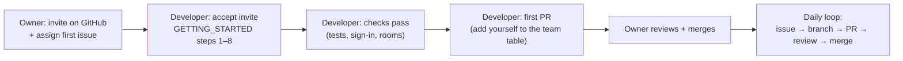

# Adding a developer to the team

How a new developer gets from nothing to their first merged pull request, and how the two of you then work on the
same code without getting in each other's way. There are three parts: **the owner** does Part 1 (about 10 minutes),
**the developer** does Part 2 (about an hour, mostly downloads), and **both** follow Part 3 every day.



## Part 1 — Owner (Prathamesh)

| # | Do | Why |
|---|---|---|
| 1 | Ask the developer for their **GitHub username** and ask them to turn on **two-factor authentication** (github.com → Settings → Password and authentication) | It's a private repo with the whole business logic in it |
| 2 | Repo → **Settings → Collaborators → Add people** → their username → **Add to repository** | On a personal-account repo every collaborator can push branches, open and merge PRs, and manage issues. They can't change settings, add people or delete the repo. The invite expires after 7 days |
| 3 | If not done yet, do the one-time repository settings in [REVIEWING.md → Repository settings](sprints/REVIEWING.md#repository-settings-to-do-once-owner-only), at least **Default branch = `develop`** | New PRs then target `develop` automatically, and `Closes #nn` in a PR closes the issue when it merges |
| 4 | **Issues** → filter by the current sprint's milestone → open one or two issues → **Assignees** → the developer | They know exactly what to start on |
| 5 | Send them **only the repo link** and this page: `https://github.com/Prathamesh27702/resort-os/blob/develop/docs/ONBOARDING.md` | Everything else is in the repo |

**Keys and passwords: there is nothing to send today.** Each PC's setup script generates its own local secrets
(database password, signing keys, local owner password) into that PC's `.env`. Your `.env` and your local owner
password stay on your PC. Each developer gets their own.

Integration keys (Razorpay test mode from Sprint 11, WhatsApp/email from Sprint 24, Zoho Books from Sprint 25, the
channel manager from Sprint 26) are shared **only when that sprint starts**:

- Send them through a password manager's secure share. Bitwarden's free plan and its *Send* feature both work.
  Never use Git, GitHub issues/PRs, email, WhatsApp or Slack.
- Share **test/sandbox** keys with developers. Production keys never go on a developer's PC.
- Keep a note of who has which key, so you know what to rotate if someone leaves (Part 4).

**Optional, after their first PR:** add their GitHub handle to `.github/CODEOWNERS` next to yours so GitHub asks
them to review too. Branch protection on `main` and `develop` needs GitHub Pro (see [COSTS.md](COSTS.md)). Until then,
the "never push straight to `main` or `develop`" rule in Part 3 is a team agreement, not something GitHub enforces.

## Part 2 — Developer

### 2a. Get access

1. Accept the invitation: GitHub sends an email, or open
   https://github.com/Prathamesh27702/resort-os/invitations while signed in.
2. Check you can see the repo's **Code**, **Issues** and **Pull requests** tabs.

### 2b. Set up your PC

Follow **[GETTING_STARTED.md](GETTING_STARTED.md) Steps 1–8** exactly: install the tools, clone in VS Code, add the
extensions, run `scripts/setup-dev.ps1` (macOS/Linux: `setup-dev.sh`), run, test. On macOS/Linux, or if you prefer
the command line, [SETUP.md](SETUP.md) is the short reference.

When VS Code asks you to sign in to GitHub while cloning, use **your own** account. Your commits must show your name
(GETTING_STARTED Step 2).

### 2c. Check it works

You're set up when all of these are true:

| Check | Expected |
|---|---|
| `pwsh -ExecutionPolicy Bypass -File scripts/test.ps1` | Backend **51 passed, 0 failed**; frontend **14 of 14 SUCCESS** (the numbers grow each sprint, see the current sprint guide) |
| http://localhost:5180/health/ready | `Healthy` |
| http://localhost:4300, sign in as `owner@demo.local` with **your** `Bootstrap__OwnerPassword` from **your** `.env` | *Good morning/afternoon, Demo* and the Today checklist |
| **Rooms** in the menu | Deluxe 101–102, Standard 103–106, a dormitory with 10 beds (demo data, only on your PC) |

Stuck? See [GETTING_STARTED → Problems?](GETTING_STARTED.md#problems). If it's still broken, open an issue with the
**Bug** template and paste the error **without** anything from `.env`.

### 2d. Read (about an hour)

1. [README.md](../README.md): what the system is, and the current sprint.
2. [ARCHITECTURE.md](ARCHITECTURE.md): the modules, how a request flows, the rules every module follows.
3. [CONTRIBUTING.md](../CONTRIBUTING.md): branches, commit messages, PR rules, code rules, secrets.
4. [sprints/PROCESS.md](sprints/PROCESS.md): how sprints run.
5. The **current sprint guide** in [sprints/](sprints/README.md): what's being built now.
6. One finished module end to end, e.g. rooms: `database/migrations/V004__accommodation.sql` →
   `backend/Resort.Api/Endpoints/AccommodationEndpoints.cs` → `backend/Resort.Application/Accommodation/` →
   `backend/Resort.Tests/Integration/AccommodationTests.cs` → `frontend/src/app/features/rooms/`.

### 2e. Your first pull request (practice run)

This proves your Git, CI and review setup before you touch real code.

```powershell
git switch develop
git pull
git switch -c docs/onboard-<your-github-username>
```

Add yourself to the [team table](#team) at the bottom of this file, then:

```powershell
git add docs/ONBOARDING.md
git commit -m "docs(team): add <your name>"
git push -u origin docs/onboard-<your-github-username>
```

GitHub then shows **Compare & pull request**: base `develop`. Fill in the template, then **Create pull request**.
Wait for the checks to go green (about 3 minutes). The owner reviews and merges it. Then start on your assigned issue.

## Part 3 — Working together every day

### Who does what

- **Work comes from issues** in the current sprint's milestone. Before you start one, **assign yourself**, so the
  other person can see it's taken. If it isn't in an issue, open one first.
- **One issue = one branch = one pull request.** Branch names: `feature/S03-123-guest-search`,
  `fix/S03-130-phone-validation` (sprint, issue number, short name).
- **Never commit straight to `develop` or `main`.** Everything goes through a PR.

### The loop

```powershell
git switch develop; git pull                       # start from everyone's latest work
git switch -c feature/S03-123-guest-search         # your branch
# … code + tests …  run scripts/test.ps1
git push -u origin feature/S03-123-guest-search    # then open a PR into develop
```

1. **PR into `develop`**, using the template; `Closes #123` in the description.
2. **CI must be green**: Backend, Frontend, Migrations, Security.
3. **The other person reviews.** The owner reviews the developer's PRs. The developer reviews the owner's PRs,
   including PRs opened by Claude, which appear under the owner's account. GitHub doesn't let anyone approve their
   own PR, so with two people each reviews the other.
4. **The author squash-merges** after approval and deletes the branch.
5. Everyone runs `git switch develop; git pull` before starting the next branch.

### Not stepping on each other

| Situation | What to do |
|---|---|
| Your branch is a few days old | `git fetch` then `git merge origin/develop` into your branch, fix any conflicts, re-run the tests, push |
| You both need a new migration | Comment on your issue *"taking V005"* before you write it. If two PRs still collide, whoever merges second renumbers their file. **Never edit a migration that's already on `develop`** |
| You both need the same file (e.g. `app.routes.ts`, `Permissions.cs`) | Keep each change small and merge often. Conflicts in these are usually just "keep both lines" |
| Someone pulled and the API won't start | Usually a new migration or package: `npm ci` in `frontend`, restart the API. Still broken? Reset the local database (`scripts/db-reset.ps1`) |
| A decision is needed (how a feature should behave) | Ask in the issue, label it `needs:owner-decision`. Decisions stay in GitHub so the next person can find them; a chat message gets lost |
| You want to show a bug | Steps using the **demo data** plus a screenshot. Never real guest data, never anything from `.env` |

Each of you has your **own local database**. Nothing you type locally reaches the other person. Shared data comes
only from migrations and the dev seed files in `database/seed/dev`, which come through Git.

### Every sprint

Planning picks the issues and assigns them. Work happens as above. At the end the owner runs the sprint review in
[sprints/REVIEWING.md](sprints/REVIEWING.md) and accepts or files fixes. Details: [sprints/PROCESS.md](sprints/PROCESS.md).

## Part 4 — When someone leaves

1. Repo → **Settings → Collaborators** → remove them.
2. **Rotate** every integration key they were given (Razorpay, WhatsApp, Zoho …) and send the new ones to whoever
   still needs them.
3. Reassign their open issues; close or take over their open PRs.

## Team

| Name | GitHub | Role | Joined |
|---|---|---|---|
| Prathamesh | @Prathamesh27702 | Product owner | Sprint 00 |
