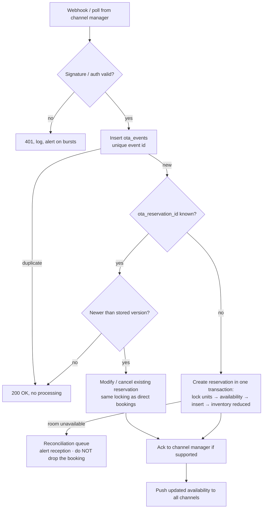

# OTA / channel manager

> Status: **design**, built in Sprint 26. One channel manager integration rather than six direct OTA integrations
> (brief §28). Provider to be chosen by the owner in Sprint 0. Keys: `ChannelManager__*`.

## Model

| Table | Purpose |
|---|---|
| `ota_channels` | Booking.com, MakeMyTrip, Goibibo, Airbnb, Agoda, Expedia — enabled flag, commission % (for net revenue reports) |
| `ota_room_mappings` | our accommodation type ↔ channel room code |
| `ota_rate_mappings` | our rate plan ↔ channel rate code |
| `ota_reservations` | channel + OTA reservation id (unique) → our reservation, last OTA version/timestamp |
| `ota_events` | every inbound event: event id (unique), payload, status, error |
| `ota_inventory_pushes` | outbound availability/rate pushes and their results |

## Inbound reservation lifecycle (brief §29, §75, §91 O)

## Outbound

- **Inventory push** after any change to availability (booking, cancellation, block), debounced per date range.
- **Rate push** after rate plan price changes.
- Full re-sync job nightly to heal drift.

## Double-booking protection

The database exclusion constraint used by direct bookings (Sprint 5) also guards OTA imports, so an OTA booking and
a walk-in can't take the same room. When the OTA wins a room we no longer have, the booking goes to the
**reconciliation queue** for a human (move to another room, upgrade, or contact the guest/OTA). It's never silently lost.

## Tests

Duplicate webhook → one reservation; modification older than stored → ignored; cancellation frees inventory; no
availability → reconciliation item + alert; simultaneous OTA + walk-in for the last room → exactly one succeeds.
