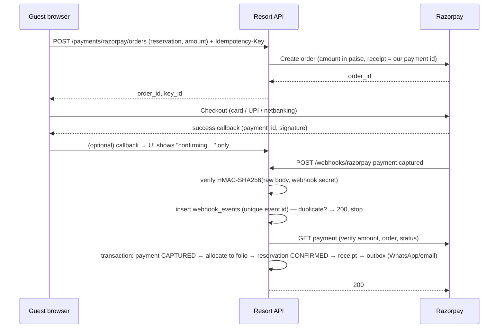

# Razorpay

> Status: **design**, built in Sprint 11 (payments core in Sprint 10). Keys: `Razorpay__KeyId`, `Razorpay__KeySecret`,
> `Razorpay__WebhookSecret` — test mode outside production, issued privately by the owner.

## Lifecycle (brief §22, §91 K/M)

## Rules

- **The webhook is authoritative.** The browser callback never marks anything paid.
- **Verify then trust:** signature over the *raw* request body with the webhook secret (constant-time compare); then
  fetch the payment from Razorpay and check amount, currency, order id.
- **Dedupe** on Razorpay's event id via `webhook_events (provider, event_id) UNIQUE`.
- **Out-of-order events** (`captured` before `authorized`, `failed` after `captured`) are handled by the payment state
  machine: transitions that move backwards are ignored and logged.
- **Amounts** are integers in paise at the Razorpay boundary; `numeric(12,2)` rupees internally.
- **Refunds** go through `IPaymentGateway.RefundAsync` with our refund id as the receipt; `refund.processed` webhook confirms.
- **No card data** ever reaches our servers (Checkout is hosted by Razorpay).

## Payment states

`PENDING → AUTHORIZED → CAPTURED → (PARTIALLY_REFUNDED | REFUNDED)`, or `FAILED` / `CANCELLED`.

## Testing

- Fake Razorpay server (`tests/fakes`) for CI: order creation, signed webhook delivery, duplicates, bad signatures, out-of-order.
- Manual: Razorpay test mode with test cards/UPI; expose the local webhook with `cloudflared tunnel` or `ngrok`.
  Never point test-mode webhooks at production.

## Adding Cashfree / Stripe later

Implement `IPaymentGateway` (`CreateOrderAsync`, `FetchPaymentAsync`, `RefundAsync`, `VerifyWebhook`) and register it
per property in `property_settings` (`payments.gateway`).
