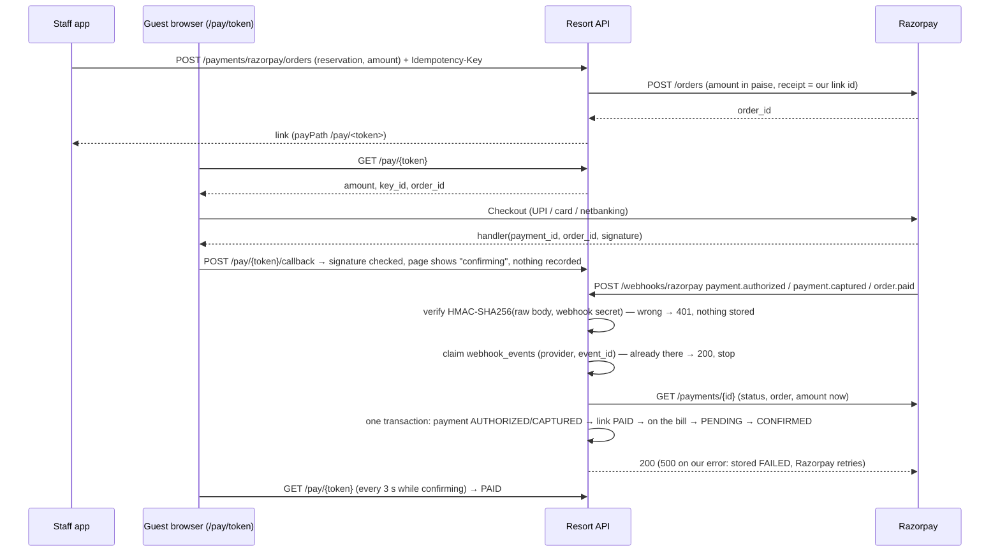

# Razorpay

> Status: **built in Sprint 11** (payments core in Sprint 10). Keys: `Razorpay__KeyId`, `Razorpay__KeySecret`,
> `Razorpay__WebhookSecret` in `.env` (never in git) — test mode outside production, issued privately by the owner.
> Endpoints: [API.md → Sprint 11](API.md#built-endpoints-sprint-11--razorpay). Tables:
> [schema-sprint-11.md](database/schema-sprint-11.md). Design: [system-design.md → 4.21](architecture/system-design.md#421-razorpay-the-webhook-is-the-only-writer).

## What staff and guests see

1. On a booking, **Send payment link** asks for an amount (at most what the booking owes, less open links; ₹1 or more).
   The link (`https://<app>/pay/<token>`) is copied; send it by WhatsApp, SMS or email.
2. The guest opens it on their phone, with no sign-in: property, booking, dates and the amount, and **Pay**, which opens
   Razorpay Checkout (UPI, cards, net banking, wallets). Card details go to Razorpay, never to us.
3. When Razorpay's webhook arrives, the payment (method **Online (Razorpay)**) goes on the bill, the link is **Paid** and
   a pending booking is **confirmed**. The guest's page changes to "Paid" by itself.
4. A declined try is shown to the guest and to staff (with the bank's reason); the link stays open. A link can be
   cancelled with a reason. Refunds of an online payment go back through Razorpay by default.

## Lifecycle (brief §22, §91 K/M)

## Rules

- **The webhook is authoritative.** The browser callback never marks anything paid; method `ONLINE` can't be typed in
  at the desk.
- **Verify then trust:** the signature over the *raw* request body with the webhook secret (constant-time compare);
  then fetch the payment from Razorpay and check order, amount and currency, and use Razorpay's status *now*, not the
  event's.
- **Dedupe** on Razorpay's event id (`X-Razorpay-Event-Id`) via `webhook_events (provider, event_id) UNIQUE`, claimed with
  `INSERT … ON CONFLICT` inside the transaction, so two deliveries at once process once. Payments are also unique on
  Razorpay's payment id.
- **Out-of-order events** (`captured` before `authorized`, `failed` after `captured`): a payment only moves forward
  (none < authorised < failed < captured). The late event is stored `IGNORED` with "changes nothing".
- **Our errors are retried by Razorpay:** the event is stored `FAILED` with the reason and the API answers 500;
  the next delivery takes the `FAILED` row over.
- **Amounts** are integers in paise at the Razorpay boundary; `numeric(12,2)` rupees internally.
- **Refunds** go through `IPaymentGateway.RefundAsync` (receipt = our refund id) and wait `PENDING` for
  `refund.processed`; `refund.failed` puts the money back on the payment. A refund call is never retried on an unclear
  failure (it might have gone through): staff are told to check Razorpay's dashboard first. Online payments can't be voided.
- **Calls to Razorpay** have a timeout per try (10 s) and are retried up to 3 times with exponential backoff and jitter
  when that is safe (create order, fetch payment; a refund only after 429).
- **No card data** ever reaches our servers (Checkout is hosted by Razorpay); stored webhook payloads have card details,
  email, phone and UPI id removed.
- **Keys are per organisation for now** (one Razorpay account, from `.env`). Per-property accounts can come later via
  `property_settings` (open question for Sprint 00).

## Payment states

`AUTHORIZED → CAPTURED → (PARTIALLY_REFUNDED | REFUNDED)`, or `FAILED` is only noted on the link (no payment row).
A failed gateway refund moves `REFUNDED` / `PARTIALLY_REFUNDED` back, for `ONLINE` payments only.

## Setting it up (test mode)

1. In the Razorpay dashboard switch to **Test mode**; Settings → API Keys → generate a key. Put them in `.env`:
   `Razorpay__KeyId=rzp_test_…`, `Razorpay__KeySecret=…`.
2. Expose your local API: `cloudflared tunnel --url http://localhost:5180` (or `ngrok http 5180`). Settings → Webhooks →
   add `https://<tunnel>/api/v1/webhooks/razorpay`, choose a secret, tick `payment.authorized`, `payment.captured`,
   `payment.failed`, `order.paid`, `refund.processed`, `refund.failed`. Put the secret in `.env` as
   `Razorpay__WebhookSecret`. **Never point test webhooks at production.**
3. Restart the API. Send a link from a booking and pay with a test card (e.g. 4111 1111 1111 1111, any future expiry,
   any CVV) or the test UPI id `success@razorpay`.
4. Wherever the web app is hosted, its Content-Security-Policy must allow `https://checkout.razorpay.com` (script and
   frame) on the `/pay/…` page.

Without keys (outside production) the API uses the **built-in fake Razorpay** (`FakeRazorpayServer`): same HTTP calls,
signed webhooks with the secret `fake-webhook-secret`, and the guest's page shows *Pay (test)* and *Fail the payment
(test)* buttons instead of Checkout. `Razorpay__Mode=Fake` forces it (refused in production); `Razorpay__Mode=Live` forces
the real API.

## Testing

- Integration tests (`RazorpayTests`) run the real API and database against the fake Razorpay: the demo, duplicate
  delivery (also at the same moment) processed once, bad signature → 401 with nothing stored, captured before
  authorised, a declined try, a cancelled link paid anyway, retries and timeouts, online refunds (processed and failed),
  permissions and tenants, and the database refusing edits. `RazorpayUnitTests` check the HMACs against known vectors.
- Browser tests `e2e/sprint-11.spec.ts` (fake Razorpay), API checks (`scripts/check-api.mjs`, Sprint 11 block) and
  `database/queries/check-sprint-11.sql`.
- Manual: Razorpay test mode as above.

## Adding Cashfree / Stripe later

Implement `IPaymentGateway` (`CreateOrderAsync`, `FetchPaymentAsync`, `RefundAsync`, `VerifyWebhook`, `VerifyCheckout`)
and register it per property in `property_settings` (`payments.gateway`); `payment_gateway_orders.gateway` and
`webhook_events.provider` already name the gateway.
