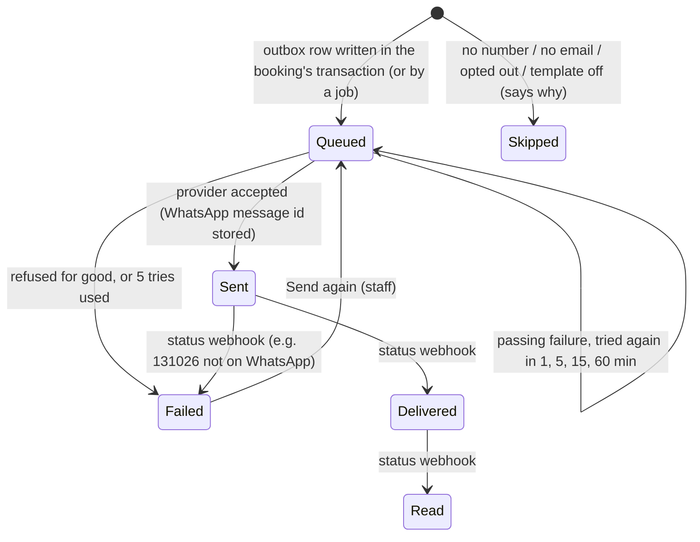

# WhatsApp, email and notifications

> Status: **built in Sprint 24** (accepted 7 Nov 2026). WhatsApp Business Platform (Meta Cloud API) for guests, Resend for email,
> and the bell in the staff app. Keys: `WhatsApp__PhoneNumberId`, `WhatsApp__AccessToken`, `WhatsApp__AppSecret`,
> `WhatsApp__WebhookVerifyToken`; `Email__ApiKey`, `Email__FromAddress`. Without keys in development (and in every test)
> the built-in **test WhatsApp and test email** are used and nothing reaches a phone or inbox. In production without
> keys the messages fail with the reason, so nothing is lost: set the keys and press **Send again**.
> How it works inside: [system-design.md → 4.34](architecture/system-design.md#434-messages-the-outbox-and-the-daily-jobs).

## What is sent

| Message | When | To | Channels |
|---|---|---|---|
| Booking confirmation | The moment a booking is confirmed: booked as confirmed, a pending booking confirmed by staff (or moved to confirmed), or paid online with a Razorpay link. Not for walk-ins (they are in front of you) | Guest | WhatsApp + email |
| Day-before reminder | Job `reservation_reminder`, daily at **10:00**: confirmed bookings arriving tomorrow | Guest | WhatsApp + email |
| Pre-arrival message | Job `pre_arrival`, daily at **10:00**: confirmed bookings arriving in **3 days** (setting `notifications.pre_arrival_days`, 2–30) | Guest | WhatsApp + email |
| Check-out reminder | Job `checkout_reminder`, daily at **08:00**: guests in house leaving today | Guest | WhatsApp |
| Payment reminder | Job `payment_reminder`, daily at **11:00**: bookings still pending whose payment link was made over a day ago; **once per link** | Guest | WhatsApp + email |
| Low stock alert | Job `inventory_alert`, daily at **08:00**: items at or below their reorder level; one a day | Staff with `inventory.manage` | Bell + email |
| Leave reminder | Job `leave_reminder`, daily at **09:00**: leave requests waiting more than a day; one a day | Staff with `leave.approve` | Bell |

Times are the property's time. The owner changes the words (**Messages → Templates**) and turns a job off or moves it
(**Messages → Daily jobs**) without a release; a receptionist or manager can **Run now** and **Send again**.

No sensitive data goes in a message (brief §32): no ID numbers, no payment details beyond the amount and the pay link.
Guest replies to the WhatsApp number are counted, not read or stored (a later sprint can add an inbox).

## Who gets what (consent)

Booking messages are **transactional**: they go unless the guest said No. On the guest's profile under **Consent**,
*Booking messages on WhatsApp* (`SERVICE_WHATSAPP`) and *Booking messages by email* (`SERVICE_EMAIL`) show "Not asked, so
they are sent"; **No** stops them, and every message that would have gone says so on the Messages page ("Asha asked not
to get booking messages on WhatsApp (recorded 3 Nov)"). Offers (`MARKETING_*`) are separate and not sent by Resort OS yet.

A guest with no mobile number, no email, or an anonymised profile gets nothing on that channel; the line on the Messages
page says why.

## Setting up WhatsApp (owner, once)

1. In [Meta Business Suite](https://business.facebook.com) make a WhatsApp Business account and add the resort's number
   (a number that is not on the WhatsApp app). Verify the business.
2. In the [Meta developer console](https://developers.facebook.com) make an app of type *Business*, add **WhatsApp**, and
   copy the **Phone number ID** → `WhatsApp__PhoneNumberId`.
3. Make a **System user** with a permanent token that has `whatsapp_business_messaging` → `WhatsApp__AccessToken`.
4. App settings → Basic → **App secret** → `WhatsApp__AppSecret` (it signs the status webhooks).
5. Pick any long random text → `WhatsApp__WebhookVerifyToken`. In WhatsApp → Configuration set the callback URL to
   `https://<your API>/api/v1/webhooks/whatsapp` with that verify token, and subscribe to **messages**.
6. In **WhatsApp Manager → Message templates** create the five templates below, category **Utility**, language English
   (`en`), with **named** variables exactly as listed (Meta's "Name" parameter format). Wait for approval (minutes to a day).
   The text on the Messages → Templates page should match the approved text: WhatsApp sends its approved words with our
   values filled in; ours is the record of what was sent.
7. Put the keys in `.env` (never in git) and restart the API. **Messages** stops saying "built-in test service".

| Template name | Variables |
|---|---|
| `booking_confirmation` | guest_name, reference, property_name, check_in, check_out, nights, rooms, check_in_time, check_out_time, property_phone |
| `reservation_reminder` | the same |
| `pre_arrival` | the same |
| `checkout_reminder` | the same |
| `payment_reminder` | the same, plus amount, pay_link |

Costs: Meta charges per conversation; utility templates sent in India cost about ₹0.12–0.15 each (2026 rates; see
[COSTS.md](COSTS.md)). Replies within 24 hours are free.

## Setting up email (Resend)

1. Sign up at [resend.com](https://resend.com) (the free tier is 3,000 emails a month), add the resort's domain and add
   the DNS records it shows (SPF, DKIM).
2. Make an API key with *Sending access* → `Email__ApiKey`.
3. `Email__FromAddress` = `Palm Grove <bookings@yourdomain.in>` on the verified domain. A key without a from address
   counts as not connected.

## Delivery

- **Passing failures** (WhatsApp rate limits and temporary errors 4, 80007, 130429, 131000, 131016, 131048, 131056,
  133004; HTTP 429 and 5xx; a timeout) stay *Waiting* and are tried again after 1, 5, 15 and 60 minutes: at most **5
  tries**, then *Failed* with the last answer. Anything else (a wrong number, a template that isn't approved, a bad
  token) fails at once with WhatsApp's words.
- **Status webhooks** are checked with `X-Hub-Signature-256` (HMAC-SHA256 of the body with the app secret); a wrong
  signature is refused with 401 and changes nothing. Each status is recorded once (`webhook_events`, event id
  `wamid:status`), and a status only moves a message **forward** (a late "delivered" after "read" changes nothing).
- **Nothing is lost**: the outbox row is written in the same transaction as the booking. After a crash between WhatsApp
  accepting a message and us saving its id, the message is sent again, so a guest could (rarely) get it twice. Email uses
  the outbox id as Resend's `Idempotency-Key`, so an email is never sent twice.

## Background jobs (brief §70)

A PostgreSQL-backed scheduler in the API itself (no Redis, brief §76). Each minute it looks for jobs whose `next_run_at`
has passed and claims each with a compare-and-set update, so with two API copies only one runs it. A job finds its work
(e.g. tomorrow's arrivals) and, per item, takes an advisory lock and records `job_runs (property, job, business_key)`
with a unique key such as `{reservationId}:{arrival day}`; an item already recorded is skipped. So running a job twice, by
hand or at the same moment, sends each message **once**. The outbox sender runs every 10 seconds
(`Notifications__DispatchIntervalSeconds`).

Settings: `Notifications__JobsEnabled`, `Notifications__DispatchEnabled` (both on; the tests turn them off and drive them
by hand), `Notifications__PublicUrl` (the address in pay links), `Notifications__MaxAttempts` (5).

## Testing without WhatsApp

With the test WhatsApp (no keys, never in production) a message's detail on the Messages page has **Delivered**, **Read**
and **Failed** buttons: they send a correctly signed status webhook through the real webhook endpoint, so the page
follows exactly as it would with WhatsApp.
