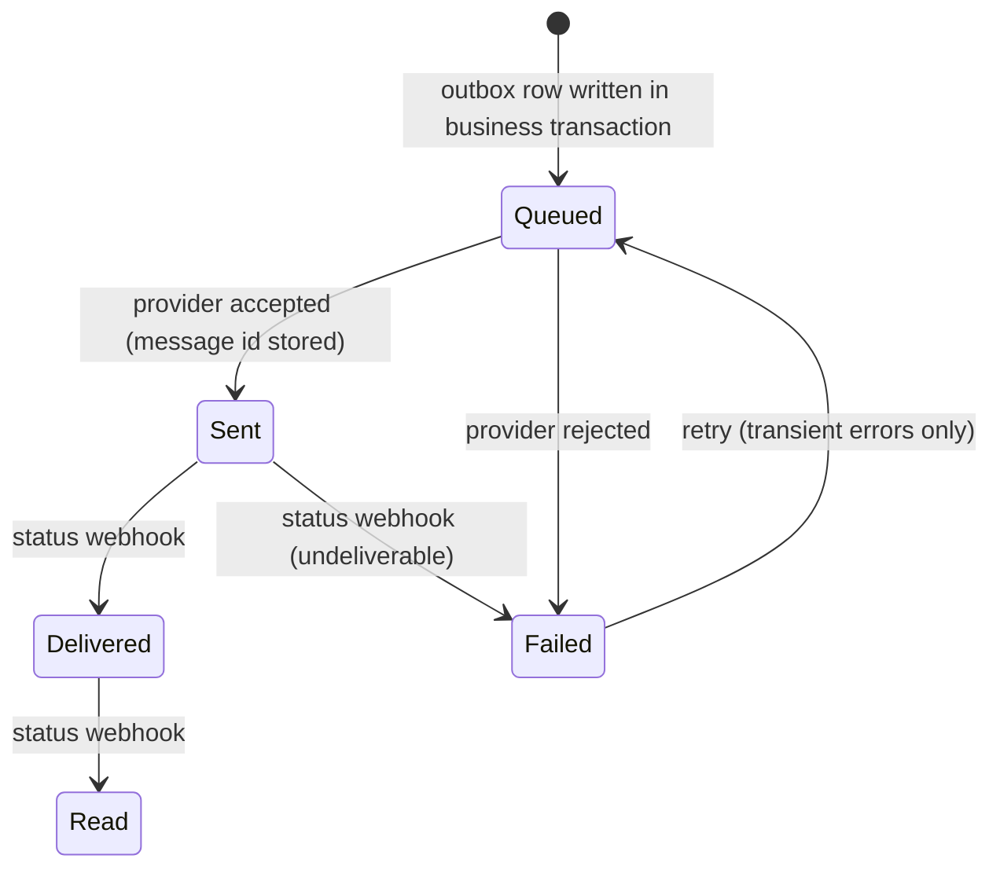

# WhatsApp and notifications

> Status: **design**, built in Sprint 24. WhatsApp Business Platform (Meta Cloud API). Keys: `WhatsApp__PhoneNumberId`,
> `WhatsApp__AccessToken`, `WhatsApp__AppSecret`, `WhatsApp__WebhookVerifyToken`. Email keys `Email__*`.

## Channels (brief §69)

`IMessageSender` with implementations: WhatsApp, email, in-app notification. SMS can be added later.

## Messages (brief §32)

| Template | Trigger | Channel |
|---|---|---|
| booking_confirmation | reservation confirmed | WhatsApp + email |
| payment_confirmation | payment captured | WhatsApp + email |
| pre_arrival | job: 1 day before arrival (property time) | WhatsApp |
| check_in_welcome | check-in | WhatsApp |
| checkout_thanks | check-out | WhatsApp |
| invoice / receipt | invoice issued | email (PDF) + WhatsApp link |
| activity_confirmation, transport_confirmation | booking | WhatsApp |
| feedback_request | job: day after checkout | WhatsApp |
| staff alerts | leave requested, low stock, payment failure | in-app + email |

- Business-initiated WhatsApp messages must use **Meta-approved templates**. Template names, languages and variables
  are configurable in `message_templates` (no code change to edit wording).
- **No sensitive data** in messages (brief §32): no ID numbers, no full payment details. Invoices are sent as
  short-lived signed links, not attachments with full PII in the body.
- Respect guest communication preferences and opt-outs (`guest_consents`).

## Delivery lifecycle

Status webhooks are verified (`X-Hub-Signature-256` with the app secret) and deduplicated like every other webhook.

## Background jobs (brief §70)

PostgreSQL-backed scheduler and worker in the same deployable (no Redis). Every job is **idempotent**: it records
`job_runs (job, business_key, run_at)` with a unique key, such as `pre_arrival:{reservationId}`, so a re-run sends nothing twice.
Jobs: reservation reminders, pre-arrival, checkout reminder, payment reminder, inventory alerts, leave reminders,
OTA sync, accounting sync, report refresh.
