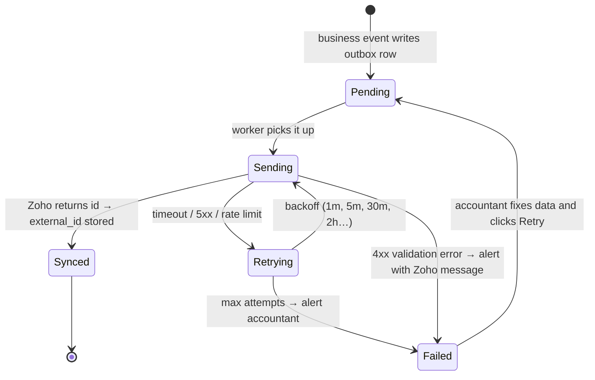

# Zoho Books (and Tally)

> Status: **design**, built in Sprint 25. Keys: `ZohoBooks__ClientId`, `ZohoBooks__ClientSecret`,
> `ZohoBooks__RefreshToken`, `ZohoBooks__OrganizationId` (India data centre, `zoho.in`). Sandbox credentials issued
> privately by the owner.

## What syncs (brief §26)

| Resort OS | Zoho Books | Trigger |
|---|---|---|
| Guest / B2B customer | Contact (customer) | first invoice for that guest |
| Supplier | Contact (vendor) | supplier created/updated |
| Tax rules | Taxes | tax rule created (mapped once, then by id) |
| Charge categories / menu items | Items | created/updated |
| Invoice | Invoice | issued |
| Credit / debit note | Credit note / debit note | issued |
| Payment / refund | Customer payment / refund | captured / processed |
| Expense | Expense | approved |

## Lifecycle (brief §91 N)

## No duplicates on retry

1. Every synced record has a row in `accounting_sync_records (entity_type, entity_id, provider, external_id, sync_status, last_sync_at, sync_error, attempt_count)`.
2. Our invoice number is sent as Zoho's invoice number / reference.
3. **Before re-creating** after an ambiguous failure (timeout), search Zoho by our reference. If found, store the id
   and mark synced instead of creating again.

## Tally

Not coupled to the core. `IAccountingExport` produces Tally-compatible XML (vouchers) and CSV for a date range,
downloadable by the accountant. A live `TallyProvider` can implement `IAccountingProvider` later.
