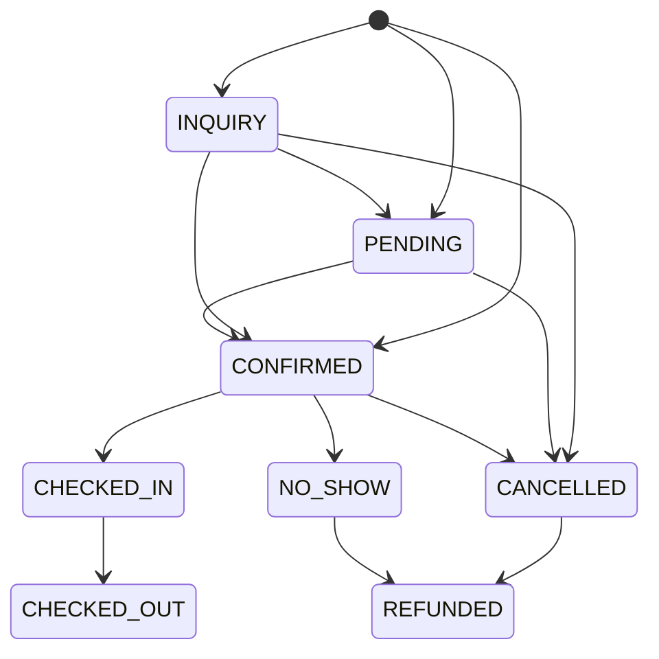

# Booking algorithm (Sprint 5)

How a reservation is created or changed without ever selling the same room (or dormitory bed) twice, and what exactly
PostgreSQL does at each step. Code: `backend/Resort.Application/Reservations/ReservationService.cs`,
`InventoryLoader.cs`, and the pure engine in `backend/Resort.Domain/Reservations/Availability.cs`. Schema:
`database/migrations/V007__reservations.sql` ([schema-sprint-05.md](../database/schema-sprint-05.md)).

## Rules the algorithm guarantees

1. **A room or bed is held by at most one booking per night.** A stay is the half-open range `[check_in, check_out)`:
   a guest leaving on the 12th and another arriving on the 12th never clash.
2. **Only PENDING, CONFIRMED and CHECKED_IN hold inventory.** An enquiry (INQUIRY) holds nothing; CANCELLED, NO_SHOW,
   CHECKED_OUT and REFUNDED free their rooms at once.
3. **Blocked rooms are never booked, and booked rooms are never blocked** (Sprint 2 blocks: maintenance, owner use).
4. **A retried create never makes a second booking** (Idempotency-Key).
5. **Every refusal says why**: which room or type, which nights, and what is holding it (`R00012`, or the block's reason).

## Create: `POST /properties/{id}/reservations`

Everything below runs in **one transaction** (`READ COMMITTED`, PostgreSQL's default).

| Step | SQL | Why |
|---|---|---|
| 1. Claim the key | `INSERT INTO idempotency_keys (…, scope, key, request_hash) … ON CONFLICT (organization_id, scope, key) DO NOTHING` | The unique index makes a second request with the same key **wait** on the first one's uncommitted row. When the first commits, the insert does nothing (0 rows) and the second reads the stored response. If the first rolled back, the second's insert succeeds and it books normally. |
| 1a. Replay | `SELECT … FROM idempotency_keys` | Same key, same body hash → the stored `201` body, plus header `Idempotent-Replayed: true`. Same key, **different** body → `422 IDEMPOTENCY_KEY_REUSED`. |
| 2. Check the request | ordinary `SELECT`s | Check-in not before the property's today, source, guests, rate plan, room types, chosen rooms, occupancy. Each problem is a field error (`Rooms[0].Adults`, `CheckIn`, …). |
| 3. Lock | `SELECT 1 FROM accommodation_units WHERE property_id = $p AND accommodation_type_id = ANY($types) ORDER BY id FOR UPDATE` | Serialises every booking that wants **the same room types**. The fixed `ORDER BY id` means two bookings for overlapping sets of types lock in the same order, so they can't deadlock. Bookings for other types don't wait. |
| 4. Read what is taken | `SELECT … FROM reservation_units WHERE unit_id = ANY(…) AND holds_inventory AND start_date < $to AND end_date > $from`, and the same for active `unit_blocks` | Because of the lock, these reads include every booking committed before us, and nobody can add one for these types until we finish. |
| 5. Allocate | none (pure C#) | `AvailabilityEngine.Allocate` takes the requested lines (type, optional room, guests) and picks free rooms, or for a dormitory one free bed per guest, preferring a room the user chose. If something doesn't fit it returns the reason, e.g. *"Room 102 isn't free for the night of 14 Oct 2026: it is booked on R00007. Choose another room."* or *"No Deluxe room is free for the night of 14 Oct 2026. Choose another room type or other dates."* → `409 ROOM_UNAVAILABLE`. |
| 6. Price | `SELECT … FROM rate_plan_prices` | `QuoteEngine` (Sprint 4) prices every night of every room; one `reservation_rate_breakdowns` row per room per night. A night without a price → `422 RATE_NOT_SET` naming the nights. |
| 7. Reference | `INSERT INTO property_counters … ON CONFLICT DO UPDATE SET last_value = last_value + 1 RETURNING last_value` | `R00001`, `R00002` … per property. The row lock on the counter keeps numbers unique; a rolled-back booking may leave a gap (allowed). |
| 8. Insert | `reservations`, `reservation_units`, `reservation_guests`, `reservation_rate_breakdowns`, `reservation_status_history` (`NULL → CONFIRMED`), optional `reservation_notes`, `audit_logs` | |
| 9. Store the response | `UPDATE idempotency_keys SET status_code = 201, response = $json` | Then `COMMIT`. |

### The final guard: exclusion constraints

Steps 3–5 are the normal path and give the precise message. The database enforces the rule on its own, whatever code
writes the rows:

```sql
stay daterange GENERATED ALWAYS AS (daterange(start_date, end_date, '[)')) STORED,
CONSTRAINT ex_reservation_units_unit EXCLUDE USING gist (unit_id WITH =, stay WITH &&) WHERE (holds_inventory AND bed_id IS NULL),
CONSTRAINT ex_reservation_units_bed  EXCLUDE USING gist (bed_id  WITH =, stay WITH &&) WHERE (holds_inventory AND bed_id IS NOT NULL)
```

A clash raises SQLSTATE **23P01** (`exclusion_violation`), which the API maps to `409 ROOM_UNAVAILABLE`
(`Resort.Api/Infrastructure/Problems.cs → KnownConstraints`). Two triggers cover blocks, which live in another table:
`fn_reservation_units_check` refuses a held row on a blocked room (`ex_reservation_units_blocked`) and
`fn_unit_blocks_not_reserved` refuses a block over a held night (`ex_unit_blocks_reserved` → `409
BLOCK_OVERLAPS_RESERVATION`). Both take the same `accommodation_units … FOR UPDATE` lock first, so a block and a
booking for the same room can't slip past each other.

A dormitory **room** row (`bed_id IS NULL`) can't coexist with a held bed row of the same dorm on the same night: the
type's inventory mode is checked by the trigger (`ck_reservation_units_mode`) so a BED type is always booked per bed.

### Why not SERIALIZABLE?

`SERIALIZABLE` would also be correct, but losers get `40001` and must retry the whole request. The row lock makes the
second booking wait a few milliseconds and then answer with the real reason, which is what the receptionist needs.

## Change: `PUT /reservations/{id}`

Same lock (on the reservation row first, then the room types), same engine, with the booking's own rows excluded from
"taken" and its current rooms preferred, so changing only the guests or extending a night keeps the same room when it's
free. The old `reservation_units` rows are **not deleted**: they get `superseded_at` and `holds_inventory = false`
(saved first, so the new rows may reuse the same room), and new rows and a new nightly breakdown are inserted. Totals
are re-priced from today's grid. Only INQUIRY, PENDING and CONFIRMED bookings can be changed
(`422 RESERVATION_NOT_CHANGEABLE`); a stale `version` is `409 CONCURRENCY_CONFLICT`.

## Status changes

Allowed moves are rows of `reservation_status_transitions`; the trigger `fn_reservations_status_transition` refuses
anything else (`ck_reservations_status_transition`), and the same table is mirrored in
`ReservationStatuses.Transitions` so the API answers first with `422 INVALID_STATUS_TRANSITION` and lists what is
possible.



- **Cancel / no-show** need a reason (≥ 3 characters); the rows stop holding inventory in the same transaction, so the
  room is bookable the moment the cancel commits. No-show is allowed from the arrival day (`422 NO_SHOW_TOO_EARLY`).
- **Enquiry → booking**: its rooms are checked again under the lock; if they were sold meanwhile, other free rooms of
  the same type are taken, or `409 ROOM_UNAVAILABLE` says why.
- CHECKED_IN / CHECKED_OUT arrive with the front desk (Sprint 7); REFUNDED with payments (Sprint 10).
- Every change writes `reservation_status_history` (from, to, reason, who, when) and an audit entry. Reservations are
  never deleted (trigger), enquiries included: an unwanted enquiry is cancelled.

## Tests that prove it

`backend/Resort.Tests/Integration/ReservationTests.cs`:

- **Last room, 50 runs**: two requests released together by a barrier → exactly one `201`, one `409 ROOM_UNAVAILABLE`.
- **Last dorm bed**: 5 parallel requests for one free bed → one `201`, four `409`.
- **Database guard**: inserting an overlapping held row directly in SQL fails with 23P01.
- **Idempotency**: the same key twice → one reservation, identical body, `Idempotent-Replayed: true`; a different body → 422.
- **Cancel frees inventory**, **illegal transition → 422**, blocks vs bookings both ways.

To watch the lock while a test is paused: `SELECT pid, relation::regclass, mode, granted FROM pg_locks WHERE NOT granted;`
