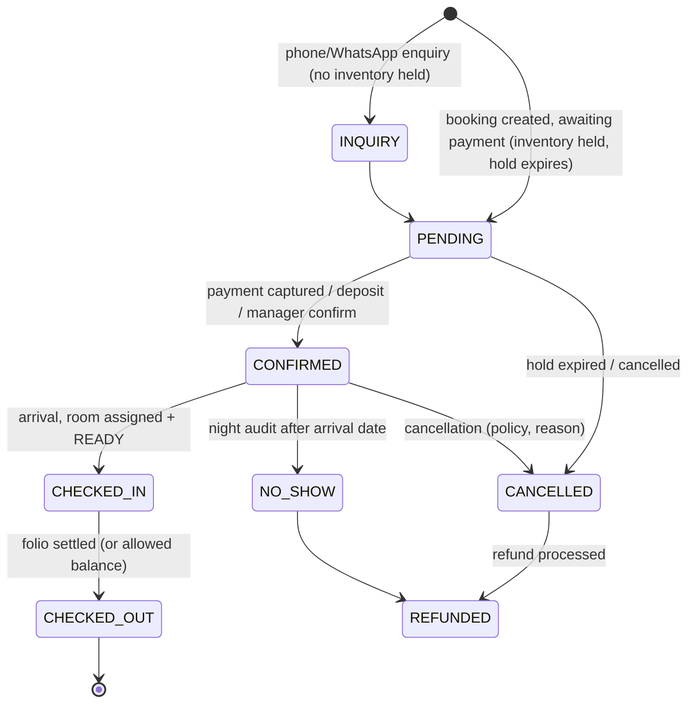
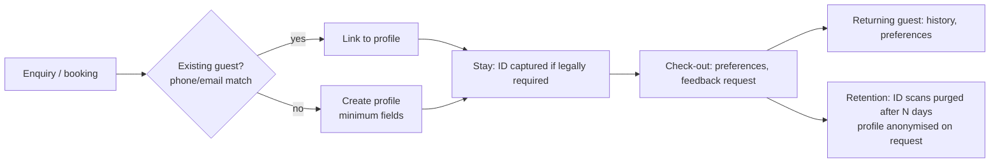
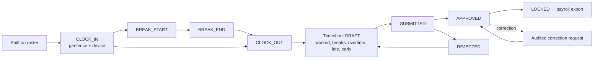
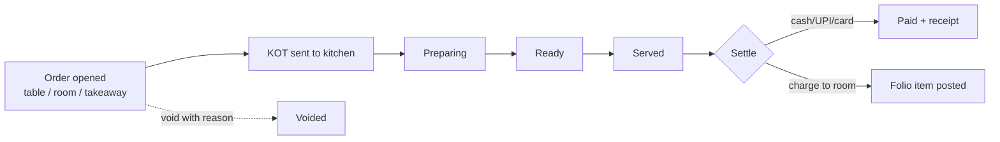

# Lifecycles (brief §91 I–U)

Payment (K), GST/invoice (L), Razorpay (M), Zoho Books (N) and OTA (O) live with their integration docs:
[RAZORPAY.md](../RAZORPAY.md), [GST.md](../GST.md), [ZOHO_BOOKS.md](../ZOHO_BOOKS.md), [OTA.md](../OTA.md).
Every transition below is audited.

## I. Booking

Sources: direct website, walk-in, phone, WhatsApp, MakeMyTrip, Goibibo, Booking.com, Airbnb, Agoda, Expedia, travel
agent, corporate, referral, other (`reservation_sources`). Reservations are never deleted (brief §87).

### Overbooking prevention (Sprint 5 — the exact algorithm goes in `booking-algorithm.md`)

1. Client sends `Idempotency-Key`. If the key exists with the same request hash, return the stored response.
2. `BEGIN` (READ COMMITTED).
3. `SELECT … FROM accommodation_units WHERE id = ANY(@candidates) ORDER BY id FOR UPDATE` (fixed order → no deadlocks).
4. Check no active `reservation_units` / `unit_blocks` overlap `[arrival, departure)`.
5. `INSERT` reservation + reservation_units.
6. The `EXCLUDE USING gist (unit_id WITH =, stay WITH &&) WHERE (active)` constraint is the final guard; a `23P01`
   becomes `ROOM_UNAVAILABLE`.
7. Store the idempotency response; `COMMIT`.

Two simultaneous requests for Room 103: B waits on A's row lock at step 3; when A commits, B's check at step 4 sees
A's row and returns `ROOM_UNAVAILABLE`.

## J. Guest

## P. Employee

`Hired (employee record, documents, compensation)` → `optional user account + roles` → `rostered` → `active` →
`on leave` ↔ `active` → `notice` → `exited (user deactivated same day, documents retained per policy)`.

## Q. Attendance and timesheet

Example (brief §44): 08:03 in, 12:00–12:30 break, 16:10 out → 7h 37m.

## R. Leave

`employee requests` → checks: balance, overlap with own leave, staff coverage on the roster → `manager notified` →
`APPROVED` (ledger debit, roster updated, payroll export) or `REJECTED (reason)` → `CANCELLED` (before start, ledger
credit).

## S. Restaurant

Served items consume recipe ingredients from inventory (Sprint 15).

## T. Inventory

`Purchase request → PO (approved) → GRN (stock +) → supplier invoice → payment`; stock − via sales/recipes,
consumption, wastage, damage; ± via counted adjustments (reason) and transfers between locations. On-hand is the sum
of the movement ledger. Low-stock alerts from a job.

## U. Activity and transport

Activity: `schedule (capacity, guide, equipment, weather-dependent)` → `booking (capacity locked)` → `equipment
issued` → `completed / weather-cancelled (refund or folio credit)` → `equipment returned / damaged`.

Transport: `trip scheduled (vehicle, driver, capacity)` → `guest books seat (₹ to folio)` → `manifest` → `driver marks
boarded / no-show` → `completed`.
