# How Resort OS works: architecture and system design

This is the guide for someone joining the project. Read it once from top to bottom and you will know how the whole
code base fits together, why it is built the way it is, and where to look when you change something. It is updated
at the end of every sprint (see [How this guide stays current](#how-this-guide-stays-current)).

| Part | What it answers |
|---|---|
| [1. The system in one picture](#1-the-system-in-one-picture) | What runs where, and how a click becomes a database row |
| [2. The code base map](#2-the-code-base-map) | Which folder holds what, and the rules between layers |
| [3. Built sprint by sprint](#3-built-sprint-by-sprint) | Each sprint's architecture: tables, services, screens, diagram |
| [4. System design: how the hard parts work](#4-system-design-how-the-hard-parts-work) | Passwords, sign-in, permissions, tenants, audit, encryption, no double booking, idempotency, money, time, errors, room moves, the front desk, folios, GST, payments, Razorpay, invoices, housekeeping, restaurant, inventory, purchasing, roster, attendance, leave and payroll |
| [5. Changing the system safely](#5-changing-the-system-safely) | Adding a table, an endpoint or a screen without breaking these guarantees |
| [6. Where to read more](#6-where-to-read-more) | The detailed documents behind each part |

Status: Sprints 01–17 built and accepted (October 2026); Sprints 18 and 19 built and in review. Anything marked *planned* is design that a later sprint
builds; [ARCHITECTURE.md](../ARCHITECTURE.md) holds the full target design and [decisions.md](decisions.md) the
decisions behind it.

---

## 1. The system in one picture

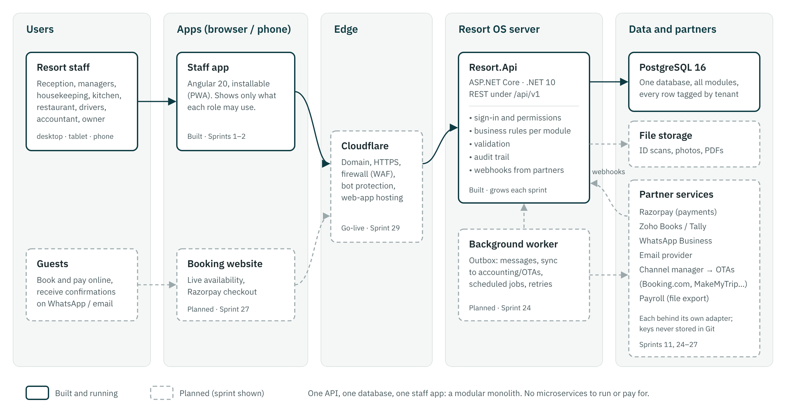

Resort OS is a **modular monolith**: one ASP.NET Core API (.NET 10), one PostgreSQL 16 database and one Angular 20
staff app. There are no microservices, queues or caches to run; every rule that matters is enforced in one process
and one database transaction, which keeps the system cheap to host and easy to reason about. External services
(payments, accounting, WhatsApp, OTAs) arrive in later sprints behind adapters.

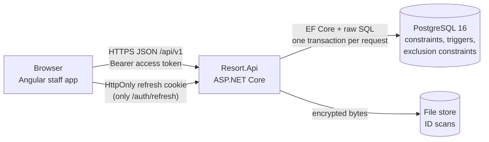

### What happens on one request

Take "book Room 102 for tonight". The same path applies to every write.

1. The Angular page calls `ReservationsApi.create()`. `authInterceptor` (`frontend/src/app/core/http.ts`) adds the
   15-minute access token; if the API answers 401 it refreshes the token once from the HttpOnly cookie and retries.
2. The request enters the API pipeline (`backend/Resort.Api/Program.cs`):

   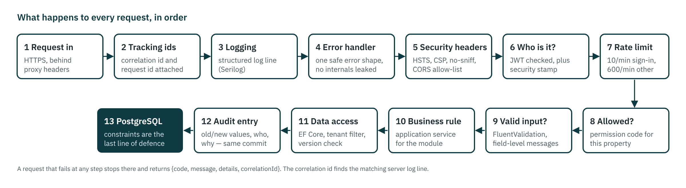

   correlation id → request log → exception handler → security headers → CORS → JWT check (signature, expiry and the
   user's **security stamp**) → rate limiter → **permission policy** for the property in the URL → **validator**
   (FluentValidation; every error names its field and says why).
3. The endpoint (`Api/Endpoints/ReservationEndpoints.cs`) only maps HTTP to a call on an **application service**
   (`Application/Reservations/ReservationService.cs`). All business rules live there or in the **domain**.
4. The service reads and writes through `AppDbContext`. A **tenant filter** limits every query to the caller's
   organisation; the **audit interceptor** writes an `audit_logs` row for each change inside the same transaction.
5. PostgreSQL enforces the rules a bug in C# must never break: foreign keys, checks, triggers (status graph,
   never-delete) and **exclusion constraints** (no room held twice on a night).
6. Errors come back as `{code, message, details, correlationId}`; the page shows each `details` entry under its field
   (`showFieldErrors`), and anything else next to the button, always with the reason.

---

## 2. The code base map

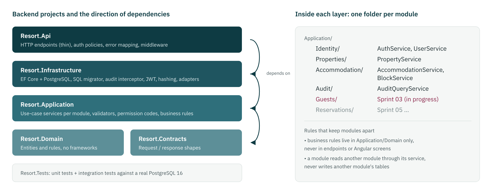

```
backend/
  Resort.Domain          Entities and pure rules: no database, no clock, no framework. Unit-tested.
                         e.g. Rates/QuoteEngine.cs, Reservations/Availability.cs, Guests/Guests.cs (GuestRules)
  Resort.Contracts       Request/response records (what the API accepts and returns)
  Resort.Application     One service per use case group, validators, permission codes, shared helpers
                         Common/ (errors, idempotency, concurrency, protection), Identity/, Properties/,
                         Accommodation/, Guests/, Rates/, Reservations/, FrontDesk/, Folios/, Tax/, Payments/, Audit/, Validation/
  Resort.Infrastructure  AppDbContext (EF Core, snake_case), SQL migrator, audit interceptor,
                         JWT + password hashing (Identity/Security.cs), field encryption, file store, dev seeder,
                         external adapters (Payments/RazorpayPaymentGateway.cs and its FakeRazorpayServer)
  Resort.Api             Program.cs (pipeline), Endpoints/*.cs (one file per module),
                         Infrastructure/ (authorisation, problems/error mapping, current user, security headers)
  Resort.Tests           Unit tests + integration tests against a real PostgreSQL (one database per test class)
database/
  migrations/V###__*.sql The schema. Applied in order at API start; never edited once applied
  seed/dev/S###__*.sql   Demo data, Development only
  queries/check-sprint-NN.sql  Read-only checks the owner runs during review
frontend/src/app/
  core/                  auth, http (interceptor, error helpers), property context, guards, dates, models
  layout/                the shell (menu, header with the property's local time)
  features/<module>/     one folder per module: *.page.ts (screens), *.api.ts (HTTP), *.forms.ts (form rules)
frontend/e2e/            Playwright browser tests, one file per sprint (the review scripts)
docs/                    Everything you are reading; sprint plan in docs/sprints/sprints.yml
tools/handbooks/         Builds the two Word handbooks and the diagrams used here
```

Rules between the layers:

- Dependencies point inwards: `Api → Infrastructure → Application → Domain / Contracts`. The domain knows nothing
  about HTTP or SQL, which is why `QuoteEngine` and `AvailabilityEngine` can be tested with plain inputs.
- Business rules live in Application or Domain, never in endpoints or Angular components. The UI repeats a rule only
  to give a faster message; the API always checks again.
- The **database owns the schema**. EF Core maps onto the SQL files; EF migrations are not used. The rules that
  protect money and inventory are also enforced by the database, so they hold for any code that writes rows.
- Every module is a folder in each layer with the same name (`Reservations` in Domain, Application, Api, frontend).

---

## 3. Built sprint by sprint

Each sprint adds one module end to end: migration → domain → service → endpoints → screens → tests → docs. The
per-sprint guides in [docs/sprints/](../sprints/README.md) list every file; this section explains the design.

### Sprint 01: Foundation (sign-in, organisations, roles, audit)

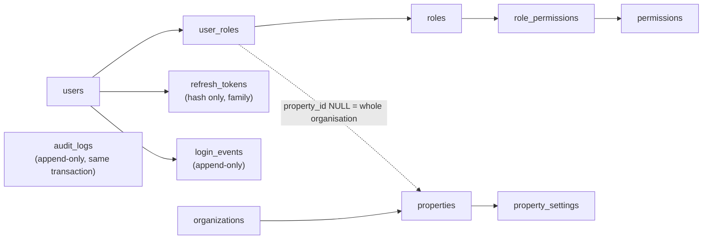

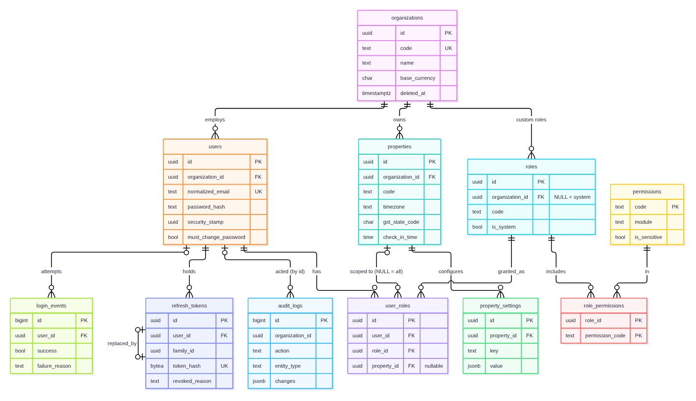

- Migrations V001 (foundation), V002 (17 roles, 117 permissions), V003 (request context on audit rows).
- Code: `Application/Identity/AuthService.cs`, `UserService.cs`, `Infrastructure/Identity/Security.cs`,
  `Infrastructure/Persistence/AuditInterceptor.cs`, `Api/Infrastructure/Authorization.cs`.
- Screens: sign-in, forced password change, staff accounts, roles and permissions, audit trail, dashboard.
- Design detail: [4.1 Passwords](#41-passwords), [4.2 Sign-in and tokens](#42-sign-in-tokens-and-sessions),
  [4.3 Permissions](#43-permissions-and-roles), [4.4 Tenants](#44-one-database-many-organisations),
  [4.5 Audit](#45-the-audit-trail).

### Sprint 02: Accommodation (room types, rooms, dorm beds, blocks)

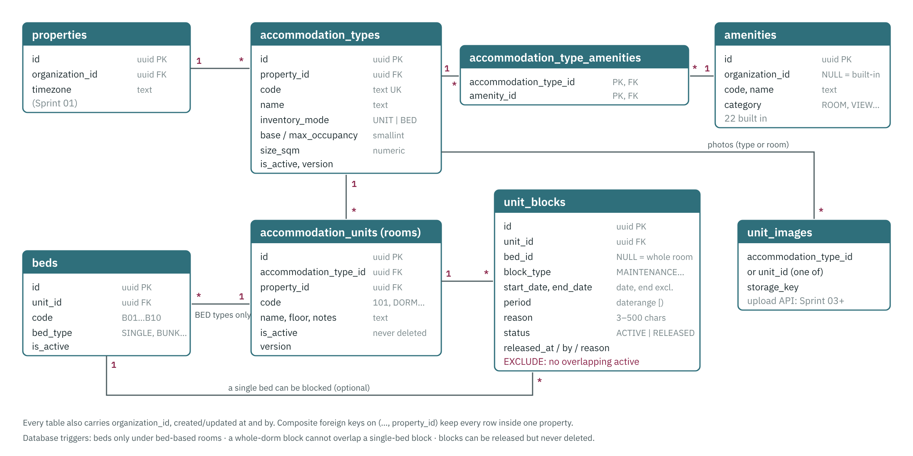

- Migration V004. A room type's `inventory_mode` decides how it is sold: **UNIT** (a whole room) or **BED** (a
  dormitory, sold per bed, so each bed is its own row in `beds`).
- `unit_blocks` take a room or one bed out of sale for a date range (maintenance, owner use) with a reason. Two
  exclusion constraints stop two active blocks overlapping on the same room or bed; `BlockService` locks the room row
  first so it can explain which block is in the way.
- Room status (`/rooms/status`) shows each room's own condition for a night (available, blocked, some beds blocked,
  not in use). It does not show bookings yet; that view comes with the calendar and front desk sprints.

### Sprint 03: Guests (profiles, ID documents, duplicates, privacy)


- Migration V005. Guests belong to the organisation and are shared by all its properties.
- Phones are stored as E.164 (`+919820012345`); `GuestRules.NormalizePhone` accepts the ways people type Indian
  numbers (98200 12345, 098200 12345, +91-98200-12345). Search uses generated columns (`search_text`, phone digits)
  with trigram indexes.
- **Duplicates**: before creating a profile the API looks for the same phone, the same email, the same full name, or
  (for an existing profile) the same ID document via a keyed hash. The user picks one or says "add anyway".
- **Merge** folds a duplicate into the survivor (documents, consents, preferences, bookings) and marks it MERGED;
  **anonymise** removes personal data but keeps the row so stays and invoices still add up. Profiles are never deleted.
- ID numbers and scans are encrypted: [4.6 Encryption](#46-encrypting-id-documents).

### Sprint 04: Rates and packages

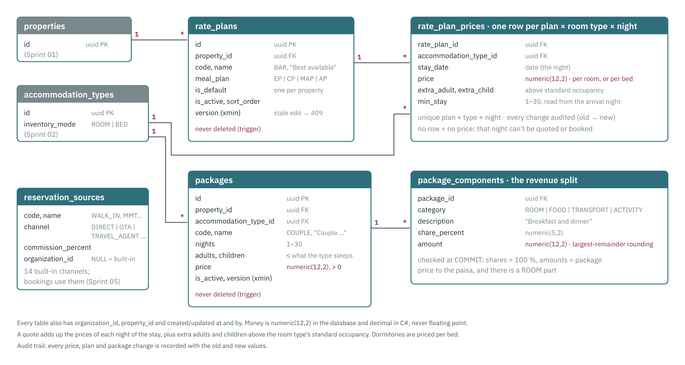

- Migration V006. `rate_plan_prices` has one row per plan × room type × night; no row means "no price", and that
  night cannot be quoted or booked.
- `Domain/Rates/QuoteEngine.cs` prices a stay night by night: the base price covers the type's standard occupancy,
  extra adults and children pay their rates, dormitories charge per bed, minimum stay is read from the arrival night.
  It is pure and unit-tested.
- Packages split their price into room, food, transport and activity with the largest-remainder rule
  ([4.9 Money](#49-money)). A deferred trigger checks at COMMIT that shares add up to 100 % and amounts to the price.

### Sprint 05: Availability and reservations

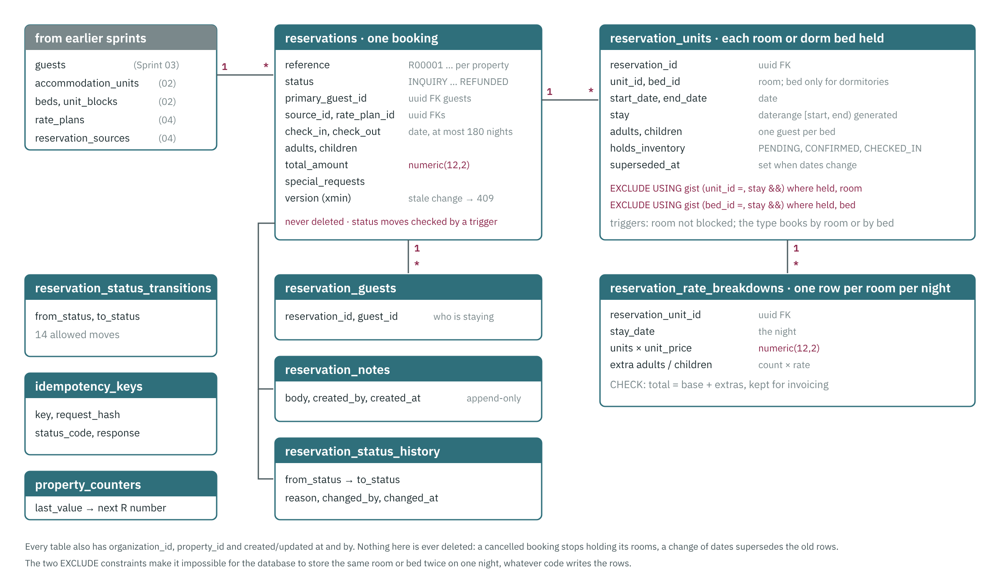

- Migration V007: `reservations`, `reservation_units` (each room or bed held, with its stay as a `daterange`),
  `reservation_rate_breakdowns` (the price of every night, kept for invoicing), `reservation_guests`,
  `reservation_notes`, `reservation_status_history`, `reservation_status_transitions`, `idempotency_keys`,
  `property_counters`.
- `Domain/Reservations/Availability.cs` (`AvailabilityEngine`) is pure: given the rooms, what is held and blocked, it
  finds free rooms per night, allocates rooms or one bed per dormitory guest, and explains why something does not fit.
- `ReservationService` runs the booking transaction; [4.7](#47-no-double-booking) explains it and
  [booking-algorithm.md](booking-algorithm.md) gives the exact SQL.
- Screens: Reservations list, the five-step New booking wizard, the booking page (change dates or guests, confirm,
  cancel, no-show, notes, history). Date fields across the app show "15 Oct 2026" with a calendar
  (`frontend/src/app/core/dates.ts`); the form value stays the API's ISO date.

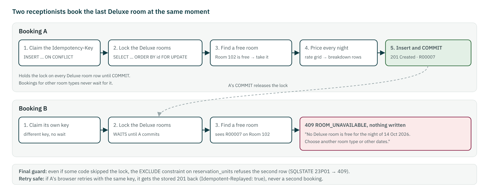

### Sprint 06: Reservation calendar

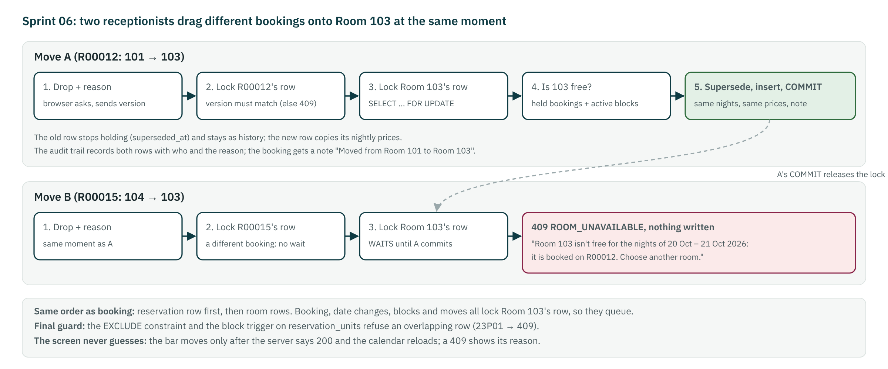

- Migration V008: one index, `ix_reservation_units_calendar (property_id, start_date, end_date) WHERE superseded_at IS
  NULL`. No new table: a move reuses Sprint 05's superseded-row history.
- `Application/Reservations/CalendarService.cs` is the calendar's read model: for a window of up to 62 days it reads
  the rooms with their beds, every current reservation row that overlaps the window (PENDING, CONFIRMED, CHECKED_IN,
  CHECKED_OUT; enquiries hold nothing and stay in the list), the guests and sources those rows name, and the active
  blocks. One indexed query per layer, never one per room or per booking. `paymentStatus` is `NONE` until payments
  arrive in Sprint 10.
- `ReservationService.ReassignAsync` moves one room (or dorm bed) of a booking to another for the same nights:
  [4.16](#416-moving-a-guest-to-another-room) explains the locking.
- Screens: `/reservations/calendar` (`features/reservations/calendar.page.ts`) with Day, Week and Month views. The grid
  (`calendar-grid.ts`) is a CSS grid, one row per room or dorm bed, bookings and blocks as bars; Angular CDK drag-drop
  with the axis locked vertically, so a drag can change the room but never the dates. `calendar.model.ts` holds the
  pure logic (windows, rows, placement, "why can't it go there") and is unit-tested, including the 7 rooms × 31 days
  render under 200 ms. `move-dialog.ts` shows a booking's status, source and payment and asks for the reason. Under
  760 px wide the same window is a list by day (arrives, in house, leaves, blocked).

### Sprint 07: Front desk (arrivals, check-in, check-out, walk-ins)

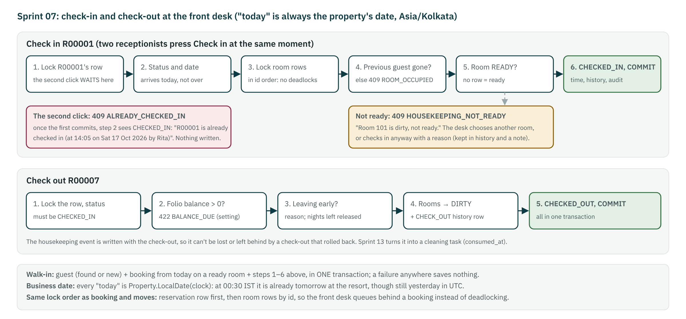

- Migration V009: `reservations.checked_in_at` / `checked_out_at`, `unit_housekeeping_status` (the cleaning state of
  each room or dorm bed; no row means READY) and `unit_housekeeping_history` (append-only; the check-out rows are the
  events Sprint 13's housekeeping module will consume). Details: [schema-sprint-07.md](../database/schema-sprint-07.md).
- `Domain/FrontDesk/FrontDesk.cs`: the housekeeping states and the pure date rules (`FrontDeskRules.CheckInDateProblem`,
  `DepartureOnCheckOut`), unit-tested.
- `Application/FrontDesk/FrontDeskService.cs`: the lists (arrivals with late arrivals, departures with overdue guests,
  in house, the dashboard and rooms board), room options, assign/move, check-in, check-out, walk-in and setting a room's
  state. It reuses `ReservationService`'s booking and room-move steps (`BookAsync`, `MoveRoomAsync`) instead of
  copying them. `IFolioBalances` answers "what does this stay still owe"; it returns 0 until folios arrive in Sprint 8.
- Two property settings: `frontdesk.allow_checkin_when_not_ready` (default on, with a reason) and
  `frontdesk.allow_checkout_with_balance` (default off).
- Screens: `/front-desk/arrivals | departures | in-house | rooms` (`features/front-desk/front-desk.page.ts`, tiles and
  one list per tab, a rooms board with *Mark ready*), `/front-desk/walk-in` (stay, guest and check in on one screen),
  and Check in / Check out / Assign room on the booking page. `desk-actions.ts` is shared by both: one click when
  nothing is in the way, otherwise a window that says why and offers *Choose another room* or *Check in anyway*.
  [4.17](#417-the-front-desk) explains the rules.

### Sprint 08: Folio (the bill of a stay)

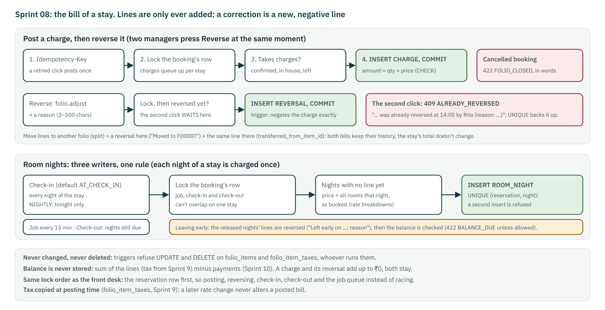

- Migration V010: `folios` (one main folio per confirmed booking, more to split a bill), `folio_items` (immutable
  lines: CHARGE or REVERSAL, eight categories, source MANUAL / ROOM_NIGHT / PACKAGE) and `folio_item_taxes` (filled
  from Sprint 9). Triggers refuse UPDATE and DELETE; CHECKs and a trigger make every amount add up and every reversal
  cancel its charge exactly. Details: [schema-sprint-08.md](../database/schema-sprint-08.md).
- `Domain/Folios/Folios.cs`: categories, sources, the posting setting and `FolioMath` (line amount, package lines,
  negation), unit-tested.
- `Application/Folios/FolioPosting.cs`: the shared steps every writer uses (open the main folio, post room nights,
  reverse, sum the balance). `FolioService.cs`: list, read, post a charge or a package, reverse, split.
  `RoomChargeRun` (in FolioPosting.cs) is the nightly room charge; `Api/Infrastructure/RoomChargeJob.cs` runs it every
  15 minutes. `FolioBalances` replaces Sprint 7's placeholder, so the front desk's balance and the check-out rule are real.
- Hooks into earlier code: `ReservationService` opens the main folio when a booking becomes CONFIRMED;
  `FrontDeskService` posts room nights at check-in and at check-out, and reverses released nights on an early departure.
- Screens: `/folios` (search, in house / arriving / all) and `/folios/:id` (balance, sums by category, every line with
  who posted it, reversed lines struck through with the reason; Post charge, Move lines, Reverse for managers),
  plus a Bill button on the booking page and on the front desk lists. [4.18](#418-folios-the-bill-of-a-stay)
  explains the rules.

### Sprint 09: GST configuration and the tax engine

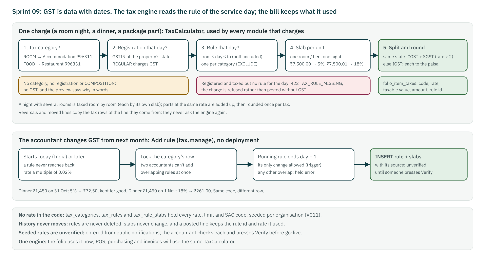

- Migration V011: `gst_registrations` (the GSTIN a property bills under, from/to a date), `tax_categories` (what is
  taxed, its SAC code and the folio charge category it covers), `tax_rules` (a category's rule with dates and its
  source) and `tax_rule_slabs` (rates by value). EXCLUDE constraints stop overlapping periods; triggers refuse deletes,
  freeze slabs and let a rule change only its end date and verification. `fn_seed_tax_defaults` seeds accommodation and
  restaurant GST for every organisation, unverified. Details: [schema-sprint-09.md](../database/schema-sprint-09.md).
- `Domain/Tax/Tax.cs`: the entities, `TaxMath` (slab lookup, CGST/SGST or IGST split, rounding, a line made of parts)
  and `Gstin` (format and check digit with a reason in words), unit-tested.
- `Application/Tax/TaxCalculator.cs`: **the one tax engine**. Given a property, a charge category, a day and the
  line's parts, it finds the registration, category and rule of that day and returns the tax rows, or why there is no
  GST. `TaxService.cs`: registrations, categories, rules (auto-closing the running one), Verify and the preview.
- Hooks into earlier code: `FolioPosting.ChargeAsync` asks the engine for every new charge (room nights, manual
  charges, package parts) and stores `folio_item_taxes`; `FolioService` returns each line's taxes. Reversals and
  splits already copied tax rows (Sprint 8).
- Screens: `/settings/gst` (registration, categories with their rules, Add rule, Verify, Try a charge); the bill shows
  *amount + GST* under each line. [4.19](#419-gst-rules-as-data-the-tax-engine) explains the rules; worked examples in
  [GST.md](../GST.md#worked-examples).

### Sprint 10: Payments, refunds and the cash drawer

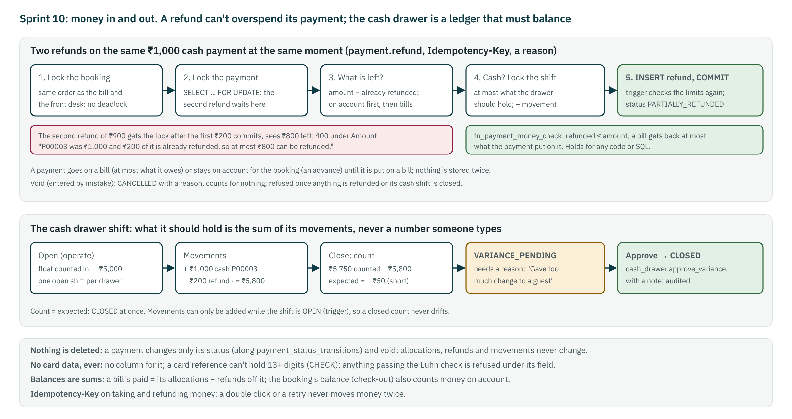

- Migration V012: `payments` (P00001 numbers, CASH / UPI / CARD / BANK_TRANSFER, the status graph in
  `payment_status_transitions`), `payment_allocations` (which bill a payment settles), `refunds` (with a reason),
  `cash_drawers`, `cash_drawer_sessions` (one shift, OPEN / VARIANCE_PENDING / CLOSED) and `cash_drawer_movements` (the
  drawer's ledger). Triggers refuse deletes, let a payment change only its status and void, and check every allocation
  and refund against its payment under a row lock (`fn_payment_money_check`). No column can hold card data. Details:
  [schema-sprint-10.md](../database/schema-sprint-10.md).
- `Domain/Payments/Payments.cs`: the entities, the status graph and `PaymentMath` (what can be refunded, what is on
  account, the status after a refund, the variance, the card-number check with Luhn), unit-tested.
- `Application/Payments/PaymentService.cs`: list, read, take (on a bill or on account), allocate, refund, void.
  `CashDrawerService.cs`: open, close, approve a variance, and the helpers the payment service uses to put cash in and
  out of the open shift. `PaymentLedger.cs`: the one place that sums what bills and bookings have been paid.
- Hooks into earlier code: `FolioService` and `FolioBalances` (front desk, check-out) subtract real payments;
  `CalendarService` shows paid / part paid; `FolioDto` lists the bill's payment lines.
- Screens: `/payments` (totals by method, filters, search, the drawer panel) and `/payments/:id` (Refund, Void, Put on
  a bill); **Take payment** and the payments list on the bill (`/folios/:id`); the cash drawer panel on the front desk.
  [4.20](#420-refunds-that-cant-overspend-and-a-cash-drawer-that-balances) explains the rules.

---

### Sprint 11: Razorpay (payment links, the webhook, online refunds)

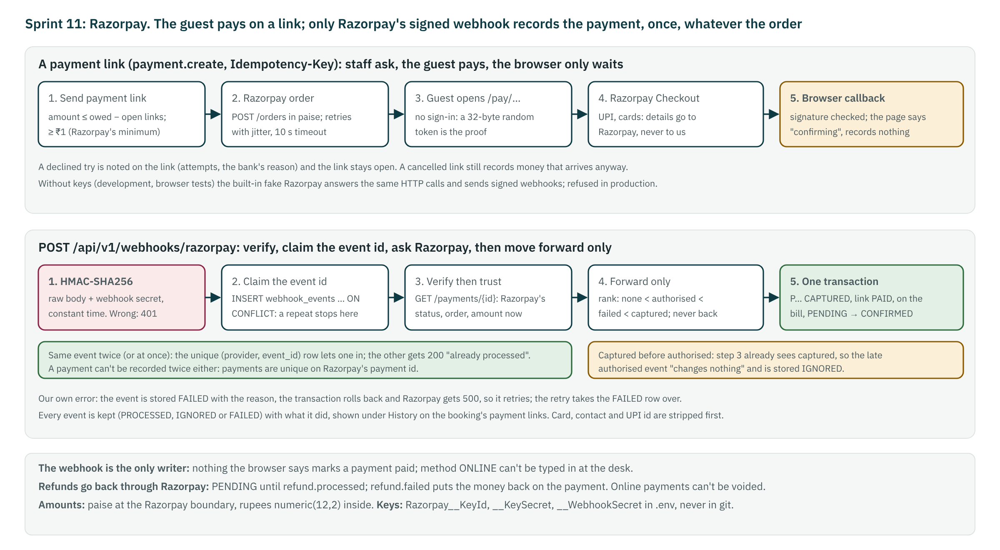

- Migration V013: `payment_gateway_orders` (a payment link: Razorpay order, amount, the guest's private token, status
  CREATED / PAID / CANCELLED, declined tries) and `webhook_events` (each verified Razorpay delivery, unique on the event
  id, with what it did). `payments` gets method `ONLINE`, the link it came through and how the guest paid, unique on
  Razorpay's `pay_…` id; `refunds` gets `ONLINE` with Razorpay's `rfnd_…` id. Details:
  [schema-sprint-11.md](../database/schema-sprint-11.md).
- `Application/Payments/PaymentGateway.cs`: the `IPaymentGateway` port (create order, fetch payment, refund, the two
  signature checks). `Infrastructure/Payments/RazorpayPaymentGateway.cs` implements it over `HttpClient` with a timeout
  per try and retries with jitter; `FakeRazorpayServer.cs` answers the same HTTP calls in memory and signs webhooks, for
  tests and for development without keys (`DependencyInjection.AddRazorpay` chooses).
- `PaymentLinkService.cs`: send, list, cancel links and the guest's page (by token, no sign-in; `SystemActor` lets an
  anonymous request act for the link's organisation). `RazorpayWebhookService.cs`: verify, dedupe, fetch, apply.
  `PaymentService` refunds online payments through the gateway; `ReservationService.ConfirmLockedAsync` confirms a pending
  booking inside the webhook's transaction.
- Endpoints: `RazorpayEndpoints.cs` (staff links under the property, `POST /api/v1/webhooks/razorpay`, `/api/v1/pay/{token}`).
- Screens: the **Online payment links** panel on a booking (`/reservations/:id`: Send payment link, copy / WhatsApp /
  open, cancel, History of what Razorpay sent), the guest's page `/pay/:token` outside the staff shell (Razorpay Checkout,
  or test buttons with the fake), online details and Razorpay refunds on `/payments/:id`.
  [4.21](#421-razorpay-the-webhook-is-the-only-writer) explains the rules.

### Sprint 12: GST invoices, credit and debit notes, receipts

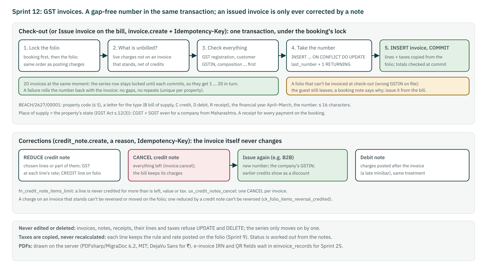

- Migration V014: `invoice_series` (one gap-free counter per property, document type and financial year), `invoices`,
  `invoice_items`, `invoice_item_taxes`, `credit_notes` (CANCEL or REDUCE), `debit_notes`, their lines and taxes,
  `receipts` (one per payment) and `einvoice_records` (for Sprint 25). Every document table refuses UPDATE and DELETE;
  totals are checked against the lines when the transaction commits. `folio_items` gets `CREDIT` lines (a REDUCE credit
  note taking money off the bill). Details: [schema-sprint-12.md](../database/schema-sprint-12.md).
- `Domain/Invoicing/Invoicing.cs`: the entities and `InvoiceMath` (financial year, number format, amount in words with
  lakh and crore, the tax a part credit takes off). `Application/Invoicing/FolioBilling.cs`: what on a folio is already
  billed or still unbilled, and `NextNumberAsync` (the series upsert). `InvoiceService.cs`: preview, issue (also at
  check-out from `FrontDeskService.CheckOutAsync`), credit and debit notes, PDFs. `ReceiptService.cs`: receipts.
  `InvoicePrinter.cs` turns a document into a `PrintDocument`; `Infrastructure/Documents/PdfRenderer.cs` draws it with
  PDFsharp/MigraDoc 6.2 (MIT) and the embedded DejaVu Sans font. `FolioPosting.RequireNotInvoicedAsync` stops reversing or
  moving a billed charge.
- Endpoints: `InvoiceEndpoints.cs` (preview and issue under a folio, invoices with their PDFs, credit and debit notes,
  a payment's receipt, note and receipt PDFs).
- Screens: **Invoices** (`/invoices`: search, status, period) and one invoice (`/invoices/:id`: parties, lines, tax
  totals, Credit note and Debit note dialogs, notes and receipts with PDFs); on the bill, **Issue invoice** (or the
  invoice's number), each billed charge marked with its invoice and no Reverse; the booking links to its invoices; a
  payment has **Receipt**. [4.22](#422-gst-invoices-gap-free-numbers-and-corrections-only-by-note) explains the rules.

### Sprint 13: Housekeeping and maintenance (mobile-first)

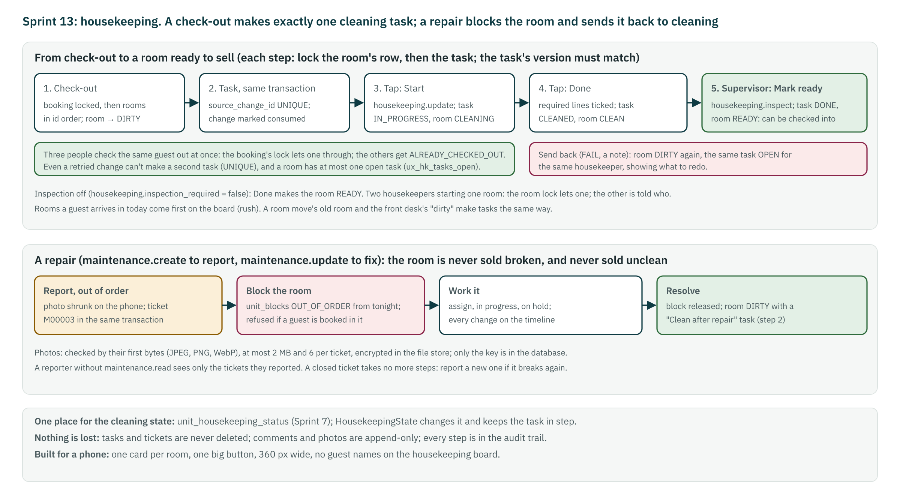

- Migration V015: `housekeeping_tasks` (one per DIRTY state change, `source_change_id` UNIQUE; at most one open per room
  or bed; never deleted), `housekeeping_checklist_templates` and `_items` (copied into the task as `checklist` jsonb),
  `maintenance_assets`, `maintenance_tickets` (`M00001` …, holding the room's `OUT_OF_ORDER` block), and the append-only
  `maintenance_comments` and `maintenance_attachments`. The cleaning state itself stays in Sprint 7's
  `unit_housekeeping_status`. Details: [schema-sprint-13.md](../database/schema-sprint-13.md).
- `Domain/Housekeeping/Housekeeping.cs` (task types and statuses, `HousekeepingFlow`: which step is allowed when, and the
  exact refusal) and `Maintenance.cs` (`MaintenanceFlow`: ticket steps, the out-of-order date rule, `SniffImage`).
  `Application/Housekeeping/HousekeepingState.cs` is the one place a room's cleaning state changes and its task is kept
  in step; `FrontDeskService` (check-out, room move, set by hand) and `MaintenanceService` (out of order, resolve) call it.
  `HousekeepingService.cs`: board, tasks, start / finish / inspect, checklists. `MaintenanceService.cs`: tickets, photos,
  equipment. `BlockService.AddAsync` / `Release` are shared with Sprint 2's blocks screen.
- Endpoints: `HousekeepingEndpoints.cs` (`/housekeeping/...` and `/maintenance/...`).
- Screens, built for a 360 px phone: **Housekeeping** (`/housekeeping`: one card per room or dorm bed, rush rooms first,
  one big Start / Done / Mark ready button; a task sheet with the checklist, assign, send back and Report a problem),
  **Checklists** (`/housekeeping/checklists`), **Maintenance** (`/maintenance`), **Report a problem**
  (`/maintenance/new`, photos shrunk on the phone by `compressPhoto`), a ticket (`/maintenance/:id`, timeline and next
  step); **Room status** shows today's cleaning state and open repairs. [4.23](#423-housekeeping-one-task-per-check-out-and-out-of-order-rooms) explains the rules.

### Sprint 14: Menu, restaurant POS and KOT

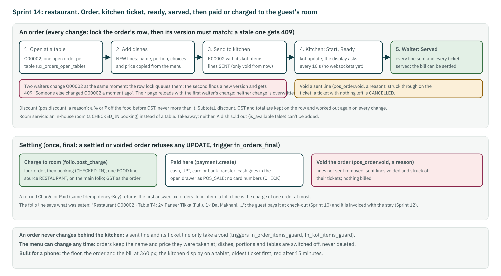

- Migration V016: the menu (`menu_categories`, `menu_items`, `menu_item_variants`, `modifier_groups`, `modifiers`; switched
  off, never deleted), `restaurant_tables`, `orders` (`O00001` …; at most one open per table; final once settled or
  voided), `order_items` (name, portion, choices and price copied when ordered; a sent line can only be voided), `kots`
  (`K00001` …) and `kot_items`. `cash_drawer_movements` gains `order_id` and type `POS_SALE`; `folio_items.source` gains
  `RESTAURANT`. Details: [schema-sprint-14.md](../database/schema-sprint-14.md).
- `Domain/Restaurant/Restaurant.cs` (statuses, `RestaurantMath`: line prices, the discount, the folio line's text;
  `RestaurantFlow`: which kitchen step is allowed when and the exact refusal). `Application/Restaurant/OrderService.cs`:
  floor, orders, send, serve, void, discount, pay (cash through `CashDrawerService.AddSaleMovement`), charge to room
  (`FolioPosting`, tax from `TaxCalculator`, category FOOD) and the kitchen display. `MenuService.cs`: menu and tables.
  `Validation/RestaurantValidators.cs`.
- Endpoints: `RestaurantEndpoints.cs` (`/menu/...`, `/orders/...`, `/kitchen/kots/...`).
- Screens: **Restaurant** (`/restaurant`: the floor on a waiter's phone, room service, takeaway), an order
  (`/restaurant/orders/:id`: menu picker with portions and choices, send, served, discount, void, paid, charge to room),
  **Today's orders** (`/restaurant/orders`), **Kitchen** (`/restaurant/kitchen`: New / Preparing / Ready, polling every
  10 s) and **Menu** (`/restaurant/menu`: sections, dishes, sold out, tables).
  [4.24](#424-restaurant-orders-two-waiters-one-order-and-the-room-charge) explains the rules.

### Sprint 15: Inventory and recipe costing

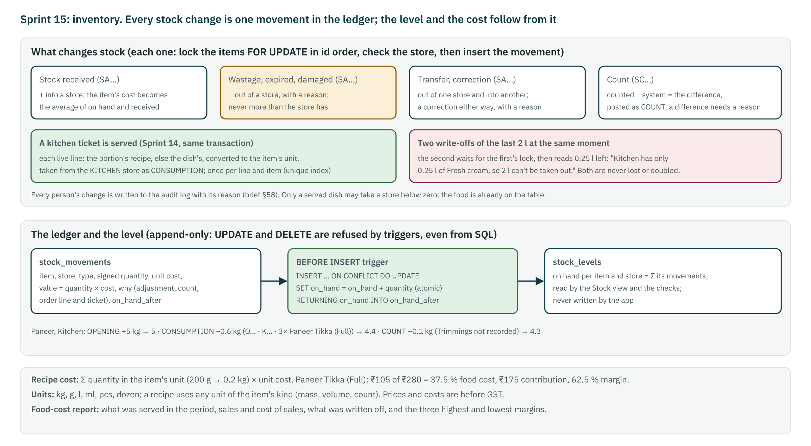

- Migration V017: `inventory_units` (a fixed list with kind and size), `inventory_categories`, `stock_locations` (one is the
  kitchen), `inventory_items`, `stock_movements` (the append-only ledger), `stock_levels` (on hand per item and store, kept
  by the trigger `fn_stock_movements_level`), `stock_adjustments` (`SA00001` …) and `stock_counts` (`SC00001` …), both
  never changed, `recipes` and `recipe_ingredients`. Details: [schema-sprint-15.md](../database/schema-sprint-15.md).
- `Domain/Inventory/Inventory.cs` (movement types, adjustment kinds, `InventoryMath`: unit conversion, values to the paisa,
  food cost %, contribution, margin, moving average cost). `Application/Inventory/StockLedger.cs`: the only writer of
  movements (lock the items, check what a store has, add a movement, use a served ticket's recipes).
  `InventoryService.cs`: stock, groups, stores, items, adjustments, counts, the ledger. `RecipeService.cs`: recipes with
  their cost and the food-cost report. `Validation/InventoryValidators.cs`. `OrderService.ServeAsync` (Sprint 14) now calls
  `StockLedger.ConsumeAsync` in the same transaction.
- Endpoints: `InventoryEndpoints.cs` (`/inventory`, `/inventory/movements`, `/categories`, `/locations`, `/items`,
  `/adjustments`, `/counts`, `/recipes`, `/food-cost`).
- Screens: **Inventory** (`/inventory`: Stock by group and store with reorder flags, Recipes with cost and margin, Food
  cost with the highest and lowest margins, Ledger), dialogs to record, count and edit in `inventory-dialogs.ts`.
  [4.25](#425-the-stock-ledger-recipes-and-food-cost) explains the rules.

### Sprint 16: Suppliers and purchasing

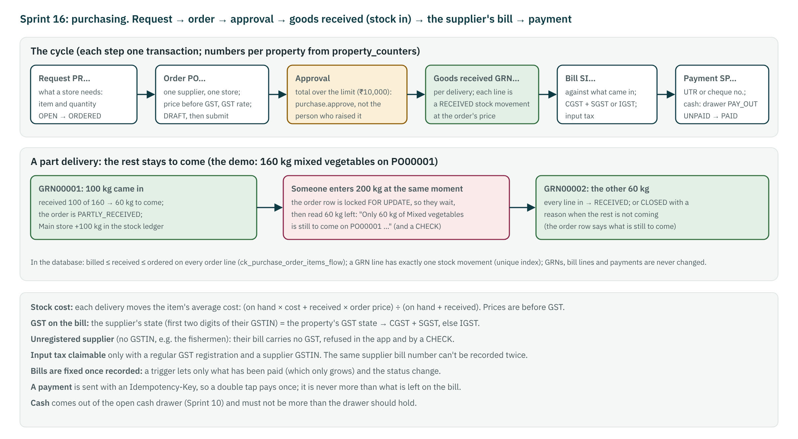

- Migration V018: `suppliers` (GSTIN optional, state from it), `purchase_requests` + `purchase_request_items`,
  `purchase_orders` + `purchase_order_items` (received and billed per line, billed ≤ received ≤ ordered by CHECK),
  `goods_received_notes` + `grn_items` (never changed), `supplier_invoices` (fixed once saved except what is paid) +
  `supplier_invoice_items`, `supplier_payments` (never changed). `stock_movements.grn_item_id` and
  `cash_drawer_movements.supplier_payment_id` link a delivery to the stock ledger and a cash payment to the drawer.
  Details: [schema-sprint-16.md](../database/schema-sprint-16.md).
- `Domain/Purchasing/Purchasing.cs` (statuses, `PurchaseMath`: line values, CGST + SGST or IGST, what is still to come,
  when approval is needed, the status after a delivery or a payment). `Application/Purchasing/SupplierService.cs`
  (suppliers, GSTIN checks with `Gstin.Problem`), `PurchasingService.cs` (requests, orders, submit / approve / send back /
  cancel / close, goods received through `StockLedger`), `SupplierInvoiceService.cs` (bills and payments, cash through
  `CashDrawerService`). `Validation/PurchasingValidators.cs`. Setting `purchasing.approval_limit` read with
  `PropertySettingsReader.DecimalAsync`.
- Endpoints: `PurchasingEndpoints.cs` (`/purchasing/suppliers`, `/requests`, `/orders` with `submit`, `approve`, `reject`,
  `cancel`, `close`, `receipts`, `invoices`, and `/purchasing/invoices/{id}/payments` with an Idempotency-Key).
- Screens: **Suppliers** (`/inventory/suppliers`), **Purchasing** (`/inventory/purchases`: Orders, Requests, Bills) and
  the order page (`/inventory/purchases/{id}`) with the steps a person may take; dialogs in `purchasing-dialogs.ts`.
  [4.26](#426-purchasing-approval-goods-received-and-supplier-bills) explains the rules.

### Sprint 17: Employees and roster

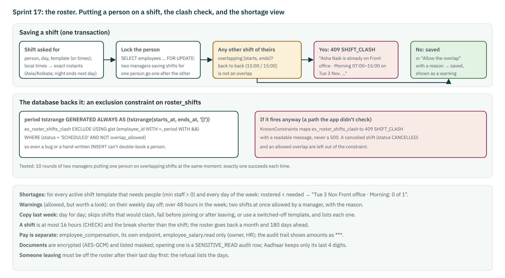

- Migration V019: `departments` + `designations` (job titles), `employees` (`E00001` …, optional `user_id` linking one
  staff account, weekly day off, `ACTIVE` / `LEFT`), `employee_documents` (numbers encrypted, Aadhaar last 4 only, scans
  encrypted in the file store), `employee_compensation` (pay from a date, append-only by trigger), `shift_templates`
  (times, break, people needed every day) and `roster_shifts` (a generated `period tstzrange` and the exclusion
  constraint `ex_roster_shifts_clash`). Details: [schema-sprint-17.md](../database/schema-sprint-17.md).
- `Domain/Employees/Employees.cs` (entities, statuses, `RosterMath`: local times to instants in the property's time
  zone, a night shift ending the next day, the week's Monday, "7 h 30 min"). `Application/Employees/EmployeeService.cs`
  (departments, job titles, profiles, account link, leaving), `CompensationService.cs` (pay, behind
  `employee_salary.read`), `EmployeeDocumentService.cs` (documents through `IFieldEncryptor` and `IFileStore`),
  `RosterService.cs` (templates, the week with shortages and warnings, saving a shift with the clash check, copy a week,
  my shifts). `Validation/EmployeeValidators.cs`. `[SalaryData]` makes the audit trail show pay amounts as `***`.
- Endpoints: `EmployeesEndpoints.cs` (`/departments`, `/designations`, `/employees` with `/compensation` and
  `/documents`, `/roster` with `/templates`, `/shifts`, `/copy-week`, `/mine`).
- Screens: **Employees** (`/employees`, by department, search, add), the profile (`/employees/{id}`: pay and documents
  sections only for those allowed, next shifts, leaving) and **Roster** (`/roster`: a week grid by department on a
  desktop, one day at a time on a phone; shortages to tap and fill; warnings; copy last week; shift templates), dialogs in
  `employee-dialogs.ts` and `roster-dialogs.ts`. [4.27](#427-roster-clash-detection-and-shortages) explains the rules.

### Sprint 18: Attendance and timesheets (PWA)

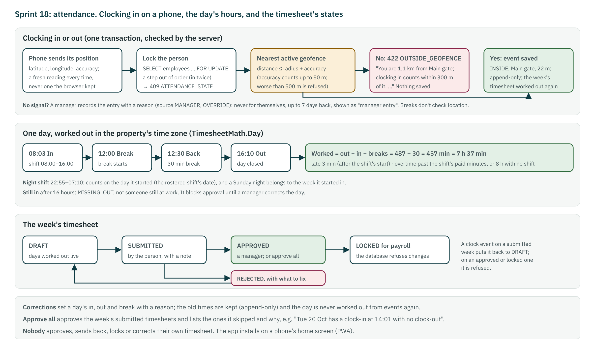

- Migration V020: `geofences` (a centre and a radius of 20–2000 m), `attendance_events` (clock-in, break start and end,
  clock-out; append-only by trigger; where the phone was, how far from the nearest geofence, or a manager's entry with
  its reason), `timesheets` (one per person per Monday-to-Sunday week, with totals and the approval; a `LOCKED` row can't
  change), `timesheet_lines` (one per day; can't change once locked) and `timesheet_corrections` (append-only, old and
  new times with the reason). Details: [schema-sprint-18.md](../database/schema-sprint-18.md).
- `Domain/Attendance/Attendance.cs` (entities, statuses, `TimesheetMath`: a day from its clock events, from a
  correction's times, the haversine distance, "1.2 km"). `Application/Attendance/AttendanceService.cs` (geofences, my
  attendance, clocking with the geofence check, the day's board, a manager's entry) and `TimesheetService.cs` (weeks,
  making a timesheet when first needed, working out its days, submit, approve, approve all, send back, lock, correct).
  `Validation/AttendanceValidators.cs`.
- Endpoints: `AttendanceEndpoints.cs` (`/attendance` with `/me`, `/me/clock`, `/events`, `/geofences`; `/timesheets`
  with `/mine`, `/{id}`, `/submit`, `/approve`, `/reject`, `/lock`, `/corrections`, `/approve-week`).
- Screens: **Attendance** (`/attendance`: one big button on a phone for the next step, the day's entries and hours; for
  managers also the team board with who is in, late or not in, recording an entry with a reason, and the areas),
  **Timesheets** (`/timesheets`: my week to submit, or the team's week with approve all) and one timesheet
  (`/timesheets/{id}`: each day with its entries, corrections, approve, send back, lock); dialogs in
  `attendance-dialogs.ts`. The dashboard's **Your day** card shows the shift and a clock-in link.
- **Installable app (PWA):** `public/manifest.webmanifest` and `public/icons/`, `@angular/service-worker` with
  `ngsw-config.json` in production builds only (the app's files are cached; `/api`, `/pay`, `/swagger` and `/health`
  never are), and `core/install.ts` keeping the browser's install prompt for the dashboard banner and the user menu (an
  iPhone gets "Share → Add to Home Screen" instead). [4.28](#428-attendance-geofence-and-timesheet-maths) explains the rules.

### Sprint 19: Leave, holidays and payroll export

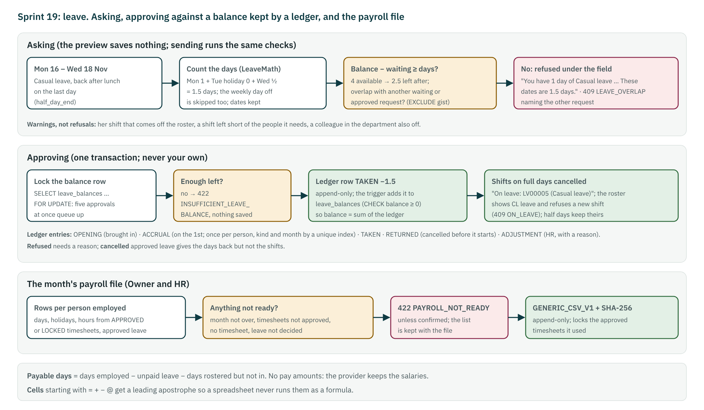

- Migration V021: `leave_types` and `leave_policies` (days a year, earned monthly or yearly, a maximum), `leave_requests`
  (the counted days stored with the request; `ex_leave_requests_overlap` refuses two waiting or approved requests of one
  person on the same day), `leave_ledger` (append-only) and `leave_balances` (kept equal to the ledger by
  `trg_leave_ledger_balance`, never below zero), `holidays`, `payroll_exports` (append-only, with the SHA-256), and the
  permission `payroll.export` for Owner and HR. Details: [schema-sprint-19.md](../database/schema-sprint-19.md).
- `Domain/Leave/Leave.cs` (entities, statuses, `LeaveMath`: counting days with half days, holidays and the day off;
  monthly and pro-rated yearly accrual; `PayrollCsv`: the `GENERIC_CSV_V1` writer). `Application/Leave/LeaveService.cs`
  (kinds and policies with the defaults, holidays, balances and the ledger, adjustments, `LeaveAccrual`),
  `LeaveRequestService.cs` (preview, ask, approve, refuse, cancel, the roster warnings) and `PayrollService.cs` (the
  month's rows and warnings, making and keeping the file). `Validation/LeaveValidators.cs`. `Api/Infrastructure/
  LeaveAccrualJob.cs` posts each month's accrual on the 1st (`Leave:AccrualJob`). `RosterService` shows leave on the
  week, refuses a shift on a day of leave (`409 ON_LEAVE`) and skips those days when copying a week.
- Endpoints: `LeaveEndpoints.cs` (`/leave` with `/me`, `/types`, `/policies`, `/holidays`, `/balances`, `/adjustments`,
  `/accruals/run`, `/requests` with `/preview`, `/approve`, `/reject`, `/cancel`; `/payroll` with `/preview`, `/exports`,
  `/exports/{id}/file`).
- Screens: **Leave** (`/leave`, `features/leave/`: mine with balances and **Ask for leave** with a live preview; team
  with approvals and who is off; balances with each person's history and adjustments; holidays; kinds of leave) and
  **Payroll export** (`/payroll`: the month's rows, what isn't ready, making and downloading files); dialogs in
  `leave-dialogs.ts`. The roster shows leave chips; the dashboard shows **Leave waiting for you**. The file format is in
  [PAYROLL.md](../PAYROLL.md); [4.29](#429-leave-balance--ledger-overlap-guard-payroll-export) explains the rules.

---

## 4. System design: how the hard parts work

### 4.1 Passwords

Code: `PasswordHasherService` in `backend/Resort.Infrastructure/Identity/Security.cs`; policy in
`Application/Validation/Validators.cs`.

- Passwords are never stored. We store a **PBKDF2** hash in the ASP.NET Core Identity v3 format: HMAC-SHA512,
  100,000 iterations and a random salt for every hash. The salt and iteration count are inside the hash string, so
  the cost can be raised later without a migration.
- On sign-in `Verify` returns *success*, *failed* or *success, rehash needed*. In the last case the service stores a
  fresh hash with today's settings, so old hashes upgrade themselves as people sign in.
- **No user enumeration**: when the email does not exist, `SimulateVerify` runs the same hash against a dummy, so a
  wrong email takes as long as a wrong password and the error text is the same.
- **Lockout**: 5 wrong passwords lock the account for 15 minutes (`AuthOptions`, configurable). Every attempt is
  written to the append-only `login_events`. Sign-in endpoints are also rate-limited to 10 a minute per IP.
- The policy is at least 10 characters with letters and numbers (`Validators.Password`). The first owner account,
  new staff and reset passwords get `must_change_password`; the app forces the change before anything else.

### 4.2 Sign-in, tokens and sessions

Code: `AuthService` (`Application/Identity/AuthService.cs`), `TokenService` (`Infrastructure/Identity/Security.cs`),
`OnTokenValidated` in `Api/Program.cs`, `frontend/src/app/core/auth.service.ts` and `http.ts`.

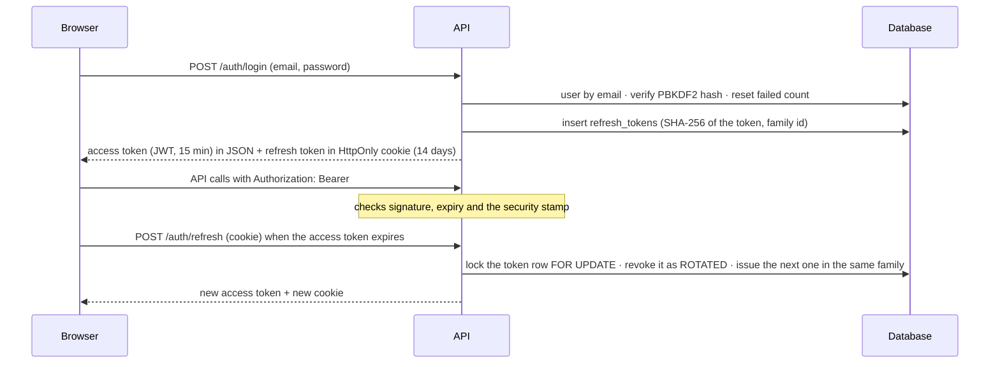

- The **access token** is a JWT signed with HMAC-SHA256 (key from `Jwt__SigningKey`, at least 32 bytes, never in
  git). It lives 15 minutes and is kept **in memory** by the app, never in localStorage, so a script injected into
  the page cannot read a long-lived secret.
- The **refresh token** is 32 random bytes in an HttpOnly, Secure cookie. The database stores only its SHA-256 hash.
  Each refresh **rotates** it. If a token that was already rotated is presented again, someone copied it: the whole
  token family is revoked and a `RefreshTokenReuse` audit row is written. The row is locked `FOR UPDATE` so two tabs
  refreshing at once do not look like theft.
- Every token carries the user's **security stamp**. Changing or resetting a password, or deactivating a user,
  rotates the stamp, so their existing access tokens stop working at once. Role changes clear the user's cached
  access, so new permissions apply on the next request (the cache otherwise lives at most 30 seconds).
- Signing out revokes the family; changing the password revokes every refresh token of that user.

### 4.3 Permissions and roles

Code: `Application/Common/Permissions.cs`, `Api/Infrastructure/Authorization.cs`, `Application/Common/CallerAccess.cs`;
matrix in [security/permission-matrix.md](../security/permission-matrix.md).

- Code checks **permission codes**, never role names: `reservation.create`, `rate.manage`, `guest.read`, … Roles are
  rows that bundle permissions, so the owner can change what a role may do without a code change.
- A grant is **scoped**: `user_roles.property_id` NULL means the whole organisation, otherwise one property. A route
  with `{propertyId}` needs the permission org-wide or for that property.
- Endpoint policies do the coarse check; services do the fine one (e.g. a guest is visible only to someone with guest.read for at least one property). An **escalation guard**
  stops anyone granting a role with permissions they do not hold themselves.
- The Angular guards and hidden buttons are only convenience. The API checks every call.

### 4.4 One database, many organisations

Code: `AppDbContext` (`Infrastructure/Persistence/AppDbContext.cs`).

- Every business table has `organization_id`, and property-level tables also `property_id`. Composite foreign keys
  such as `(unit_id, property_id)` make it impossible to attach a row to another property's room.
- EF Core **global query filters** add `organization_id = <caller's org>` to every query. For an anonymous caller
  the org is NULL, so tenant queries return nothing unless code explicitly calls `IgnoreQueryFilters()` (only sign-in
  does, to find the user by email).
- Another organisation's id in a URL gives **404**, not 403, so callers cannot probe which ids exist.

### 4.5 The audit trail

Code: `AuditInterceptor` (`Infrastructure/Persistence/AuditInterceptor.cs`), `AuditContext`.

- The interceptor runs inside `SaveChanges`, so each change and its audit row commit or roll back **together**.
- Each row records who, when, the entity, old and new values, the reason (cancel, block, release …), IP, device,
  correlation id and request id. Personal fields (`[PersonalData]`) and secrets are recorded as changed but masked,
  so anonymising a guest really removes their data.
- `audit_logs` and `login_events` are **append-only**: a trigger refuses UPDATE and DELETE.
- Business tables are never deleted either. Reservations, plans, packages and guests have their own never-delete
  triggers; deletion is a status (cancelled, inactive, merged, anonymised).

### 4.6 Encrypting ID documents

Code: `AesGcmFieldEncryptor` (`Infrastructure/Protection/FieldEncryption.cs`), `IFieldEncryptor`
(`Application/Common/Protection.cs`), `LocalDiskFileStore`; rotation steps in [SECURITY.md](../SECURITY.md).

- ID numbers, document details and scans are encrypted by the API before they reach the database or disk, with
  **AES-256-GCM** (confidentiality and tamper detection).
- The key is `Encryption__Key` (32 random bytes, base64) from the environment, never the database or git. HKDF
  derives separate keys for encryption and for lookup hashes from it.
- Each value is an envelope: version, key id, 12-byte random nonce, ciphertext, 16-byte tag. The key id makes
  **key rotation** possible: new data uses the active key, old data stays readable with `PreviousKeys` until it is
  re-encrypted.
- The row and field (`guest_document:{id}:number`) are bound in as associated data, so a ciphertext copied to another
  row will not decrypt.
- To answer "is this passport already on another profile?" without decrypting everything, the API stores an
  **HMAC-SHA256 keyed hash** of the normalised number and compares hashes.
- Numbers are masked in the UI until someone with permission opens them, and every opening is audited.

### 4.7 No double booking

Code: `ReservationService.CreateAsync` and `InventoryLoader`, `AvailabilityEngine`, migration V007. Exact SQL and
tests: [booking-algorithm.md](booking-algorithm.md). Diagram: the booking flow above.

The goal: when two receptionists book the last room at the same moment, exactly one succeeds and the other is told
why, every time. It is solved in three layers, each enough on its own for its job:

1. **Serialise the competitors.** Inside one transaction the service runs
   `SELECT 1 FROM accommodation_units WHERE property_id = $p AND accommodation_type_id = ANY($types) ORDER BY id FOR UPDATE`.
   Two bookings that want the same room types queue on these row locks; bookings for other types do not wait. The
   fixed `ORDER BY id` means two bookings that want overlapping sets of types lock in the same order and cannot
   deadlock.
2. **Decide with fresh data.** Holding the lock, the service reads every held `reservation_units` row and active
   block that overlaps the stay and gives them to the pure `AvailabilityEngine`. Because of the lock, nothing can be
   added for these types until we commit, so "free" really means free. If it does not fit, the engine says exactly
   why ("Room 102 isn't free for the night of 14 Oct 2026: it is booked on R00007") → `409 ROOM_UNAVAILABLE`.
3. **The database guarantees it anyway.** `reservation_units.stay` is a `daterange [check_in, check_out)` and two
   exclusion constraints (`EXCLUDE USING gist (unit_id WITH =, stay WITH &&)` and the same on `bed_id`, only for rows
   that hold inventory) make overlapping rows impossible to store. Any code path that skipped the lock still fails
   with SQLSTATE 23P01, which the API maps to the same 409. Triggers do the same between bookings and blocks, in both
   directions.

Details that matter:

- Stays are **half-open**: a guest leaving on the 12th and another arriving on the 12th never clash.
- Only PENDING, CONFIRMED and CHECKED_IN **hold inventory** (`holds_inventory`). An enquiry holds nothing; cancel and
  no-show set it to false in the same transaction, so the room is bookable the moment the cancel commits.
- **Changing dates** never deletes: the old rows get `superseded_at` and stop holding, new rows are inserted and the
  stay is re-priced, under the same locks.
- Why not `SERIALIZABLE`? It is also correct, but the loser gets a serialisation failure and must retry the whole
  request blindly. The row lock makes it wait a few milliseconds and then answer with the real reason.
- Proved by tests: the last room raced **50 times** (exactly one 201 and one 409 every run), the last dorm bed with 5
  parallel requests, and a direct SQL insert of an overlapping row failing with 23P01.

### 4.8 Idempotency: a retried click never books twice

Code: `Application/Common/Idempotency.cs`, `ReservationService`, table `idempotency_keys`.

- The app sends an `Idempotency-Key` header (a new UUID per booking attempt, kept when the user retries).
- First step of the transaction: `INSERT INTO idempotency_keys … ON CONFLICT DO NOTHING`. The unique index makes a
  second request with the same key **wait** for the first. When the first commits, the second reads the stored
  response and returns it with `Idempotent-Replayed: true`.
- The request is hashed as parsed (SHA-256), so a different body with the same key is `422 IDEMPOTENCY_KEY_REUSED`
  rather than a silent replay of something else.
- Payments (Sprint 11) and webhooks will use the same table and pattern.

### 4.9 Money

- `decimal` in C#, `numeric(12,2)` in SQL. Never `float` or `double`.
- Every night of a booking keeps its own price row (`reservation_rate_breakdowns`) with a CHECK that the total equals
  base plus extras, so invoices later use what was sold, not today's price.
- Splitting an amount (a package into room, food, transport) uses the **largest-remainder** rule
  (`MoneySplit` in `Domain/Rates/QuoteEngine.cs`): work in paise, give each part its whole paise, then hand the paise
  left over to the parts with the largest discarded fractions. Nothing is lost or gained.

### 4.10 Time and dates

- Instants are stored as UTC `timestamptz`. Business dates (check-in, a night, "today") are `date` in the property's
  own timezone (`properties.timezone`, Asia/Kolkata): `Property.LocalDate(utcNow)`. Never the server's clock zone.
- Services take the current time from an injected `TimeProvider`, so tests can stand the clock at 23:30 or 00:30 IST
  (Sprint 07's `FrontDeskClockTests`) instead of waiting for midnight.
- The header shows the property's local time; the app formats instants with `inZone()` (`core/property-context.ts`).
- Date fields use `IsoDateAdapter` (`core/dates.ts`): they show "15 Oct 2026", accept typed dates, and keep the
  API's ISO `2026-10-15` as the form value.

### 4.11 Edits that collide

- Every editable row exposes `version`, which is PostgreSQL's `xmin`. The client sends back the version it saw;
  `ConcurrencyGuard` turns it into `UPDATE … WHERE id = @id AND xmin = @version`. If someone saved in between, zero
  rows match and the API answers `409 CONCURRENCY_CONFLICT` instead of overwriting their change.
- Inventory uses row locks instead ([4.7](#47-no-double-booking)), because there the second person must get an answer,
  not a conflict.

### 4.12 Status machines

- Allowed moves are **rows** (`reservation_status_transitions`), enforced by a trigger, and mirrored in C#
  (`ReservationStatuses.Transitions`) so the API can answer first with `422 INVALID_STATUS_TRANSITION` and list the
  moves that are possible. Each move writes `reservation_status_history` with who, when and why.
- Later modules (folios, invoices, leave) follow the same pattern.

### 4.13 Migrations and seed data

Code: `DatabaseMigrator` (`Infrastructure/Persistence/DatabaseMigrator.cs`).

- The API applies `database/migrations/V###__name.sql` at start-up, each file in its own transaction, under a
  PostgreSQL advisory lock so two API instances starting together do not race.
- The SHA-256 of every applied file is stored; editing an applied migration stops the API from starting. Fix forward
  with a new file. CI also checks that migrations are only ever added.
- Development seeds (`database/seed/dev/S###`) add demo data in Development only, and must not touch the rooms that
  earlier sprints' review scripts block (Room 103, dorm beds B01–B04).

### 4.14 Errors that say why

- Every error is `{code, message, details, correlationId}`: a stable code the UI can act on, a sentence for people,
  and per-field messages keyed by field name. No stack traces or SQL leave the server.
- Database constraint names map to codes and messages in `Api/Infrastructure/Problems.cs` (`KnownConstraints`), so a
  constraint caught by PostgreSQL still produces a precise message.
- **Owner rule**: never a generic "Some fields need fixing". The page puts each message under the field it concerns
  (`showFieldErrors`, `controlPath`) and anything else next to the button, always with the reason.

### 4.15 Secrets and configuration

- Secrets (`Jwt__SigningKey`, `Encryption__Key`, database password) live in `.env` locally (gitignored, written by
  `scripts/setup-dev`) and in the host's secret store in production. The API refuses to start without them.
- Security headers (CSP `default-src 'none'`, no referrer, frame denial) and CORS are set in
  `Api/Infrastructure/HttpPipeline.cs`. Full threat model: [SECURITY.md](../SECURITY.md).

---

### 4.16 Moving a guest to another room

Code: `ReservationService.ReassignAsync`, `Domain/Reservations/Availability.cs`, `calendar.model.ts` (`moveProblem`).
Diagram: the room-move flow in section 3 (Sprint 06). Tests: `CalendarTests`.

The goal: dragging a booking from Room 101 to Room 103 is as safe as booking Room 103, even when another receptionist
drags a different booking onto Room 103 at the same moment, and the screen never shows a move the server refused.

1. **The screen checks first, the server decides.** On drop, `moveProblem` checks what the loaded calendar knows
   (same kind of room, active, big enough, no booking or block on those nights) and shows the reason at once, in
   the API's words. If it looks fine, the reason is asked and the request goes to the server. The bar is never moved
   by the browser: the calendar reloads after the server answers, so a refused move cannot leave a wrong picture.
2. **Same locks as a booking, in the same order.** One transaction: lock the reservation row (`FOR UPDATE`), check
   its version against what the screen showed (`409 CONCURRENCY_CONFLICT` if someone changed it), then lock the
   target room row. Booking, changing dates, blocking and moving all lock the room row, so anything touching Room 103
   queues; locking reservation before room everywhere means no deadlocks.
3. **Decide with fresh data, with the booking engine's own rules.** Holding the room lock, it loads held bookings and
   active blocks on that room and asks `AvailabilityEngine.Free`. Not free → `409 ROOM_UNAVAILABLE` naming the booking
   or the block ("it is blocked (AC repair)").
4. **History, not edits.** The old `reservation_units` row gets `superseded_at` and stops holding (saved first, so a
   move inside the same dorm can't collide with itself); a new row is inserted for the same nights with the nightly
   prices copied, so the price stays as booked. The reservation's version changes, the audit trail stores both rows
   with the user and the reason, and a note on the booking says "Moved from Room 101 to Room 103 … Reason: …".
5. **The database still guarantees it.** The EXCLUDE constraints and the block trigger from V007 refuse an overlapping
   row whatever the code does.

Limits, on purpose: a whole room line moves for all its nights (no splitting a stay half-way); checked-in guests move
with the front desk from today ([4.17](#417-the-front-desk)). Proved by tests: two moves into the same room raced 20 times, exactly one wins every
time and the loser's booking is untouched.

### 4.17 The front desk

Code: `Application/FrontDesk/FrontDeskService.cs`, `Domain/FrontDesk/FrontDesk.cs`, `features/front-desk/`. Diagram: the
check-in flow in section 3 (Sprint 07). Tests: `FrontDeskTests`, `FrontDeskClockTests`, `FrontDeskUnitTests`.

1. **Today is the resort's day.** Every list and rule uses `Property.LocalDate(clock.GetUtcNow())` with an injected
   `TimeProvider`. At 00:30 IST it is still the previous day in UTC; a server-date bug would show yesterday's
   arrivals. `FrontDeskClockTests` pin the clock to 23:30 and 00:30 IST and check the lists and check-in follow.
2. **Check-in is race-free.** Same order as a booking: lock the reservation row, check its status and date, then lock
   its rooms' rows by id. Two receptionists pressing Check in at once: the second waits on the row lock and then sees
   `CHECKED_IN` (409 `ALREADY_CHECKED_IN`, naming who and when). Raced 20 times in the tests; one wins every time.
3. **The room must be empty and ready.** A guest still in the room after their departure day blocks the next check-in
   (409 `ROOM_OCCUPIED`, naming them; they show as *overdue* on Departures). A room that isn't READY is refused with the
   state in words; reception can choose another room or, if the property allows it, check in anyway with a reason that
   goes into the status history and a note.
4. **PENDING → CHECKED_IN isn't a valid move** in the status table, so a pending booking is confirmed and saved first,
   then checked in, in the same transaction: the history shows both steps.
5. **Check-out writes the housekeeping event in the same transaction.** Each room being left becomes DIRTY with a
   `CHECK_OUT` history row, so the event exists exactly when the check-out does. Leaving early needs a reason and
   releases the nights left (rows superseded and recreated ending on the departure day, prices re-summed, a note with
   the amount). A balance above zero blocks check-out unless the property allows it (the balance is real from Sprint 8).
6. **Moving an in-house guest** splits the stay at today: the nights already slept stay on the first room (history is
   true), the rest move with their prices, and the old room becomes DIRTY (`ROOM_MOVE`).
7. **A walk-in is one transaction and one idempotency key:** guest, booking from today (ready rooms preferred) and
   check-in. If the room turns out not ready or the guest looks like a duplicate, nothing is saved and the screen asks.
   A retried click returns the same stay.

### 4.18 Folios: the bill of a stay

Code: `Application/Folios/`, `Domain/Folios/Folios.cs`, `database/migrations/V010__folio.sql`, `features/folios/`.
Diagram: section 3 (Sprint 08). Tests: `FolioTests`, `FolioUnitTests`.

1. **A bill line is never changed.** Accounting needs to show what was charged and what was corrected, so a mistake
   is a REVERSAL line (negative quantity, the original's id, a reason), never an edit. Database triggers refuse UPDATE
   and DELETE on `folio_items`, so this holds for any code or any person with SQL access. A charge can be reversed
   once (`UNIQUE (reverses_item_id)`), and a trigger checks the reversal is its exact negative on the same folio.
2. **Totals are summed, never stored.** The balance is the sum of the lines (minus payments from Sprint 10, [4.20](#420-refunds-that-cant-overspend-and-a-cash-drawer-that-balances)); there is no
   running total to drift. Reversed and reversing lines add up to ₹0 and both stay visible.
3. **Every writer locks the reservation row first.** Posting, reversing, moving lines, check-in, check-out and the
   nightly job all start with `SELECT … FOR UPDATE` on the booking, the same order as the front desk. Two managers
   reversing at once: the second waits, then sees the reversal and gets 409 `ALREADY_REVERSED` naming who and when
   (raced 10 times in the tests).
4. **Each night is charged once.** Room nights can come from check-in, the job or check-out. The partial unique index
   on `(reservation_id, service_date)` for room-night charges makes a second insert impossible; the code skips nights
   that already have a line. It is keyed by date, not by room row, because room moves and early departures replace the
   rows. A night's price is what was booked (the rate breakdowns), not today's rate.
5. **Leaving early reverses the nights released**, then the balance is checked, so a guest is never billed for nights
   the front desk gave back.
6. **Moving lines is reversal plus copy.** Splitting a bill (the company pays the room, the guest the bar) reverses
   each line on the old folio ("Moved to F00007") and posts it on the new one with `transferred_from_item_id`. The
   stay's total is unchanged and both folios show what happened.
7. **A retried click charges once.** Posting needs an `Idempotency-Key`, as bookings do ([4.8](#48-idempotency-a-retried-click-never-books-twice)).
8. **Tax is copied, not looked up** (`folio_item_taxes`, from Sprint 9), so a later rate change never alters a posted
   bill.

Limit, on purpose: a booking isn't linked to a package yet, so selling a package with a room part on top of the room
nights would charge the room twice; staff sell packages for extras until bookings carry their package.

### 4.19 GST: rules as data, the tax engine

Code: `Application/Tax/`, `Domain/Tax/Tax.cs`, `database/migrations/V011__tax.sql`, `features/settings/gst/`.
Diagram: section 3 (Sprint 09). Tests: `TaxTests`, `TaxUnitTests`. Examples: [GST.md](../GST.md#worked-examples).

1. **No rate in the code.** GST changes by notification, often mid-year (accommodation went from 12% to 5% on
   22 Sep 2025). Every rate, slab limit and SAC code is a row with `effective_from` / `effective_to`, so an accountant
   changes GST from a date in Settings → GST and nothing is deployed. The code only knows how to apply a rule.
2. **One rule per category per day, enforced by the database.** `EXCLUDE USING gist (tax_category_id WITH =,
   daterange(from, to, '[]') WITH &&)`; the same for a property's registrations. The service locks the category's row
   while adding a rule, ends the running rule the day before the new one starts and turns any other overlap into a
   field error naming the rule it clashes with.
3. **History never moves.** A new rule starts today (India time) or later; rules are never deleted, slabs never change,
   and a trigger lets a rule change only its end date and "verified". A posted line stores each tax with its rate and
   `tax_rule_id`, and reversals copy those rows, so a bill (and, from Sprint 12, an invoice) always shows what was
   charged at the time.
4. **The slab goes by the unit, not the line.** Accommodation GST depends on the value of one room or bed for one
   night. A night line of several rooms is passed to the engine as parts (one per booked room or bed row, with its price
   per unit), so a ₹6,000 room and a ₹9,000 suite on one line are taxed at 5% and 18%, not both at 18%. "Up to ₹7,500"
   includes ₹7,500.00.
5. **Splitting and rounding.** Inside the property's state the rate is split evenly into CGST and SGST; elsewhere it is
   IGST. Each tax is rounded to the paisa, half away from zero, once per rate on a line. The rate must be a multiple
   of 0.02% so the halves are whole hundredths (checked by the validator and the database).
6. **No GST is a decision, not a gap.** No registration on the day, a COMPOSITION registration, or a charge category
   no tax category covers means no GST, and the preview says which. But a registered property with a taxed category
   and no rule for the day refuses the charge (422 `TAX_RULE_MISSING`, in words) rather than posting it untaxed.
7. **One engine, tenant-safe without a user.** `TaxCalculator` filters by the property's organisation itself (it
   ignores the request's tenant filter), because the nightly room-charge job posts with no one signed in.
8. **Seeded rules are flagged.** V011 enters the current rules from public notifications with their source and marks
   them unverified; the GST page counts them until the accountant presses Verify.

## 5. Changing the system safely

| You want to | Do this |
|---|---|
| Add or change a table | New `database/migrations/V###__name.sql` (never edit an old one). Add `organization_id` / `property_id`, composite FKs, CHECKs for every rule, `version` if editable. Map it in `AppDbContext`. Update DATABASE.md and a `schema-sprint-NN.md`. |
| Add an endpoint | Contract records in `Resort.Contracts`; validator in `Application/Validation`; service method in `Application/<Module>`; map it in `Api/Endpoints/<Module>Endpoints.cs` with a permission policy. Errors are thrown as `AppException` subclasses (`Application/Common/Errors.cs`). Document it in API.md. |
| Write anything that sells inventory or takes money | Same transaction, lock rows in id order, a database constraint as the final guard, `Idempotency-Key` on the create, an audit entry, a concurrency test with a barrier (no sleeps). |
| Add a screen | `features/<module>/<name>.page.ts`, HTTP in `<module>.api.ts`, form rules in `<module>.forms.ts`. Errors under fields via `showFieldErrors`. A browser step in `frontend/e2e/sprint-NN.spec.ts`. |
| Store personal or secret data | Encrypt with `IFieldEncryptor` (context = table:id:field), mark the property `[PersonalData]`, add a keyed hash if you need lookups. |

Every pull request runs: backend build with warnings as errors, `dotnet format` check, backend tests on Linux and
Windows, frontend lint, unit tests and production build, the browser tests of every sprint, a migrations check and a
secrets and vulnerable-package scan.

---

## 6. Where to read more

| Topic | Document |
|---|---|
| Full target architecture, module map | [ARCHITECTURE.md](../ARCHITECTURE.md) |
| Every table, conventions, ER diagram | [DATABASE.md](../DATABASE.md), [tables by sprint](../database/tables-by-sprint.md), `docs/database/schema-sprint-NN.md` |
| Every endpoint | [API.md](../API.md), [endpoints by sprint](../api/endpoints-by-sprint.md) |
| Security, threat model, key rotation | [SECURITY.md](../SECURITY.md), [permission matrix](../security/permission-matrix.md) |
| The booking algorithm, exact SQL | [booking-algorithm.md](booking-algorithm.md) |
| Frontend structure and conventions | [frontend.md](frontend.md) |
| Business lifecycles (booking, guest, payment …) | [lifecycles.md](lifecycles.md) |
| Decisions and open questions | [decisions.md](decisions.md), [risks-and-open-questions.md](risks-and-open-questions.md) |
| GST rules and worked examples | [GST.md](../GST.md) |
| Running and testing everything | [RUN_AND_TEST.md](../RUN_AND_TEST.md), [TESTING.md](../TESTING.md) |
| Each sprint's files, results, screenshots | [docs/sprints/](../sprints/README.md) |

---

### 4.20 Refunds that can't overspend, and a cash drawer that balances

Code: `Application/Payments/`, `Domain/Payments/Payments.cs`, `database/migrations/V012__payments.sql`,
`features/payments/`. Diagram: section 3 (Sprint 10). Tests: `PaymentTests`, `PaymentUnitTests`.

1. **Money records are never edited.** A refund is a new row with its reason; a mistake is a void (status
   `CANCELLED`, with a reason), never a delete. A trigger lets a payment change only its status and void fields, and
   only along `payment_status_transitions` (desk payments start `CAPTURED`; the gateway states are ready for
   Razorpay). Allocations, refunds and drawer movements can't change at all.
2. **Two refunds at once can't exceed the payment.** Every writer locks in the same order as the bill and the front
   desk: the booking row, then the payment row (`SELECT … FOR UPDATE`), then the cash shift. The second refund waits,
   then sees the first and gets a field error naming what is left. `fn_payment_money_check` runs the same checks inside
   the database under the same lock (refunded ≤ amount; on bills + refunded from account ≤ amount; a bill gets back at
   most what the payment put on it), so they hold for any code or SQL. The test fires refunds through a barrier and
   checks the total never passes the payment.
3. **On account is a remainder, not a column.** A payment on a bill is capped at what the bill owes; anything else
   stays on account for the booking (an advance) until it is put on a bill. On account = amount − on bills − refunded
   from account. A refund takes from on account first, then from the bills it paid. What a bill has been paid is its
   allocations less refunds off it; the booking's balance (check-out, the front desk) also counts money on account.
   Nothing is stored twice, so nothing drifts.
4. **The drawer is a ledger.** Opening a shift writes the float as the first movement; every cash payment, cash
   refund and voided cash payment adds a signed movement. What the drawer should hold is their sum. Closing stores the
   expected and counted amounts; a difference needs a reason and leaves the shift `VARIANCE_PENDING` until someone with
   `cash_drawer.approve_variance` approves it with a note. Movements can be added only while the shift is OPEN
   (trigger), and a partial unique index allows one open shift per drawer.
5. **Cash rules follow the drawer.** Cash can't be taken without an open shift; a cash refund can't take more than the
   drawer should hold; a cash payment can be voided only while its shift is open (after the close the count already
   included it, so a refund is the honest correction).
6. **No card data, ever** (brief §3). There is no column for a card number, expiry or CVV. A card payment's reference
   is the terminal's approval code: the database refuses 13 or more digits in a row, and the API and the form refuse
   anything that looks like a card number (13–19 digits passing the Luhn check, spaces and dashes ignored) under its
   field. The check is on exact digit runs, so a 22-character RTGS UTR isn't mistaken for a card.
7. **A retried click moves money once.** Taking and refunding money need an `Idempotency-Key`
   ([4.8](#48-idempotency-a-retried-click-never-books-twice)).

### 4.21 Razorpay: the webhook is the only writer

Code: `Application/Payments/RazorpayWebhookService.cs`, `PaymentLinkService.cs`, `Infrastructure/Payments/`,
`database/migrations/V013__razorpay.sql`, `features/pay/`, `features/payments/payment-links-panel.ts`. Diagram: section 3
(Sprint 11). Tests: `RazorpayTests`, `RazorpayUnitTests`. Setup and rules for operators: [RAZORPAY.md](../RAZORPAY.md).

1. **The browser can't mark anything paid.** Checkout's success handler posts to `/pay/{token}/callback`; the API checks
   its signature and stores only *when* the guest said they paid, so the page can show "confirming". Only Razorpay's
   webhook creates a payment row, and the desk can't type method `ONLINE`.
2. **Verify, then trust Razorpay, not the message.** The webhook's HMAC-SHA256 is computed over the raw bytes (before
   any JSON parsing) with the webhook secret and compared in constant time; a mismatch is 401 and nothing is written.
   Then the API fetches the payment from Razorpay and uses *its* current status, order and amount. A forged or stale
   body can't move money even with a leaked secret, short of also faking Razorpay's API.
3. **Each event once.** Inside the transaction the API claims the event id with `INSERT … ON CONFLICT DO UPDATE …
   WHERE status = 'FAILED' RETURNING id`: a second delivery (even at the same moment) finds the row and returns 200
   "already processed". The unique index on Razorpay's payment id is a second guard: two different events for one
   payment can't make two rows.
4. **Order doesn't matter.** Events are applied by rank (none < authorised < failed < captured) and never move a payment
   backwards. Because step 2 reads the live status, `payment.authorized` arriving after capture already sees "captured";
   the later events are stored `IGNORED` with "changes nothing", and the History on the booking shows why.
5. **One transaction for the money.** Lock the booking, then the link (same order as everything else that touches
   money), create or capture the payment, mark the link `PAID`, allocate to the main bill up to what it owes (the rest on
   account), confirm a `PENDING` booking with the reason "Paid online: P… ₹… (Razorpay pay_…)". Any error rolls it all
   back, stores the event `FAILED` with the reason and answers 500, so Razorpay retries and the retry takes the row over.
6. **Refunds wait for Razorpay.** An online refund calls Razorpay first (not retried when the answer is unclear, because
   it may have gone through), then stores the refund `PENDING` with `rfnd_…`; `refund.processed` makes it `PROCESSED`,
   `refund.failed` makes it `FAILED` and recomputes the payment's status, which is why V013 allows `REFUNDED →
   CAPTURED` for online payments only. Online payments can't be voided: the money really came in.
7. **The guest's page is public but narrow.** The token is 32 random bytes (unguessable); the page shows the property,
   booking reference, first name, dates and amount, nothing else. Links are created with an `Idempotency-Key` and capped
   at what the booking owes less open links, so two clicks can't ask the guest twice.
8. **Tests run against a fake that speaks HTTP.** `FakeRazorpayServer` plugs in as the `HttpClient`'s handler, so the
   real adapter (auth, retries, timeouts, parsing) and the real webhook code run in every test; it can fail or hang the
   next call to prove the retry rules. Without keys the development app uses it too, and production never does.

### 4.22 GST invoices: gap-free numbers, and corrections only by note

Code: `Application/Invoicing/` (`InvoiceService.cs`, `FolioBilling.cs`, `ReceiptService.cs`, `InvoicePrinter.cs`),
`Domain/Invoicing/Invoicing.cs`, `Infrastructure/Documents/PdfRenderer.cs`, `database/migrations/V014__invoicing.sql`,
`features/invoices/`. Diagram: section 3 (Sprint 12). Tests: `InvoiceTests`, `InvoiceUnitTests`. Tax rules for
accountants: [GST.md → Invoices](../GST.md#invoices-credit-and-debit-notes-sprint-12).

1. **A number is taken inside the transaction that uses it.** `FolioBilling.NextNumberAsync` runs `INSERT INTO
   invoice_series … ON CONFLICT (property_id, document_type, financial_year) DO UPDATE SET last_number = last_number + 1
   RETURNING …`. The row stays locked until the invoice commits, so a second invoice waits and gets the next number; if
   anything fails the number rolls back with it. That is why every check (registration, GSTIN, nothing to invoice) runs
   *before* the number is taken. `fn_invoice_series_guard` refuses any change other than +1.
2. **Lock order.** Booking, then folio (`ReservationService.LockAsync`, the same order as posting charges, payments and
   check-out), then the series row. Check-out issues its invoices inside its own transaction, after housekeeping.
3. **Copy, don't recalculate.** Each line is one folio charge with its `folio_item_taxes` copied (rule, rate, amount), so
   a tax rule changed since never changes an invoice, and the invoice always matches the bill. Supplier name, address and
   GSTIN are copied too.
4. **What is billed is derived.** A charge is billed when it is on an invoice or debit note of an invoice with no CANCEL
   note (`FolioBilling.BilledAsync`). Cancelling therefore "releases" the charges without touching them, and the next
   invoice picks them up, showing any REDUCE credits as a discount. The folio API refuses reversing or moving a billed
   charge (`INVOICED`), and the database refuses reversing one a credit note reduced.
5. **Credits never overshoot.** A REDUCE line takes tax at each tax row's own rate on the part credited, rounded per
   tax; crediting what is left takes exactly what is left (`InvoiceMath.CreditTaxes`), so a line credits to the paisa.
   `fn_credit_note_items_limit` and `ck_folio_items_credit` check the same limits in SQL.
6. **Nothing issued changes.** Every document table has the reject-UPDATE/DELETE triggers; header totals must equal
   their lines (deferred constraint triggers, checked at commit). Status (issued, partly credited, credited, cancelled)
   is computed from the notes, never stored.
7. **Check-out never blocks on paperwork.** If a folio can't be invoiced (a wrong GSTIN on the guest's profile) the
   error is caught, a booking note says why, and reception issues it from the bill with the right details. Receipts are
   get-or-create on the payment (unique), so asking twice prints the same one.
8. **PDFs are the same everywhere.** MigraDoc lays out an A4 page from a `PrintDocument`; the font is embedded in the
   assembly (DejaVu Sans has ₹), so containers without fonts render identically. PDFsharp is pinned to 6.2.x: 6.5 changed
   to AGPL and refuses to run without a licence.

### 4.23 Housekeeping: one task per check-out, and out-of-order rooms

Code: `Application/Housekeeping/` (`HousekeepingState.cs`, `HousekeepingService.cs`, `MaintenanceService.cs`),
`Domain/Housekeeping/`, `database/migrations/V015__housekeeping.sql`, `features/housekeeping/`, `features/maintenance/`.
Diagram: section 3 (Sprint 13). Tests: `HousekeepingTests`, `MaintenanceTests`, `HousekeepingUnitTests`.

1. **The task is made where the room gets dirty.** A check-out (or room move, a resolved repair, the front desk by
   hand) calls `HousekeepingState.ChangeAsync` inside its own transaction: it writes the state, appends the history row,
   and turns that DIRTY change into a task pointing at it (`source_change_id`, UNIQUE) and marks the change consumed.
   There is no background job to miss or repeat. If the room already has an open task, that one is reset instead
   (`ux_hk_tasks_open` allows only one).
2. **Lock order.** Booking first (check-out), then rooms in id order (`SELECT … FOR UPDATE` on `accommodation_units`,
   the same order as booking), then the task. Every board step locks the task's room first (`LockTaskAsync`), so a
   check-out and a housekeeper's tap on the same room run one after the other, and two housekeepers tapping Start on
   one room get one winner (the other is told who started it and when). Steps also send the task's `version`.
3. **Three check-outs at once make one task.** They queue on the booking's lock; the first checks out, the others find it
   checked out and get 409 `ALREADY_CHECKED_OUT`. Even if a change were processed twice, the UNIQUE `source_change_id`
   refuses a second task. Test: `Check_out_creates_one_dirty_task_and_retried_check_outs_at_the_same_moment_make_no_second_one`.
4. **The room state follows the task, never the other way round.** OPEN = DIRTY, IN_PROGRESS = CLEANING, CLEANED = CLEAN
   (INSPECTION while a supervisor checks it), DONE = READY (`HousekeepingFlow.RoomStatusOf`). Check-in (Sprint 7)
   already refuses a room that isn't READY (HOUSEKEEPING_NOT_READY) unless someone overrides it with a reason, so a room
   isn't checked into unclean by accident.
5. **Out of order is a block.** A ticket with Out of order calls `BlockService.AddAsync` (the Sprint 2 rules: no overlap
   with a booking, the database's EXCLUDE constraint behind it) from tonight to the expected date, sets the room
   OUT_OF_ORDER and cancels its cleaning task, all in the ticket's transaction. A guest booked tonight refuses it, naming
   the booking. Resolving releases the block and makes the room DIRTY with an `AFTER_REPAIR` task, so it is cleaned first.
6. **Photos.** The phone shrinks each photo (canvas, at most 1600 px, JPEG) before upload; the server trusts only the
   bytes (`SniffImage`), caps 2 MB and 6 per ticket, encrypts with `IFieldEncryptor` and stores it in `IFileStore`
   under `maintenance/{organization}/{id}`; the row keeps only the key and key id.
7. **Who sees what.** The board shows room numbers, never guest names. A reporter with `maintenance.create` but not
   `maintenance.read` sees only their own tickets (404 for others), so housekeepers can report without reading the
   whole repair log.

### 4.24 Restaurant orders: two waiters, one order, and the room charge

Code: `Application/Restaurant/` (`OrderService.cs`, `MenuService.cs`), `Domain/Restaurant/Restaurant.cs`,
`database/migrations/V016__restaurant.sql`, `features/restaurant/`. Diagram: section 3 (Sprint 14). Tests:
`RestaurantTests`, `RestaurantUnitTests`, `restaurant.spec.ts`, `e2e/sprint-14.spec.ts`.

1. **Two waiters on one order.** Every change sends the order's `version` (PostgreSQL `xmin`). `OrderService.LockAsync`
   takes the row with `SELECT … FOR UPDATE`, then compares the version: the second of two simultaneous changes waits for
   the first, finds a newer version and gets 409 `CONCURRENCY_CONFLICT`, naming the order. The phone shows the message
   and reloads the order, so the waiter sees the other change before trying again. Nothing is merged silently. Test:
   `Two_waiters_changing_the_same_order_at_once_one_wins_and_the_other_gets_409` (10 runs with a barrier).
2. **The totals live on the row.** After every change `RecalculateAsync` works out subtotal (live lines), discount
   (`RestaurantMath.Discount`: a percentage rounded half away from zero, never more than the subtotal), GST (the tax
   engine, category FOOD, the order's business date) and total, in the same transaction. A CHECK keeps
   `total = subtotal − discount + tax`.
3. **The kitchen never sees a ticket change.** Send copies the NEW lines into a KOT. From then a line can only be voided
   (`pos_order.void`, a reason); the ticket line is struck through, not removed, and a ticket left with nothing is
   cancelled. Triggers refuse anything else, even from SQL. The display asks for tickets every 10 s while the screen is
   visible (`KITCHEN_REFRESH_MS`); the order page does the same while a ticket is cooking.
4. **Settle only what was served.** Paid and Charge to room are refused (422, saying which lines or tickets) while a line
   isn't sent or a ticket is New, Preparing or Ready. A settled or voided order is final (`fn_orders_final`).
5. **The room charge.** Lock the order, then the booking (the same order as other folio work); the booking must be
   CHECKED_IN. `FolioPosting` posts one FOOD line, source RESTAURANT, for the order's net amount, with its tax lines; the
   service checks the folio's GST equals the order's before committing, and the order keeps `folio_item_id` (unique). A
   retried request with the same `Idempotency-Key` returns the first answer.
6. **Cash at the restaurant** needs the open cash drawer and goes in as a `POS_SALE` movement linked to the order (one per
   order), so the drawer's count includes restaurant cash. References are checked for card numbers like desk payments.
7. **Permissions.** Waiters take, send, serve and settle orders (`pos_order.create/update`, `payment.create`,
   `folio.post_charge`); discounts need `pos.discount` and voids `pos_order.void` (restaurant manager, owner); the kitchen
   has `kot.read/update`; the menu needs `menu.update`. The order's `nextActions` tells the phone which buttons to show.

### 4.25 The stock ledger, recipes and food cost

Code: `Application/Inventory/` (`StockLedger.cs`, `InventoryService.cs`, `RecipeService.cs`), `Domain/Inventory/Inventory.cs`,
`database/migrations/V017__inventory.sql`, `features/inventory/`. Diagram: section 3 (Sprint 15). Tests: `InventoryTests`,
`InventoryUnitTests`, `inventory.spec.ts`, `e2e/sprint-15.spec.ts`.

1. **Stock is a ledger, never a number that is edited.** Every change is one `stock_movements` row with a signed
   quantity in the item's unit and its value at the cost of the time; a trigger refuses UPDATE and DELETE. A mistake is
   corrected by a new movement (a correction or a count), so the history always explains today's stock.
2. **On hand is kept from the ledger in the same statement.** `stock_levels` is a materialised sum: the BEFORE INSERT
   trigger `fn_stock_movements_level` runs one `INSERT … ON CONFLICT DO UPDATE SET on_hand = on_hand + quantity` and writes
   the result into the movement's `on_hand_after`. The upsert is atomic, so two inserts at once both count; the app never
   writes `stock_levels`. Check 4 of `check-sprint-15.sql` proves level = Σ movements.
3. **Two changes at the same moment.** Checking "the store has enough" and taking it out must not interleave, or two
   write-offs of the last 2 l could both pass. `StockLedger.LockItemsAsync` takes the items with `SELECT … FOR UPDATE`, in
   id order (so two requests touching the same items can't deadlock), and only then reads the level. The second request
   waits, sees the first one's movement and is refused if too little is left: *Kitchen has only 1.75 l of Fresh cream, so
   2 l can't be taken out.* Item edits also carry `xmin` as their version (409 naming the item). Test:
   `Two_people_writing_off_the_same_item_at_once_both_count_and_neither_takes_it_below_zero` (with a barrier).
4. **A reason for every change** (brief §58). Adjustments and counts with a difference need 3–300 characters, checked
   by the validator, the service and a CHECK; the audit interceptor writes each with its reason (`SA00002 WASTAGE: …`).
5. **Served dishes use their recipe, once.** `OrderService.ServeAsync` calls `StockLedger.ConsumeAsync` before it saves:
   for each live line on the ticket, the portion's recipe (else the dish's) is converted to the item's unit and taken from
   the kitchen store as CONSUMPTION with the order, ticket and dish in its note. It is the same transaction as marking
   the ticket served, so both happen or neither. `ux_stock_movements_consumption` (order line, item) makes a second
   consumption impossible. Serving is never refused for lack of stock (the food is already on the table); the level may
   go below zero and the Stock view says *Below zero: count it*. A dish with no recipe uses nothing.
6. **Units.** Each unit has a kind (mass, volume, count) and a size in base units (kg = 1000 g, dozen = 12 pcs). A recipe
   may use any unit of the item's kind; `InventoryMath.Convert` rounds to 3 decimals. The service refuses another kind
   under that line's unit, naming the units that fit.
7. **Cost.** An item's `unit_cost` (before GST) is a moving average updated only by stock received: (on hand × old cost +
   received × its cost) ÷ (on hand + received); stock below zero counts as none. Movements keep the cost of their time,
   so old values don't change. A recipe's cost = Σ quantity in the item's unit × unit cost, to the paisa; food cost % =
   cost ÷ price × 100, contribution = price − cost, margin % = contribution ÷ price × 100 (Paneer Tikka Full: ₹105 of
   ₹280 = 37.5 %, margin 62.5 %). The report adds what was served in the period (lines on served tickets of orders that
   weren't voided) and what was written off, and lists the three highest and lowest margins.
8. **Permissions.** `inventory.read` to look (kitchen, managers), `inventory.adjust` to record and count (inventory
   manager, restaurant manager, owner), `inventory.manage` for items, groups and stores, `recipe.read` / `recipe.manage`
   for recipes and the food-cost report.

### 4.26 Purchasing: approval, goods received and supplier bills

Code: `Application/Purchasing/` (`PurchasingService.cs`, `SupplierInvoiceService.cs`, `SupplierService.cs`),
`Domain/Purchasing/Purchasing.cs`, `database/migrations/V018__purchasing.sql`, `features/purchasing/`. Diagram: section 3
(Sprint 16). Tests: `PurchasingTests`, `PurchasingUnitTests`, `purchasing.spec.ts`, `e2e/sprint-16.spec.ts`.

1. **Approval with a limit, by a second person.** Submitting a draft compares its total with GST to
   `purchasing.approval_limit` (₹10,000 unless set). Within it, the order is approved at once; over it, it waits in
   `PENDING_APPROVAL` and the limit is saved on the order. `ApproveAsync` refuses the person who raised or submitted it
   (`SELF_APPROVAL`, 409 with the reason), so an over-limit order always needs two people; `purchase.approve` is held by
   the owner and general manager. Send back returns it to draft with the reason. Every step locks the order and checks
   its version (409 naming the order).
2. **A part delivery leaves the rest to come.** Each order line keeps `received_quantity`; what is still to come is
   ordered − received. `ReceiveAsync` locks the order row (`SELECT … FOR UPDATE`) before reading it, so two people
   recording deliveries at the same moment run one after the other: the second sees the first's quantities and is refused
   under the line if it would take more than is left (*Only 60 kg of Mixed vegetables is still to come on PO00001 …*).
   The CHECK `billed ≤ received ≤ ordered` backs this in the database. The order becomes `PARTLY_RECEIVED`, `RECEIVED` when
   every line is in, or `CLOSED` with a reason when the rest is not coming. Test:
   `A_partial_delivery_leaves_the_rest_to_come_two_deliveries_at_once_never_take_more_and_the_order_can_be_closed`.
3. **Goods received is stock in.** In the same transaction, the items are locked (`StockLedger.LockItemsAsync`, Sprint 15),
   the item's average cost moves with the delivery at the order's price before GST, the GRN and its lines are saved,
   and each line adds one `RECEIVED` stock movement pointing at it (`grn_item_id`, unique) with the note
   "PO00001 · Mapusa Fresh Vegetables". The ledger shows the GRN number as its source.
4. **GST and input tax.** A supplier's state is the first two digits of their GSTIN (checked, check digit included); same
   state as the property's GST registration → CGST + SGST (each half rounded), else IGST. An unregistered supplier can't be
   given GST on an order or a bill (app and CHECK). A bill records the supplier's state, ours and whether the input tax
   can be claimed (a regular registration and a supplier GSTIN).
5. **A bill is against what came in.** Each billed line is at most received − already billed on that order line; a price
   that differs from the order is kept and flagged. The supplier's own bill number can be recorded once per supplier (any
   case). Once saved, a trigger lets only `amount_paid` (which only grows) and the status change.
6. **Paying once.** A payment carries an Idempotency-Key (a double tap returns the first payment), locks the bill, checks
   its version and never pays more than is left. A bank transfer, UPI or cheque needs its UTR or cheque number. Cash must
   come from an open drawer that should hold at least the amount, and is written as a `PAY_OUT` movement linked to the
   payment, so the drawer still balances (4.20).
7. **Permissions.** `supplier.read` / `supplier.manage`, `purchase.read`, `purchase.create` (requests, orders, submit,
   cancel, close), `purchase.approve`, `grn.create` (inventory manager, purchasing), `supplier_invoice.manage` (accountant, purchasing).

### 4.27 Roster: clash detection and shortages

Code: `Application/Employees/` (`RosterService.cs`, `CompensationService.cs`, `EmployeeDocumentService.cs`,
`EmployeeService.cs`), `Domain/Employees/Employees.cs`, `database/migrations/V019__employees.sql`, `features/employees/`.
Diagram: section 3 (Sprint 17). Tests: `EmployeesTests`, `employees.spec.ts`, `e2e/sprint-17.spec.ts`.

1. **A shift is two instants.** The manager picks a day and local times (from a template or typed). `RosterMath.Instants`
   turns them into `starts_at` / `ends_at` in the property's time zone; an end at or before the start is the next day (a
   night shift). The database keeps a generated `period = tstzrange(starts_at, ends_at, '[)')`, so a shift ending at 15:00
   and one starting at 15:00 don't overlap. A shift is at most 16 hours (CHECK).
2. **One person, one shift at a time.** `SaveShiftAsync` runs in a transaction and first locks the employee row(s)
   (`SELECT … FOR UPDATE ORDER BY id`), so two managers saving shifts for the same person run one after the other. It then
   looks for another scheduled shift of theirs that overlaps and refuses with `409 SHIFT_CLASH` naming it (*Asha Naik is
   already on Front office · Morning 07:00–15:00 on Tue 3 Nov. One person can't work two shifts at once …*). The
   exclusion constraint `ex_roster_shifts_clash EXCLUDE USING gist (employee_id WITH =, period WITH &&) WHERE (status =
   'SCHEDULED' AND NOT overlap_allowed)` backs this in the database; `KnownConstraints` turns it into the same 409 if it
   ever fires. Test: `Two_managers_putting_one_person_on_overlapping_shifts_at_the_same_moment_exactly_one_succeeds_10_times`.
3. **Unless explicitly allowed.** With "Allow the overlap" and a reason (a handover), the shift is saved with
   `overlap_allowed` and left out of the constraint; the week lists it as an `OVERLAP_ALLOWED` warning with the reason.
   A cancelled shift (kept with its reason, never deleted) is left out too.
4. **Shortages are computed, not stored.** For the week, every active template with `min_staff > 0` × every day: the
   scheduled shifts on that template that day are counted; fewer than needed is a shortage ("0 of 1"). Warnings: a shift
   on the person's weekly day off, more than 48 paid hours in the week, an allowed overlap. Copying a week goes day for
   day and skips (and lists) shifts that would clash, fall outside the person's employment or use a switched-off template.
5. **Pay is apart from the profile.** `EmployeeDto` never has pay. Pay is in `employee_compensation` (append-only: a
   correction is a new row for the same date; the newest wins) behind `/employees/{id}/compensation`, which needs
   `employee_salary.read` (owner, HR; not the general manager or a manager). Its properties carry `[SalaryData]`, so the
   audit trail shows `***` instead of amounts. Test: `A_manager_sees_the_profile_and_the_roster_but_never_the_pay_and_the_audit_trail_hides_the_amounts`.
6. **Documents** (`employee_document.read`): numbers are encrypted with `IFieldEncryptor` and listed masked; opening one or
   its scan writes a `SENSITIVE_READ` audit row; for Aadhaar only the last 4 digits are stored. Removing a document wipes
   the number and the scan and keeps the entry with the reason.
7. **Permissions.** `employee.read` / `create` / `update`, `employee_salary.read`, `employee_document.read`, `roster.read`,
   `roster.manage` (manager, HR), `roster.self` (everyone, through the employee linked to their account).

### 4.28 Attendance: geofence and timesheet maths

Code: `Application/Attendance/` (`AttendanceService.cs`, `TimesheetService.cs`), `Domain/Attendance/Attendance.cs`
(`TimesheetMath`), `database/migrations/V020__attendance.sql`, `features/attendance/`. Diagram: section 3 (Sprint 18).
Tests: `AttendanceUnitTests`, `AttendanceTests`, `attendance.spec.ts`, `e2e/sprint-18.spec.ts`.

1. **The server decides where you are.** The phone only sends its position (`navigator.geolocation`, never a cached
   reading) and its accuracy. `LocateAsync` measures the great-circle distance to each active geofence and takes the
   nearest edge. Inside is `distance ≤ radius + min(accuracy, 50 m)`; a reading worse than 500 m is refused under
   `AccuracyM`. Outside is `422 OUTSIDE_GEOFENCE`: *You are 1.1 km from Main gate; clocking in counts within 300 m of it.
   Do it at the resort, or ask your manager to record it with a reason.* Only clocking in and out are checked; breaks
   aren't. With no geofence set up nothing is checked (`NO_GEOFENCE`).
2. **One step at a time per person.** `ClockAsync` runs in a transaction that first locks the employee row (`SELECT …
   FOR UPDATE`), reads their latest events and refuses a step that doesn't follow (`409 ATTENDANCE_STATE`: *You clocked
   in at 08:03 and haven't clocked out yet.*). So a double tap can't clock in twice. Test:
   `Two_clock_ins_sent_at_the_same_moment_make_exactly_one_5_times`.
3. **A manager's entry** (`POST /attendance/events`, `attendance.update`) is the override: the reason is required (the
   validator and a CHECK), the event is `source MANAGER` / `OVERRIDE`, it can be up to 7 days back but never before the
   person's latest entry, and nobody records their own (`OWN_ATTENDANCE`). The day's line is flagged `overridden`, and
   every screen shows "manager entry".
4. **Which day it counts for.** A clock-in takes the rostered shift starting within 3 hours of it and that shift's date;
   with no shift, the local date. Break and clock-out events take the open clock-in's day. So a night shift 22:55–07:10
   counts on the day it started, and a Sunday night shift belongs to the week it started in.
5. **The day's maths** (`TimesheetMath.Day`, in the property's time zone): for each session in → out, worked = out − in −
   its breaks (a break still open at clock-out ends there); the day adds its sessions. Late = first in after the shift's
   start; left early = last out before the shift's end; overtime = worked beyond the shift's paid minutes (length minus
   break), or beyond 8 h with no shift. 08:03 in, 12:00–12:30 break, 16:10 out is 487 − 30 = 457 minutes = **7 h 37 min**
   (the brief's example, a unit test). A clock-in with no clock-out is `ON_SHIFT` for 16 hours, then `MISSING_OUT`; only
   what is known (in, late) counts until it is closed.
6. **States.** `DRAFT` → `SUBMITTED` (the person, with a note; refused while still clocked in) → `APPROVED` or `REJECTED`
   (a manager, with what to fix) → `LOCKED` (for payroll). Days are worked out from events only while the timesheet is
   `DRAFT` or `REJECTED`; a new clock event on a `SUBMITTED` week puts it back to `DRAFT`, and on an approved or locked one
   is refused (`TIMESHEET_CLOSED`). Approving is refused while any day has no clock-out (`TIMESHEET_OPEN_DAY`, naming the
   day); **approve all** approves the rest of the week and lists the ones it skipped and why. Nobody approves, sends back,
   locks or corrects their own timesheet.
7. **Corrections keep the old times.** A manager sets a day's in, out and break with a reason; `timesheet_corrections`
   keeps old and new (append-only), the line is marked `corrected` and never worked out from events again. Correcting an
   approved week needs `timesheet.approve` too; a locked one is `409 TIMESHEET_LOCKED`, and the triggers
   `trg_timesheets_locked` and `trg_timesheet_lines_locked` refuse any change to it in the database. Test:
   `A_forgotten_clock_out_blocks_approval_until_a_manager_corrects_the_day_and_the_correction_is_kept`.
8. **Making a timesheet** when first needed uses `INSERT … ON CONFLICT (employee_id, week_start) DO NOTHING`, so two
   requests at once make one, and approve all locks the week's rows (`FOR UPDATE`) before deciding.
9. **Permissions.** `attendance.self` and `timesheet.self` (everyone, through the employee linked to their account),
   `attendance.read` (the board and the team's timesheets: managers, supervisors, HR), `attendance.update` (manager
   entries, areas, corrections: manager, HR), `timesheet.approve` (manager, HR).

### 4.29 Leave: balance = ledger, overlap guard, payroll export

Code: `Application/Leave/` (`LeaveService.cs`, `LeaveRequestService.cs`, `PayrollService.cs`), `Domain/Leave/Leave.cs`
(`LeaveMath`, `PayrollCsv`), `database/migrations/V021__leave.sql`, `features/leave/`. Diagram: section 3 (Sprint 19).
Tests: `LeaveUnitTests`, `LeaveTests`, `leave.spec.ts`, `e2e/sprint-19.spec.ts`. File format: [PAYROLL.md](../PAYROLL.md).

1. **Counting the days** (`LeaveMath.Count`): every date from the first to the last, less the property's active holidays
   and the person's weekly day off; a half day at the start or the end counts 0.5. Mon 16 – Wed 18 Nov with Tuesday a
   holiday and back after lunch on Wednesday is 1 + 0 + 0.5 = **1.5 days**. The counted dates are stored on the request
   (`counted_dates`, with a CHECK that `days` matches them), so adding a holiday later doesn't change leave already asked
   for, and the payroll export splits leave across a month end by its own dates.
2. **Balance = ledger.** Like stock (4.25), a balance is never written directly: every change is a `leave_ledger` row
   (append-only), and `trg_leave_ledger_balance` adds it to `leave_balances` in the same transaction, where
   `ck_leave_balances_not_negative` refuses going below zero. The trigger UPDATEs first and INSERTs only when there is no
   row yet; `INSERT … ON CONFLICT DO UPDATE` would check the new row (a negative `TAKEN`) against the CHECK before merging
   and fail. Check: `check-sprint-19.sql` block 5.
3. **Asking checks what is left.** A kind that needs a balance is refused under `LeaveTypeId` when the balance less what
   is already waiting is short: *You have 1 day of Casual leave (1 day already asked for and waiting, so 0 days left). These
   dates are 1.5 days. Ask for fewer days, or choose Leave without pay.* The same checks run for the live preview (which
   saves nothing) and for sending.
4. **No overlapping leave**, even from two tabs at once: `ex_leave_requests_overlap EXCLUDE USING gist (employee_id WITH
   =, period WITH &&) WHERE status IN ('PENDING','APPROVED')`. The service looks first to name the other request
   (`409 LEAVE_OVERLAP`); the constraint catches a race. So a morning and an afternoon half day on one date need one
   request, not two.
5. **Approving can't overdraw.** `ApproveAsync` locks the person's balance row (`SELECT … FOR UPDATE`, after making it if
   missing), checks it again (`422 INSUFFICIENT_LEAVE_BALANCE`), posts `TAKEN`, and cancels the person's `SCHEDULED`
   shifts on full days of leave (*On leave: LV00005 (Casual leave)*); half days keep their shift. Four approvals at once
   against a balance for two queue on the lock: two succeed, two are refused (test
   `Approvals_at_the_same_moment_never_take_a_balance_below_zero_5_times`). Cancelling approved leave before it starts
   posts `RETURNED`; once started it is `LEAVE_STARTED` (HR adjusts instead). Nobody approves, refuses or adjusts their own.
6. **Warnings, not refusals.** What leave does to the roster is shown, not blocked: the shift that comes off, a template
   left with fewer people than its `min_staff`, a colleague in the department also off. The manager decides.
7. **Accrual once per month.** `LeaveAccrual.RunAsync` (the background job on the 1st, or **Add this month's leave**)
   takes an advisory lock for the property, then for each person employed on the 1st and each policy (the one for their
   employment type wins over the one for everyone) posts `ACCRUAL` with `period` `yyyy-MM` (monthly: a twelfth, rounded
   down to 0.01) or `yyyy` (yearly, pro-rated from the first full month for a joiner, rounded down to 0.5), capped at
   `max_balance`. `ux_leave_ledger_accrual` makes a second run add nothing. The defaults (CL, SL, EL, LOP) are made the
   first time a property opens leave, under the same kind of lock.
8. **The payroll file** (`PayrollService`): one row per person employed in the month; hours only from `APPROVED` or
   `LOCKED` timesheets; approved leave by its counted dates; payable days = employed − unpaid leave − days not in. What
   isn't ready (the month not over, timesheets not approved, weeks with clock-ins but no timesheet, leave not decided) is
   listed; making the file needs `confirmWarnings` then (`422 PAYROLL_NOT_READY` otherwise) and keeps the list with it.
   In one transaction it locks the approved timesheets with days in the month and saves the CSV bytes with their SHA-256
   in `payroll_exports` (append-only). Text cells starting with `=`, `+`, `-` or `@` get a leading `'` (CSV injection).
9. **Permissions.** `leave.create` (everyone: their own leave, balances and history), `leave.read` (everyone's: manager,
   HR), `leave.approve` and `leave.reject` (manager, HR; approving also lets you ask for someone), `leave.manage_balances`
   (HR: kinds, holidays, adjustments, the accrual), `payroll.export` (Owner and HR).

## How this guide stays current

Closing a sprint ([PROCESS.md](../sprints/PROCESS.md), step 2) includes updating this guide in the acceptance pull
request:

1. Add the sprint to [section 3](#3-built-sprint-by-sprint): what it adds, its tables, the main classes, its screens
   and its diagram (an ER diagram in `tools/handbooks/diagrams/diagrams.html`, rendered with `npm run diagrams`, plus a
   flow diagram when the sprint has a tricky mechanism).
2. If the sprint solved a hard problem (locking, money, security, an integration), add or extend a part of
   [section 4](#4-system-design-how-the-hard-parts-work) explaining how and why, with the file names.
3. Update the status line at the top and anything in sections 1, 2 and 5 that changed.

| Sprint | Added to this guide |
|---|---|
| 01–05 | First edition (October 2026): foundation, accommodation, guests, rates, reservations; system design 4.1–4.15 |
| 06 | Reservation calendar (read model, drag-and-drop), room-move diagram; system design 4.16 Moving a guest to another room (accepted 17 Oct 2026) |
| 07 | Front desk (lists, check-in/out, walk-ins, room readiness), check-in flow diagram; system design 4.17 The front desk (accepted 18 Oct 2026) |
| 08 | Folio (bills, immutable lines, reversals, room nights, split), folio flow diagram; system design 4.18 Folios (accepted 18 Oct 2026) |
| 09 | GST configuration and the tax engine (registrations, categories, dated rules, slabs, tax on bills), tax flow diagram; system design 4.19 GST: rules as data (accepted 20 Oct 2026) |
| 10 | Payments, refunds and the cash drawer (status machine, allocations, on account, drawer ledger, variance approval), payment flow diagram; system design 4.20 Refunds that can't overspend (accepted 20 Oct 2026) |
| 11 | Razorpay (payment links, the guest's page, webhook verify / dedupe / order, online refunds, the fake Razorpay), Razorpay flow diagram; system design 4.21 The webhook is the only writer (accepted 23 Oct 2026) |
| 12 | GST invoices, credit and debit notes, receipts (gap-free series, copied taxes, CANCEL / REDUCE, debit notes, PDFs), invoice flow diagram; system design 4.22 Gap-free numbers and corrections only by note (accepted 25 Oct 2026) |
| 13 | Housekeeping and maintenance (tasks made by check-out, inspection, checklists, tickets, out of order, photos, phone screens), housekeeping flow diagram; system design 4.23 One task per check-out (accepted 26 Oct 2026) |
| 14 | Menu, restaurant POS and KOT (orders with versions, kitchen tickets and display, discounts and voids, paid or charged to room), restaurant flow diagram; system design 4.24 Two waiters, one order, and the room charge (accepted 26 Oct 2026) |
| 15 | Inventory and recipe costing (stock ledger and levels, adjustments and counts with reasons, recipes, served dishes use their recipe, food-cost report), stock ledger diagram; system design 4.25 The stock ledger, recipes and food cost (accepted 27 Oct 2026) |
| 16 | Suppliers and purchasing (requests, orders with an approval limit, part deliveries into the stock ledger, supplier bills with input GST, payments), purchase flow diagram; system design 4.26 Purchasing: approval, goods received and supplier bills (accepted 27 Oct 2026) |
| 17 | Employees and roster (departments, profiles with an optional account link, pay behind its own permission, encrypted documents, shift templates, the week's roster with clash detection, shortages and warnings), roster flow diagram; system design 4.27 Roster: clash detection and shortages (accepted 29 Oct 2026) |
| 18 | Attendance and timesheets (clock in and out on a phone with the geofence checked by the server, manager entries with a reason, weekly timesheets worked out per day, approve all, corrections that keep the old times, locked for payroll; installable app), attendance flow diagram; system design 4.28 Attendance: geofence and timesheet maths (in review) |
| 19 | Leave, holidays and payroll export (kinds and policies, requests with half days and holidays not counted, the overlap guard, balances kept by an append-only ledger, the monthly accrual, approvals that take shifts off the roster, the payroll CSV with its warnings and lock), leave flow diagram; system design 4.29 Leave: balance = ledger, overlap guard, payroll export (in review) |
