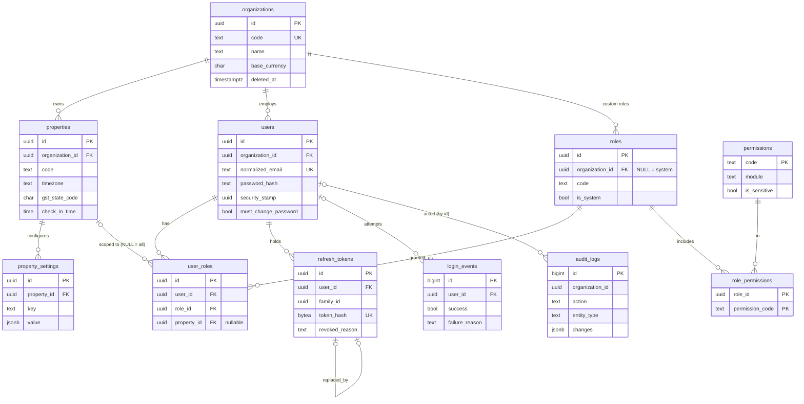

# Sprint 1 — schema reference

Source of truth: `database/migrations/V001__foundation.sql`, `V002__seed_permissions_roles.sql` and `V003__audit_request_context.sql`.
They're applied by the API on start (`Database:MigrateOnStartup`), tracked in `schema_migrations` with a SHA-256 checksum.
Editing an applied migration stops startup, so every change goes in a new `V###__name.sql`.

## Conventions (every table, every sprint)

| Rule | How |
|---|---|
| Primary keys | `uuid`, generated by the API as UUIDv7 (time-ordered, index-friendly). Append-only logs use `bigint identity`. |
| Time | `timestamptz`, always written in UTC. Business dates come from `properties.timezone` (default `Asia/Kolkata`), never from the server clock. |
| Who/when | `created_at`, `updated_at`, `created_by`, `updated_by` on mutable tables, set by the API's audit interceptor. `*_by` holds `users.id` with no FK, so seed/system rows can be NULL. |
| Soft delete | `deleted_at` on master data (organisations, properties, users). Unique indexes are partial (`WHERE deleted_at IS NULL`). Financial and log rows are never deleted. |
| Concurrency | Optimistic, using PostgreSQL's `xmin`. Clients send back `version`; a stale save gets HTTP 409. |
| Tenancy | Business rows carry `organization_id` (+ `property_id` where relevant). EF Core global filters scope every query to the caller's organisation. |
| Audit | Inserts, updates and deletes on audited entities write `audit_logs` rows in the same transaction. Password hashes, security stamps and token hashes are masked. |

## Tables

### organizations — the tenant
| Column | Type | Null | Default | Notes |
|---|---|---|---|---|
| id | uuid | no | gen_random_uuid() | PK |
| code | text | no | | `^[A-Z0-9_]{2,30}$`, unique where not deleted |
| name | text | no | | |
| legal_name | text | yes | | |
| base_currency | char(3) | no | 'INR' | ISO 4217 |
| country_code | char(2) | no | 'IN' | ISO 3166 |
| is_active | boolean | no | true | |
| created_at / updated_at | timestamptz | no | now() | |
| created_by / updated_by | uuid | yes | | |
| deleted_at | timestamptz | yes | | soft delete |

### properties — a resort/hotel
FK `organization_id → organizations`. Unique `(organization_id, code)` where not deleted.
Columns: code, name, legal_name, property_type (RESORT/HOTEL/HOMESTAY/HOSTEL/VILLA/OTHER), **timezone** (IANA, default Asia/Kolkata, validated by API),
currency, address_line1/2, city, district, state_name, **gst_state_code** (`^[0-9]{2}$`, drives CGST+SGST vs IGST later), postal_code, country_code,
phone, email, check_in_time (14:00), check_out_time (11:00), latitude/longitude (range-checked; for the attendance geofence in Sprint 16), is_active, audit columns, deleted_at.

### property_settings — key/value config per property
FK `organization_id`, `property_id`. Unique `(property_id, key)`. `key` matches `^[a-z][a-z0-9_.]{1,99}$`; `value` is jsonb.
Example: `frontdesk.allow_checkout_with_balance = false`.

### system_settings — platform-wide settings
PK `key` (text), `value` jsonb, `description`, `updated_at`, `updated_by`. Empty in Sprint 1.

### users — sign-in identities
FK `organization_id`. Unique `normalized_email` where not deleted (platform-wide, so sign-in needs no organisation picker).
Checks: `normalized_email = lower(email)`, email format, `failed_login_count >= 0`.
Columns: email, normalized_email, phone, full_name, password_hash (PBKDF2-SHA512, 100k iterations), **security_stamp** (rotated on password
change/deactivation/reset, which kills every access token immediately), is_active, must_change_password, mfa_enabled (enforced in Sprint 26),
failed_login_count, lockout_until, last_login_at, audit columns, deleted_at.

### permissions — catalogue
PK `code` (`module.action`, e.g. `reservation.cancel`), module, description, is_sensitive. 117 codes covering every planned module.

### roles
`organization_id` NULL = built-in system role (17 seeded); organisations can add custom roles later. Unique `code` for system roles and
`(organization_id, code)` for custom ones. Check: system roles have no organisation.

### role_permissions
PK `(role_id, permission_code)`. FK to roles (cascade) and permissions.

### user_roles — role grants
FK user_id, role_id, property_id (nullable). **property_id NULL = all properties** in the organisation.
Unique `(user_id, role_id, property_id) NULLS NOT DISTINCT`.

### refresh_tokens
FK user_id; self-FK replaced_by_id. Stores only `token_hash` (SHA-256, 32 bytes, unique). `family_id` groups one sign-in's rotation chain.
`revoked_reason` ∈ ROTATED, LOGOUT, REUSE_DETECTED, USER_DEACTIVATED, PASSWORD_CHANGED, ADMIN. Check `expires_at > created_at`.

### login_events — append-only
bigint identity. user_id (nullable for unknown emails), email_attempted, success, failure_reason (required when not success:
UNKNOWN_EMAIL, INACTIVE, LOCKED_OUT, BAD_PASSWORD), ip_address (inet), user_agent, occurred_at.

### audit_logs — append-only
bigint identity. organization_id, property_id, user_id, action (INSERT/UPDATE/DELETE/SOFT_DELETE/REFRESH_TOKEN_REUSE/…), entity_type,
entity_id, changes (jsonb `{"Field": {"old": …, "new": …}}`), correlation_id, ip_address, occurred_at,
and from V003: request_id, user_agent (device), reason (from the `X-Change-Reason` header, ≤ 500 chars).
Indexes: (organization_id, occurred_at desc), (entity_type, entity_id), (user_id, occurred_at desc).

**Append-only enforcement:** a trigger rejects UPDATE and DELETE on `audit_logs` and `login_events`, even from the application's own DB user.
Production should also run the app as a role without TRUNCATE/DDL rights (Sprint 26 deployment).

### schema_migrations
version (PK), name, checksum, applied_at. Created by the migrator.

## ER diagram

