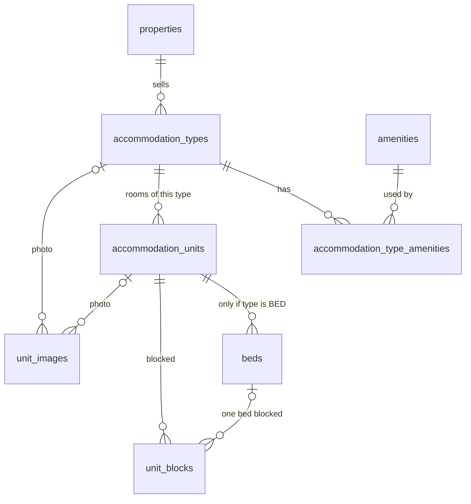

# Sprint 2 — schema reference (accommodation)

Source of truth: `database/migrations/V004__accommodation.sql`. Conventions (UUID keys, UTC `timestamptz`, audit
columns, `xmin` versions, tenant filters) are the same as Sprint 1: see [schema-sprint-01.md](schema-sprint-01.md#conventions-every-table-every-sprint).

## The model in one picture

**Room-based vs bed-based.** `accommodation_types.inventory_mode` decides what is sold:

| Mode | Sold as | Example | Capacity counted as |
|---|---|---|---|
| `UNIT` | the whole room | Deluxe room 101 | 1 per active room |
| `BED` | each bed separately | Dormitory, beds B01–B10 | 1 per active bed in an active room |

Sprint 5 (reservations) books against exactly these: `reservation_units` will point at a unit, or at a bed for
`BED` types.

## Tables

### amenities — catalogue
`organization_id NULL` = built-in (22 seeded by the migration: air conditioning, Wi-Fi, attached bathroom, mosquito net,
locker, privacy curtain, wheelchair accessible …). An organisation can add its own later.
Columns: code (`^[A-Z0-9_]{2,40}$`), name (≤ 100), category (`ROOM`, `BATHROOM`, `VIEW`, `ACCESSIBILITY`, `DORMITORY`,
`OTHER`), sort_order, is_active. Unique code among built-ins, and per organisation.

### accommodation_types — what the property sells
FK `organization_id`, `property_id`. Unique `(property_id, code)`; also unique `(id, property_id)` so child tables can
use composite FKs that keep everything inside one property.

| Column | Type | Rule |
|---|---|---|
| code | text | `^[A-Z0-9_]{2,30}$`, fixed after creation (later mapped to rate plans and OTA room codes) |
| name / description | text | ≤ 100 / ≤ 2000 |
| inventory_mode | text | `UNIT` or `BED` |
| base_occupancy / max_occupancy | smallint | 1 ≤ base ≤ max ≤ 50; **BED types: both = 1** (`ck_accommodation_types_bed_occ`) |
| size_sqm | numeric(6,1) | > 0 or NULL |
| sort_order, is_active, audit columns | | |

### accommodation_type_amenities
`(accommodation_type_id, amenity_id)` primary key. Replaced as a set when a type is saved.

### accommodation_units — rooms (and the dormitory room)
FK `(accommodation_type_id, property_id) → accommodation_types (id, property_id)`: a room can't point at another
property's type. Code `^[A-Z0-9_-]{1,20}$`, unique per property, fixed after creation. Name ≤ 100, floor ≤ 20,
notes ≤ 1000, sort_order, **is_active** (rooms are deactivated, never deleted, because bookings will reference them).

### beds — dormitory beds
FK `(unit_id, property_id) → accommodation_units`. Code unique per room. `bed_type`: `SINGLE`, `BUNK_LOWER`,
`BUNK_UPPER`, `DOUBLE`. `is_active` to take a broken bed out of sale.

### unit_images
Photo of a type **or** a room (exactly one; `ck_unit_images_owner`). `storage_key` points to blob storage. The table is
created now; the upload API comes with file storage in Sprint 3.

### unit_blocks — rooms or beds taken out of sale
| Column | Type | Rule |
|---|---|---|
| unit_id | uuid | FK `(unit_id, property_id) → accommodation_units` |
| bed_id | uuid NULL | NULL = whole room/dorm; otherwise FK `(bed_id, unit_id) → beds (id, unit_id)` (the bed must belong to that room) |
| block_type | text | `MAINTENANCE`, `OUT_OF_ORDER`, `OWNER_USE`, `HOLD`, `OTHER` |
| start_date / end_date | date | property-local dates; end **not included** (like check-out); 1–366 nights |
| period | daterange | generated: `daterange(start_date, end_date, '[)')` |
| reason | text | 3–500 characters |
| status | text | `ACTIVE` or `RELEASED`; `RELEASED` requires released_at and release_reason |
| released_at / released_by / release_reason | | set on release |

## Integrity rules enforced by the database

These are the last line of defence; the API checks the same things first and gives friendlier messages.

| Rule | How |
|---|---|
| Beds only under bed-based rooms | Trigger `trg_beds_require_bed_mode` → `check_violation` (API: 422) |
| A room with beds can't move to a per-room type | Trigger `trg_units_keep_bed_mode` |
| A type whose rooms have beds can't switch to `UNIT` | Trigger `trg_types_keep_bed_mode` |
| No two active whole-room blocks overlap on one room | `EXCLUDE USING gist (unit_id WITH =, period WITH &&) WHERE status='ACTIVE' AND bed_id IS NULL` |
| No two active blocks overlap on one bed | `EXCLUDE USING gist (bed_id WITH =, period WITH &&) WHERE status='ACTIVE' AND bed_id IS NOT NULL` |
| A whole-dorm block can't overlap a bed block in that dorm (either order) | Trigger `fn_unit_blocks_no_mixed_overlap`: locks the room row `FOR UPDATE`, then raises `exclusion_violation` |
| Blocks are history | Trigger refuses `DELETE` on `unit_blocks` |
| Everything stays inside one property | Composite FKs on `(…, property_id)` |

`EXCLUDE` on a uuid column needs the `btree_gist` extension; V004 runs `CREATE EXTENSION IF NOT EXISTS btree_gist`.
Exclusion violations reach the client as HTTP 409 `OVERLAP`.

## Development seed data

`database/seed/dev/S001__accommodation.sql` runs only when the API starts with `ASPNETCORE_ENVIRONMENT=Development`
and `DevSeed:Enabled=true` (the default in `appsettings.Development.json`). It fills the bootstrap property **only if
it has no room types yet**, so it never touches data you've entered:

| Type | Mode | Guests | Rooms |
|---|---|---|---|
| Deluxe room (`DELUXE_ROOM`) | UNIT | 2 standard, 3 max, 28 m² | 101, 102 |
| Standard room (`STANDARD_ROOM`) | UNIT | 2 / 2, 20 m² | 103, 104, 105, 106 |
| Dormitory bed (`DORMITORY`) | BED | 1 per bed | DORM with beds B01–B10 (bunks, lower/upper alternating) |

To get it back after you've changed things: reset the database (`scripts/db-reset.ps1`) and restart the API.
Seed files are `S###__name.sql`, run in order, each in its own transaction, and must be idempotent.
