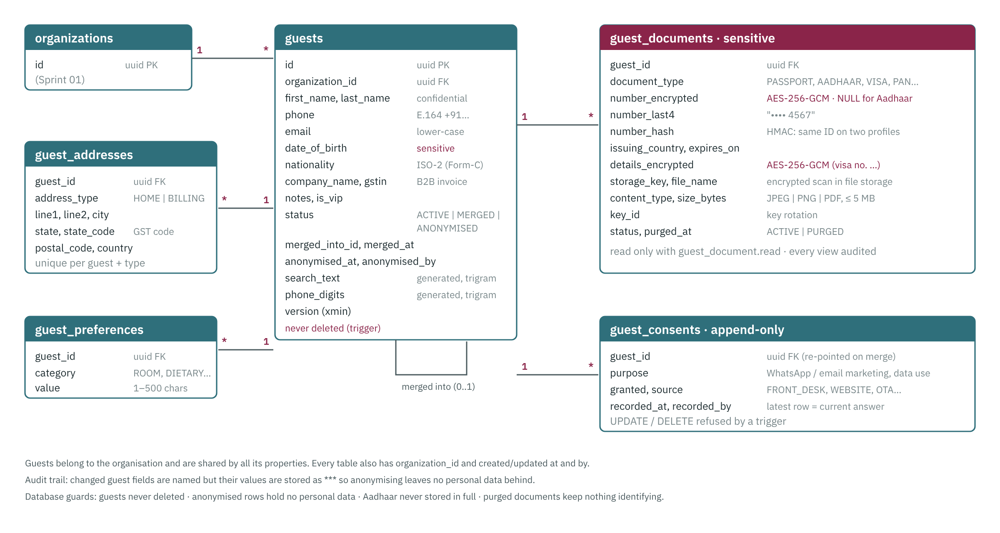
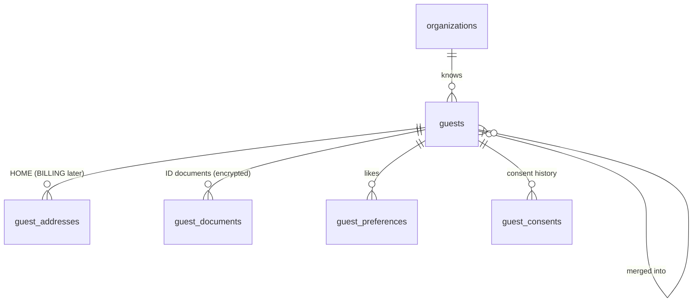

# Sprint 3 — schema reference (guests)

Source of truth: `database/migrations/V005__guests.sql`. Conventions (UUID keys, UTC `timestamptz`, audit columns,
`xmin` versions, tenant filters) are the same as Sprint 1: see [schema-sprint-01.md](schema-sprint-01.md#conventions-every-table-every-sprint).

**Guests belong to the organisation**, not to one property: a guest who stayed at one resort is recognised at the
next. Every table has `organization_id`; the API's tenant filter scopes every read to the caller's organisation.

## Tables

### guests
| Column | Type | Rule | Class |
|---|---|---|---|
| first_name / last_name | text | 1–100 / ≤ 100 | confidential |
| phone | text | E.164 `^\+[1-9][0-9]{6,14}$`, normalised by the API (`098200 12345` → `+919820012345`) | confidential |
| email | text | lower-case, ≤ 254 | confidential |
| date_of_birth | date | ≥ 1900; only if local rules need it | **sensitive** |
| nationality | char(2) | ISO 3166-1; anything but IN means Form-C at check-in (Sprint 7) | confidential |
| company_name / gstin | text | GSTIN `^[0-9]{2}[A-Z0-9]{13}$`, for B2B invoices (Sprint 12) | internal |
| notes | text | ≤ 2000 | confidential |
| is_vip | boolean | | internal |
| status | text | `ACTIVE`, `MERGED`, `ANONYMISED` | internal |
| merged_into_id / merged_at | uuid / timestamptz | both set exactly when status = MERGED; never itself | internal |
| anonymised_at / anonymised_by | timestamptz / uuid | set exactly when status = ANONYMISED | internal |
| search_text | text | **generated**: lower(first ‖ last ‖ email ‖ company); trigram GIN index | confidential |
| phone_digits | text | **generated**: digits of phone; trigram GIN index | confidential |

`ck_guests_anon_empty`: an ANONYMISED row has no last name, phone, email, date of birth, notes, company or GSTIN.

### guest_addresses
One per `(guest_id, address_type)`; `HOME` now, `BILLING` later. Lines ≤ 200, city/state ≤ 100, `state_code` = GST
state code (2 digits, Indian addresses), `country_code` ISO-2 (default IN). Personal fields are confidential.

### guest_documents — ID documents
| Column | Type | Rule | Class |
|---|---|---|---|
| document_type | text | `PASSPORT`, `AADHAAR`, `DRIVING_LICENCE`, `VOTER_ID`, `PAN`, `VISA`, `OTHER` | confidential |
| number_encrypted | bytea | AES-256-GCM envelope written by the API; **NULL for Aadhaar** (`ck_guest_documents_aadhaar`) | sensitive |
| number_last4 | text | last 4 characters for "•••• 1234" | sensitive (masked) |
| number_hash | bytea | HMAC-SHA256 of type + normalised number: finds the same passport on two profiles without decrypting | sensitive |
| issuing_country / expires_on | char(2) / date | | sensitive |
| details_encrypted | bytea | AES-256-GCM envelope of JSON details (visa number, place of issue…) | sensitive |
| storage_key, file_name, content_type, size_bytes | | encrypted scan in file storage; JPEG/PNG/PDF; 1 B – 5 MB | sensitive / internal |
| key_id | text | which encryption key protects the row (rotation) | internal |
| status / purged_at | text / timestamptz | `ACTIVE` or `PURGED`; a purged row keeps only type and dates (`ck_guest_documents_purged`) | internal |

### guest_preferences
`category` (`ROOM`, `FOOD`, `DIETARY`, `ACTIVITY`, `OTHER`) + `value` (1–500). Confidential: dietary preferences can
reveal religious practice.

### guest_consents — append-only
`purpose` (`MARKETING_WHATSAPP`, `MARKETING_EMAIL`, `DATA_PROCESSING`), `granted`, `source` (`FRONT_DESK`, `PHONE`,
`WEBSITE`, `OTA`, `EMAIL`), `recorded_at`, `recorded_by`. The latest row per purpose is the current answer; the rest
is the evidence trail required by the DPDP Act 2023. A trigger rejects DELETE and any UPDATE except re-pointing
`guest_id` when two profiles are merged.

## Integrity rules enforced by the database

| Rule | How |
|---|---|
| Guests are never deleted | Trigger `trg_guests_no_delete` |
| Merged ⇔ points at another profile | `ck_guests_merged`, `ck_guests_not_self` |
| Anonymised ⇔ no personal data left | `ck_guests_anonymised`, `ck_guests_anon_empty` |
| Aadhaar number never stored in full | `ck_guest_documents_aadhaar` |
| Purged documents keep nothing identifying | `ck_guest_documents_purged` |
| Consent history can't be rewritten | Trigger `trg_guest_consents_append_only` |
| Phones in one format | `ck_guests_phone` (E.164) |
| Every column classified | `COMMENT ON COLUMN … 'class: …'` (checked by query 13 in `database/queries/check-sprint-03.sql`) |

`pg_trgm` (trigram) indexes need `CREATE EXTENSION pg_trgm`, which V005 runs. It ships with PostgreSQL and is
available on managed services (Azure, AWS, Neon).

## What the API adds on top

- **Encryption** of `number_encrypted`, `details_encrypted` and the scan, with the key outside the database
  ([SECURITY.md](../SECURITY.md#field-encryption-and-key-rotation)). Each ciphertext is bound to its row and field,
  so copying it to another row makes it unreadable.
- **Audit masking:** guest audit rows name the changed fields but store `***` for personal values, so anonymising leaves
  nothing behind in the append-only `audit_logs`. Opening a document number or scan writes a `SENSITIVE_READ` row.
- **Anonymise** clears every personal field (also on profiles merged into this one), deletes addresses and
  preferences, purges documents and deletes scans; nationality and consents stay (no personal data).

## Development seed data

`database/seed/dev/S002__guests.sql` (Development only, `DevSeed:Enabled`) adds **20 invented guests** to the
bootstrap organisation if it has none: 14 from different Indian states (with GST state codes) and 6 from the UK,
Germany, France, Australia and the US. Phone numbers use the Indian `+91 90000 001xx` block and the ranges other
countries reserve for fiction; emails use `example.com` / `example.in`. Each has a home address, most have a
preference and consent answers. No ID documents: those are encrypted by the API, so add them in the app.
