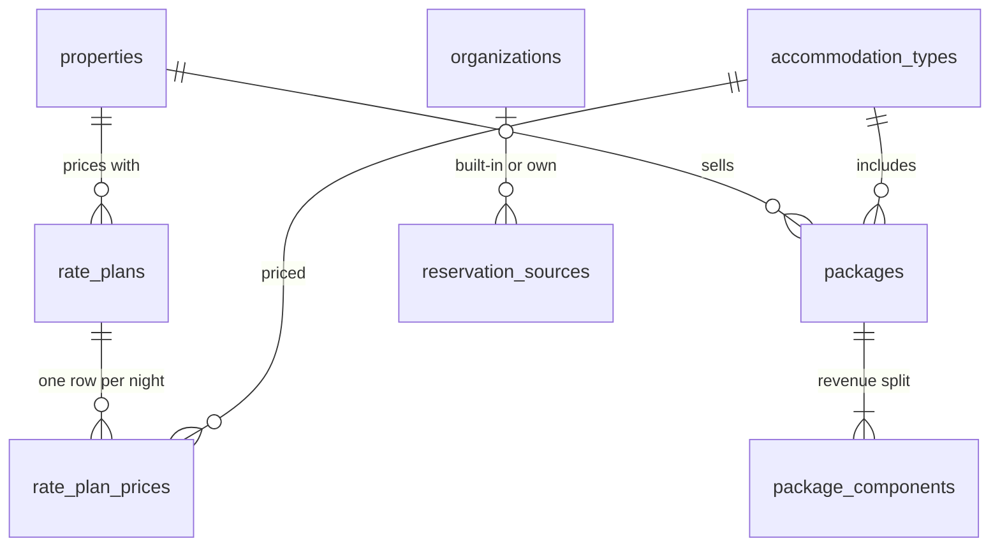

# Sprint 4 — schema reference (rate plans and packages)

Source of truth: `database/migrations/V006__rates.sql`. Conventions (UUID keys, UTC `timestamptz`, audit columns,
`xmin` versions, tenant filters) are the same as Sprint 1: see [schema-sprint-01.md](schema-sprint-01.md#conventions-every-table-every-sprint).

**Rates belong to one property** (`property_id` on every table). Composite foreign keys `(id, property_id)` keep a
price, a package and its room type inside the same property. Money is `numeric(12,2)`; prices are before tax.

## Tables

### rate_plans
| Column | Type | Rule |
|---|---|---|
| code | text | `^[A-Z0-9_]{2,30}$`, unique per property, fixed after creation (OTA mappings, Sprint 26) |
| name / description | text | 1–100 / ≤ 1000 |
| meal_plan | text | `EP` room only, `CP` + breakfast, `MAP` + breakfast and one meal, `AP` all meals |
| is_default | boolean | the plan quotes use when none is named; **at most one per property** (`ux_rate_plans_default`), and it must be active (`ck_rate_plans_default_act`) |
| sort_order, is_active | | plans are deactivated, never deleted (trigger) |

### rate_plan_prices — the rate grid
One row per **plan × room type × night** (`ux_rate_plan_prices_cell`). `stay_date` is the property-local night.
| Column | Type | Rule |
|---|---|---|
| price | numeric(12,2) | 0 … 1,00,00,000. Per room per night (UNIT types) or **per bed per night** (BED types) |
| extra_adult / extra_child | numeric(12,2) | per guest per night above the type's standard occupancy; rooms only (the API keeps them 0 for dormitories) |
| min_stay | smallint | 1–30, checked on the **arrival** night |

Every insert and change is written to `audit_logs` (entity `RatePlanPrice`) with old and new values. A bulk edit that
sets a night to the price it already has writes nothing.

### packages
| Column | Type | Rule |
|---|---|---|
| code / name / description | text | as rate plans; description ≤ 2000 |
| accommodation_type_id | uuid | the room type included (same property) |
| nights | smallint | 1–30 |
| adults / children | smallint | 1–50 / 0–50; the API also keeps them within the room type's maximum |
| price | numeric(12,2) | > 0, the whole stay, before tax |

### package_components — revenue split
`category` (`ROOM`, `FOOD`, `TRANSPORT`, `ACTIVITY`), `description` (1–200), `share_percent` (numeric(5,2), > 0, ≤ 100) and
`amount` (numeric(12,2), computed by the API). Replaced as a set when the package is edited.

### reservation_sources
Booking channels: `code`, `name`, `channel` (`DIRECT`, `OTA`, `TRAVEL_AGENT`, `CORPORATE`, `OTHER`), optional
`commission_percent`. 14 built-in rows (`organization_id` NULL): walk-in, phone, WhatsApp, email, own website,
Booking.com, Agoda, MakeMyTrip, Goibibo, Expedia, Airbnb, travel agent, corporate, other. Reservations use them from Sprint 5.

## Integrity rules enforced by the database

| Rule | How |
|---|---|
| One price per plan, type and night | `ux_rate_plan_prices_cell` |
| One default plan per property, and it is active | `ux_rate_plans_default`, `ck_rate_plans_default_act` |
| A package's split adds up: shares = 100 %, amounts = price, at least one ROOM part | Deferred constraint triggers `trg_packages_split_adds_up`, `trg_package_components_split_adds_up` (checked at COMMIT, so the package and its parts can be written in any order) |
| Prices, plans, packages and their room types stay in one property | composite FKs `(…, property_id)` |
| Plans and packages are never deleted | Triggers `trg_rate_plans_no_delete`, `trg_packages_no_delete` |
| Money never a float | `numeric(12,2)`; query 8 in `database/queries/check-sprint-04.sql` |

## Rounding

See [DATABASE.md → Money and rounding](../DATABASE.md#money-and-rounding): the largest-remainder rule splits a package
price so the parts add up to exactly the price, to the paisa.

## Development seed data

`database/seed/dev/S003__rates.sql` (Development only) adds, if the property has no rate plans yet:

- **BAR — Best available rate** (EP, default) with prices from a week ago to a year ahead:
  Deluxe room ₹5,000 (Fri/Sat nights ₹6,000; extra adult ₹1,200, child ₹600), Standard room ₹3,500 (₹4,200; ₹1,000 / ₹500),
  Dormitory bed ₹800 (₹950).
- **Couple getaway** — 2 nights Deluxe, 2 adults, ₹14,999: room 70 % ₹10,499.30, food 15 % ₹2,249.85, transport 5 % ₹749.95,
  activity 10 % ₹1,499.90.
- **Room + breakfast** — 1 night Standard, 2 adults, ₹4,100: room 85 % ₹3,485.00, food 15 % ₹615.00.
