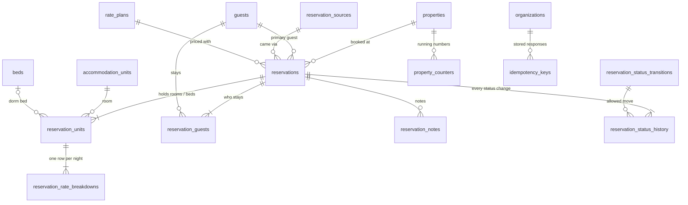

# Sprint 5 — schema reference (availability and reservations)

Source of truth: `database/migrations/V007__reservations.sql`. Conventions (UUID keys, UTC `timestamptz`, audit columns,
`xmin` versions, tenant filters) are the same as Sprint 1: see [schema-sprint-01.md](schema-sprint-01.md#conventions-every-table-every-sprint).
How the tables are used to book without double-selling: [booking-algorithm.md](../architecture/booking-algorithm.md).



**Reservations belong to one property** (`property_id` on every table). Composite foreign keys `(id, property_id)` keep a
reservation's rooms, nights, notes and history inside its property. **Nothing here is ever deleted** (triggers refuse
DELETE); notes and status history can't be edited either. Money is `numeric(12,2)`, before tax.

## Tables

### reservations
| Column | Type | Rule |
|---|---|---|
| reference | text | `R00001`, `R00002` … per property (`ux_reservations_reference`), from `property_counters` |
| status | text | `INQUIRY`, `PENDING`, `CONFIRMED`, `CHECKED_IN`, `CHECKED_OUT`, `CANCELLED`, `NO_SHOW`, `REFUNDED`. Changes must follow `reservation_status_transitions` (trigger → `ck_reservations_status_transition`) |
| source_id | uuid | `reservation_sources` (walk-in, phone, Booking.com …) |
| primary_guest_id | uuid | the booker; also a row in `reservation_guests`. Merging guests (Sprint 3) re-points it |
| rate_plan_id | uuid | same property (`fk_reservations_rate_plan`) |
| check_in / check_out | date | property-local; the stay is `[check_in, check_out)`; 1–180 nights (`ck_reservations_dates`) |
| adults / children | smallint | totals of the current rooms; adults ≥ 1 |
| total_amount, currency | numeric(12,2), char(3) | sum of the current nightly breakdown |
| special_requests | text | ≤ 2000 |
| status_changed_at | timestamptz | last status change |

### reservation_units — what a booking holds
One row per **room**, or per **dormitory bed**, per booking version.
| Column | Type | Rule |
|---|---|---|
| accommodation_type_id, unit_id | uuid | must match (`ck_reservation_units_type`, trigger) |
| bed_id | uuid | set **exactly** when the room type is sold by the bed (`ck_reservation_units_mode`, trigger); a bed row has one guest |
| start_date / end_date | date | `stay` = `daterange(start, end, '[)')`, generated |
| holds_inventory | boolean | true while the booking is PENDING / CONFIRMED / CHECKED_IN and the row is current |
| superseded_at | timestamptz | set when the booking's dates or rooms change; the row stays as history and stops holding |

**Double-booking guard:** `ex_reservation_units_unit EXCLUDE USING gist (unit_id WITH =, stay WITH &&) WHERE
(holds_inventory AND bed_id IS NULL)` and `ex_reservation_units_bed` (same on `bed_id`). A held row on a blocked room is
refused by `fn_reservation_units_check` (`ex_reservation_units_blocked`); a block over a held night by
`fn_unit_blocks_not_reserved` on `unit_blocks` (`ex_unit_blocks_reserved`). Partial index `ix_reservation_units_held`
serves availability searches.

### reservation_rate_breakdowns — the price of every night, as booked
One row per reservation unit per night (`ux_reservation_rate_breakdowns_night`). Columns mirror the Sprint 4 quote:
`units`, `unit_price`, `base_amount`, `extra_adults`, `extra_adult_rate`, `extra_adult_amount`, `extra_children`,
`extra_child_rate`, `extra_child_amount`, `total`. `ck_reservation_rate_breakdowns_amounts` checks the arithmetic
(base = price × units; total = base + extras). Prices don't change when the grid changes later; a date change re-prices.

### reservation_guests
Everyone staying, the primary guest included. Unique per (reservation, guest).

### reservation_notes
Free-text notes (1–2000 characters) with who and when. Append-only.

### reservation_status_history
Every status change: `from_status` (NULL for the first status), `to_status`, `reason` (required by the API for cancel and
no-show), `changed_at`, `changed_by`. The pair must exist in `reservation_status_transitions`. Append-only.

### reservation_status_transitions
The allowed status graph, read by the trigger and mirrored in `ReservationStatuses.Transitions` (C#).
`from_status NULL` rows are the statuses a booking may be created in (INQUIRY, PENDING, CONFIRMED). Graph:
[booking-algorithm.md → Status changes](../architecture/booking-algorithm.md#status-changes).

### idempotency_keys
| Column | Type | Rule |
|---|---|---|
| organization_id, scope, key | | unique together; `scope` is the endpoint (`POST /api/v1/properties/{id}/reservations`); key 8–100 characters |
| request_hash | bytea | SHA-256 of the request body; a different body with the same key → 422 |
| status_code, response, resource_id, completed_at | | filled when the first request commits; a retry returns `response` |

### property_counters
`(property_id, name) → last_value`. `name = 'reservation'` numbers bookings. Incremented with an upsert, so the counter
row is locked until the booking commits.

## Checking it

```bash
psql "$DATABASE_URL" -f database/queries/check-sprint-05.sql
```

Shows the demo bookings, what each holds per night, the status graph and confirms that no room or bed is held twice.
