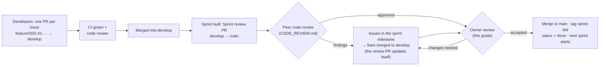

# Reviewing a sprint

How the product owner checks a finished sprint and accepts it (or sends it back). **Sprint 03 is waiting for review
now (review PR #102).** Before you accept, the second developer does a code review of the same PR:
[CODE_REVIEW.md](CODE_REVIEW.md). You need the setup from [../GETTING_STARTED.md](../GETTING_STARTED.md).

## How a sprint reaches you



- **`develop`** = everything merged so far, including unreviewed sprint work.
- **`main`** = only sprints you have accepted.
- The **Sprint review PR** (`develop → main`) shows exactly what you're accepting: every file changed since the
  last accepted sprint.

## Part A — Review on GitHub (20–40 minutes)

Open the repo → **Pull requests** → the PR titled **"Sprint 01 + 02 review — …"**
([#74](https://github.com/Prathamesh27702/resort-os/pull/74)).

> Sprint 01 only: its code came in the repository's first commit, which is on both `main` and `develop`, so *Files
> changed* shows only later additions. The PR description links the Sprint 01 code folders. From Sprint 02 the
> review PR shows every file.

1. **Conversation tab.** Read the summary. It links the sprint guide and lists what to check.
2. **Checks.** At the bottom of the Conversation tab every check must be ✅ green (*Backend*, *Frontend*,
   *Migrations*, *Security*). Click **Details** on *Backend — build, lint, test* to see the test count
   (e.g. *Backend tests: 30 passed, 0 failed*). A red ❌ means don't accept.
3. **Files changed tab.** Everything that would go into `main`.
   - Use the file tree on the left; filter by extension (e.g. only `.sql`, only `.md`).
   - Read in this order: `docs/sprints/sprint-NN-*.md` (what was promised) → `database/migrations/*.sql`
     (the new schema) → `backend/Resort.Api/Endpoints/*` (the API surface) → tests in `backend/Resort.Tests`
     → `frontend/src/app/features/*`.
   - Tick **Viewed** on each file as you go; GitHub remembers.
   - To ask about a line, hover it → click the blue **+** → write a comment → **Start a review**.
4. **Finish your review** (top-right button) with **Comment** (questions only) or **Request changes**.
   GitHub doesn't let a PR's author approve their own PR. Review PRs opened by Claude show under your account,
   so for those you comment and then merge. Your developers' PRs you can **Approve**.

You don't need to understand every line of C#. You're checking that what was promised was built, that it's tested,
and that it does what the resort needs.

## Part B — Try it yourself (20–30 minutes)

```powershell
cd C:\dev\resort-os
git switch develop
git pull
pwsh -ExecutionPolicy Bypass -File scripts/db-reset.ps1     # start clean (answer y)
```

Start the API and web app (Getting started, Step 6) and run the tests (Step 7). Then follow each sprint's
**acceptance script**. Want to watch it done automatically first, or check the API and the stored data too? See
[../testing/VERIFYING.md](../testing/VERIFYING.md): browser tests, `check-api.mjs`, and SQL checks per feature.

### Sprint 01 — sign-in, staff, roles, audit


| # | Do | You should see |
|---|---|---|
| 1 | Open http://localhost:4300, sign in as `owner@demo.local` with the password from `.env` | *Good morning/afternoon, Demo*, today's date in IST, and a 3-step setup checklist |
| 2 | Click **Edit property**. Fill address line 1, PIN code, phone and email; check **State (GST)** shows Goa (30). **Save changes** | *Changes saved*; back on **Today** the first two checklist steps are ticked |
| 3 | **Staff accounts → Add staff**: name *Riya Naik*, email `riya@demo.local`, temporary password `Welcome12345`, role **Receptionist** at **Palm Grove Beach Resort**. **Create account** | Riya appears with *Awaiting first sign-in* |
| 4 | **Roles & permissions** | A grid of 117 permissions × 17 roles; salary rows only for Owner and HR |
| 5 | **Audit trail** | Your property edit (old → new values) and Riya's creation, with your name and IST time |
| 6 | Open a **private/incognito window**, sign in as `riya@demo.local` / `Welcome12345` | Forced to **Choose your own password**. Set one, then sign in again with it |
| 7 | As Riya | Menu shows only **Today** and **Properties**. Typing `localhost:4300/users` sends her back to Today |
| 8 | Back as owner: **Staff accounts → Riya** → reason *"Testing deactivation"* → **Deactivate** | *Account deactivated* |
| 9 | In Riya's window, click anything | She's sent to the sign-in page and can't sign in |
| 10 | Owner → **Audit trail** | The deactivation, with your reason in quotes |
| 11 | Shrink the browser to phone width (F12 → device toolbar, 390 px) | Menu collapses behind ☰; pages still usable |
| 12 | Add another staff account (e.g. `test@demo.local`). Sign out, then enter a **wrong password 5 times** for it, then the right one | *Too many failed attempts. Try again later or ask a manager to reset your password.* (locked 15 minutes) |

### Sprint 02 — rooms, dormitory and blocks

Continue as the owner after the Sprint 01 script. The demo rooms come from the dev seed
([what it adds](../database/schema-sprint-02.md#development-seed-data)). Screenshots of each screen:
[sprint-02-screens/](sprint-02-screens/).

| # | Do | You should see |
|---|---|---|
| 1 | **Today** | A 4th checklist step *Set up rooms*, already ticked (demo rooms exist). Menu has **Rooms**, **Room status**, **Room types** |
| 2 | **Rooms** | *6 rooms and 10 dorm beds*. Three groups: Deluxe room (101, 102 · up to 3 guests per room), Standard room (103–106 · up to 2), Dormitory bed (DORM · 10 beds). All *Available* |
| 3 | On the **103** row click the ⦸ (Block) icon. Why: *Maintenance*. First night: today. Available again on: the day after tomorrow. Reason: *AC compressor replacement*. **Block** | The dialog says *2 nights: (today) – (tomorrow)* before you save. After: *Room 103 blocked for 2 nights*, 103 shows **Blocked**, and the **Blocks** list at the bottom shows it with your name |
| 4 | Block **103** again for tomorrow → the day after, reason *Painting* | Refused inside the dialog: *Room 103 is already blocked … (AC compressor replacement)*. Nothing is saved |
| 5 | **Room status** | A tile per room. 103 is orange with the reason and *Free from …*. Use › to step to the day after tomorrow: 103 is green again (the end date isn't included, like a check-out) |
| 6 | **Rooms → DORM** | Its bed list B01–B10 (bunk lower/upper). Untick **In use** on B10 → **Save** | *Bed B10 saved*; Rooms now says *9 dorm beds* |
| 7 | Block → Room *Dormitory*, Bed *B01*, 1 night, reason *Mattress replacement* | Room status: DORM is amber *1 of 9 beds blocked*. Now try blocking the **whole dormitory** for the same night: refused, because a bed in it is already blocked |
| 8 | Try to add beds to a normal room: open **Rooms → 101** | No bed section: beds exist only in rooms whose type is sold per bed (the database refuses it too) |
| 9 | **Room types → Add room type**: *Per room*, name *Garden cottage*, code *garden cottage*, max guests 4, tick *Balcony*. **Add room type** | Code becomes `GARDEN_COTTAGE`. You land on **Add room** with the type preselected. Add code *C1*, name *Cottage 1* → it appears on Rooms |
| 10 | **Room types → Garden cottage**, untick **Active** → **Save** | Refused: *Deactivate or move the rooms of this type first.* Open **Rooms → C1**, switch off *Room is in use*, save; then the type can be deactivated |
| 11 | **Rooms → Blocks** list → **Release** on the 103 block, reason *Fixed early* | *Block released*; 103 is *Available* again |
| 12 | **Audit trail** | The type, room and bed changes with old → new values; the block and the release, each with its reason (*AC compressor replacement*, *Fixed early*) |
| 13 | Sign in as the receptionist in a private window (re-activate Riya first: **Staff accounts → Riya → Activate**) | Riya sees **Rooms**, **Room status**, **Room types**, but no *Add room*, *Block* or *Release* buttons, and fields are read-only. Typing `localhost:4300/rooms/new` sends her back |
| 14 | Phone width (390 px) → **Room status** | Two tiles per row, no sideways scrolling |
| 15 | Acceptance timing: on a fresh database with `DevSeed__Enabled=false` in `.env`, time yourself setting up 2 types, 6 rooms and a 10-bed dorm (**Add beds** → 10, bunk pairs) | Under 10 minutes |

### Sprint 03 — guests, ID documents, privacy

Continue as the owner. The 20 demo guests come from the dev seed
([what it adds](../database/schema-sprint-03.md#development-seed-data)). Screenshots: [sprint-03-screens/](sprint-03-screens/).
The browser tests do all of this for you: `cd frontend; npm run e2e:headed` (names S03-1 … S03-13).

| # | Do | You should see |
|---|---|---|
| 1 | **Guests** (new in the menu) | 20 demo guests: 14 Indian, 6 international; Rohan Fernandes, Vihaan Reddy and Ava Johnson marked **VIP** |
| 2 | Type **90000 00104** in the search box (any format works: `9000000104`, `+91 90000 00104`, `00104`) | Exactly one guest: **Ananya Iyer**, phone shown as *+91 90000 00104*. That's the acceptance test: a returning guest found by phone in one search |
| 3 | **Add guest**: first name *Ananya*, last name *Iyer*, phone *090000 00104*, then click into Email | A yellow box: *This guest may already have a profile* → Ananya Iyer · *Same phone, Same name*. The button now says *Create a new profile anyway*. Don't save; click Cancel |
| 4 | **Add guest**: your own test guest (e.g. *Kavya Desai*, phone *98765 43210*, city *Panaji*, State **Goa**, PIN *403001*), add preference **Dietary** → *Jain food* → **Add**, then **Add guest** | *Guest added*; the profile shows the phone as *+91 98765 43210*, the address *Panaji, Goa, 403001*, and *Dietary: Jain food* |
| 5 | On her profile → **Add document** → Passport, number *Z 1234 567*, attach any photo or PDF → **Save document** | The list shows **•••• 4567** (masked). **Show number** reveals *Z1234567*; **View scan** opens the file in a new tab |
| 6 | **Audit trail** | *Opened (sensitive) · ID document* rows: every Show number / View scan is recorded with your name and time |
| 7 | **Add document** → Aadhaar, number *2345 6789 0123* | Shows **•••• 0123** and no *Show number* button: only the last 4 digits are ever stored |
| 8 | Consent: **Offers on WhatsApp → Yes** | *Consent recorded*, with the date and your name |
| 9 | Private window: sign in as a **receptionist** limited to the resort (e.g. Riya) → Guests → search her phone | She finds and opens the guest and sees the ID documents (masked) |
| 10 | Private window: a **Waiter** account (Staff accounts → Add staff → role Waiter) → open the guest's link | The profile, but **no ID documents section** and no Edit. `localhost:4300/guests/new` sends them back |
| 11 | A **Housekeeper** account | No **Guests** in the menu; `localhost:4300/guests` sends them back |
| 12 | Owner: add a second profile for the same person with a different email (*Create a new profile anyway*), then on the first one → **More → Merge a duplicate into this profile** → find the second → reason → **Merge** | *Profiles merged*; the email (and company) from the duplicate fill the empty fields; searching the duplicate's email finds nothing |
| 13 | **More → Anonymise**, reason *Guest asked to be forgotten* | *Anonymised guest*, a grey banner, phone/email/address gone, documents *Purged*. Searching her phone finds nothing. The Audit trail has the reason, and personal fields show *\*\*\** instead of values |
| 14 | Phone width (390 px) → Guests → a guest | One column, no sideways scrolling |

### Sprint 04 — rate plans, rate grid, quotes and packages

Continue as the owner. The demo rates come from the dev seed ([what it adds](../database/schema-sprint-04.md#development-seed-data)):
BAR with Standard rooms at ₹3,500 a night and ₹4,200 on Friday and Saturday nights. Screenshots:
[sprint-04-screens/](sprint-04-screens/). The browser tests do all of this for you: `cd frontend; npm run e2e:headed -- e2e/sprint-04.spec.ts`
(names S04-01 … S04-06). Database checks: `database/queries/check-sprint-04.sql`.

| # | Do | You should see |
|---|---|---|
| 1 | **Rates** (new in the menu) | Plan *Best available rate (BAR) — default*; a grid of room types × 14 nights from today. Friday and Saturday columns are shaded and cost more (Standard ₹4,200, Deluxe ₹6,000, Dormitory bed ₹950) |
| 2 | Set the first night shown to **next Thursday** | Thursday ₹3,500, Friday ₹4,200, Saturday ₹4,200, Sunday ₹3,500 for the Standard room |
| 3 | **Set prices**: Room types *Standard room*, first night next Thursday, last night two weeks later, click **Weekend (Fri, Sat)**, price *4500*, extra adult *1000*, extra child *500* → **Apply prices** | *Prices saved in Best available rate: 4 changed*; the four weekend cells now show ₹4,500, weekdays unchanged |
| 4 | **Quote a stay**: *Room 103 · Standard room*, arrival next Thursday, 3 nights, 2 adults → **Get quote** | Three rows: ₹3,500, ₹4,500, ₹4,500 and **Total before tax ₹12,500** — the same numbers as the grid. That's the acceptance test |
| 5 | Same quote with **3 adults** | Under the button: *Standard room sleeps at most 2 guests; this quote has 3 (3 adults).* |
| 6 | Quote a **Deluxe** room (Room 101) for 2 adults and 1 child | Each night adds *1 × ₹600* for the child |
| 7 | Price **-5** → **Apply prices** | Under the price field: *Price can't be negative.* (no generic message anywhere) |
| 8 | **Audit trail** → Show *Rate price* | *Changed · Rate price* rows with the old and new price (*Price 4200 → 4500*) of each night you changed |
| 9 | **Packages** | *Couple getaway* ₹14,999 split Room ₹10,499.30, Food ₹2,249.85, Transport ₹749.95, Activity ₹1,499.90, and *Room + breakfast* ₹4,100 |
| 10 | **Add package**: *Monsoon escape*, code *MONSOON*, Deluxe room, 2 nights, price *9999.99*; parts Room 60 %, then **Add part** Food 25.5 % → **Add package** | Under the parts: *The shares add up to 85.5%; they must add up to exactly 100%.* |
| 11 | **Add part** (it fills in the 14.5 % left), category Activity → **Add package** | Amounts ₹5,999.99 + ₹2,550.00 + ₹1,450.00 = ₹9,999.99 exactly; the list shows the split |
| 12 | Private window: a **receptionist** → Rates | The grid and the quote, but no *Set prices*, *Add rate plan* or *Add package* |
| 13 | Phone width (390 px) → Rates | The grid scrolls sideways inside its box; the room-type column stays put; forms are one column |

Write down anything that's wrong or confusing, with the step number. A screenshot helps; never include passwords
or real guest data.

## Part C — Decide

### Accept

1. On the review PR: **Merge pull request** → choose **Create a merge commit**, not *Squash*, so `develop` and `main`
   keep the same history → **Confirm**.
2. **Tag the release** (for a combined review, tag the same merge as both `sprint-01` and `sprint-02`):
   repo home → **Releases** → **Draft a new release** → *Choose a tag* → type `sprint-01` →
   *Create new tag on publish* → target **main** → title *Sprint 01 — Foundation* → **Generate release notes** →
   **Publish release**.
3. Tell the team (or Claude) *"Sprint 01 accepted"*. They set `status: done` and `current: 2` in
   `docs/sprints/sprints.yml` and run `python3 scripts/github/sync-sprints.py github Prathamesh27702/resort-os`,
   which closes the Sprint 01 milestone and updates the guides.
4. Close the *"S01: Review and sign-off by owner"* issue with a comment *"Accepted"*.

### Send back

1. For each problem: **Issues → New issue → Bug**, set **Milestone = Sprint 01 — …**, describe it with the step
   number from Part B.
2. Comment on the review PR: *"Changes requested: #nn, #nn"*.
3. Developers fix them on `fix/S01-<issue>-…` branches merged into `develop`. **The review PR updates
   automatically**, so repeat Parts A and B on the new commits only (Files changed → *Changes from* dropdown →
   pick the commits since your last review).

## Reviewing a developer's day-to-day PR (during a sprint)

Smaller and more frequent than the sprint review:

1. **Pull requests** → the PR → read the template answers (*What / Why / How tested*). Is the linked issue
   (`Closes #nn`) in the current sprint?
2. Checks green?
3. **Files changed**: is it one concern? Tests included? New migration is a **new** `V###` file, not an edit?
   Any secrets, real names or phone numbers? (There must be none.)
4. Pull it locally if it changes screens: `gh pr checkout 41` (or VS Code → GitHub Pull Requests panel →
   *Checkout*), run, click through.
5. **Review changes → Approve** (or Request changes). The author then squash-merges into `develop`.

## Repository settings to do once (owner only)

These need the owner's GitHub account; Claude's access can't change repository settings.

| Where | Set | Why |
|---|---|---|
| Settings → General → **Default branch** | `develop` | New PRs target `develop` automatically |
| Settings → General → Pull Requests | ✅ Allow merge commits · ✅ Allow squash merging · ☐ Allow rebase merging · ✅ Automatically delete head branches | Matches CONTRIBUTING.md |
| Settings → **Collaborators** → **Add people** | Each developer's GitHub username (full steps: [../ONBOARDING.md](../ONBOARDING.md)) | So they can push branches and open PRs |
| Settings → Branches → Branch protection *(needs GitHub Pro, see [../COSTS.md](../COSTS.md))* | `main` and `develop`: require PR, 1 approval, status checks *Backend*, *Frontend*, *Migrations*, *Security* | Stops anyone pushing straight to `main`/`develop` |
