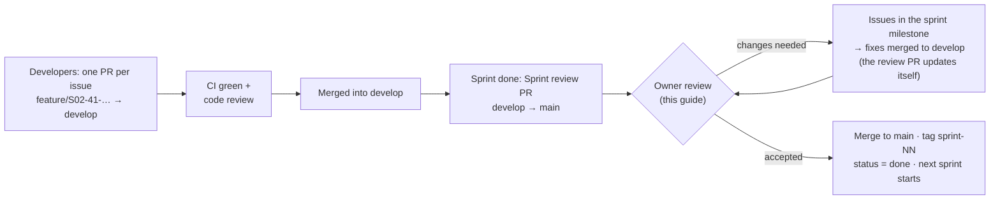

# Reviewing a sprint

How the product owner checks a finished sprint and accepts it (or sends it back). The example throughout is
**Sprint 01**, which is waiting for this review now. You need the setup from [../GETTING_STARTED.md](../GETTING_STARTED.md).

## How a sprint reaches you



- **`develop`** = everything merged so far, including unreviewed sprint work.
- **`main`** = only sprints you have accepted.
- The **Sprint review PR** (`develop → main`) shows exactly what you're accepting: every file changed since the
  last accepted sprint.

## Part A — Review on GitHub (20–40 minutes)

Open the repo → **Pull requests** → the PR titled **"Sprint 01 review — …"**
([#74](https://github.com/Prathamesh27702/resort-os/pull/74)).

> Sprint 01 only: its code came in the repository's first commit, which is on both `main` and `develop`, so *Files
> changed* shows only later additions. The PR description links the Sprint 01 code folders. From Sprint 02 the
> review PR shows every file.

1. **Conversation tab.** Read the summary. It links the sprint guide and lists what to check.
2. **Checks.** At the bottom of the Conversation tab every check must be ✅ green (*Backend*, *Frontend*,
   *Migrations*, *Security*). Click **Details** on *Backend — build, lint, test* to see the test count
   (e.g. *Backend tests: 30 passed, 0 failed*). A red ❌ means don't accept.
3. **Files changed tab.** Everything that would go into `main`.
   - Use the file tree on the left; filter by extension (e.g. only `.sql`, only `.md`).
   - Read in this order: `docs/sprints/sprint-NN-*.md` (what was promised) → `database/migrations/*.sql`
     (the new schema) → `backend/Resort.Api/Endpoints/*` (the API surface) → tests in `backend/Resort.Tests`
     → `frontend/src/app/features/*`.
   - Tick **Viewed** on each file as you go; GitHub remembers.
   - To ask about a line, hover it → click the blue **+** → write a comment → **Start a review**.
4. **Finish your review** (top-right button) with **Comment** (questions only) or **Request changes**.
   GitHub doesn't let a PR's author approve their own PR. Review PRs opened by Claude show under your account,
   so for those you comment and then merge. Your developers' PRs you can **Approve**.

You don't need to understand every line of C#. You're checking that what was promised was built, that it's tested,
and that it does what the resort needs.

## Part B — Try it yourself (20–30 minutes)

```powershell
cd C:\dev\resort-os
git switch develop
git pull
pwsh -ExecutionPolicy Bypass -File scripts/db-reset.ps1     # start clean (answer y)
```

Start the API and web app (Getting started, Step 6) and run the tests (Step 7). Then follow the sprint's
**acceptance script**. For Sprint 01:

| # | Do | You should see |
|---|---|---|
| 1 | Open http://localhost:4300, sign in as `owner@demo.local` with the password from `.env` | *Good morning/afternoon, Demo*, today's date in IST, and a 3-step setup checklist |
| 2 | Click **Edit property**. Fill address line 1, PIN code, phone and email; check **State (GST)** shows Goa (30). **Save changes** | *Changes saved*; back on **Today** the first two checklist steps are ticked |
| 3 | **Staff accounts → Add staff**: name *Riya Naik*, email `riya@demo.local`, temporary password `Welcome12345`, role **Receptionist** at **Palm Grove Beach Resort**. **Create account** | Riya appears with *Awaiting first sign-in* |
| 4 | **Roles & permissions** | A grid of 117 permissions × 17 roles; salary rows only for Owner and HR |
| 5 | **Audit trail** | Your property edit (old → new values) and Riya's creation, with your name and IST time |
| 6 | Open a **private/incognito window**, sign in as `riya@demo.local` / `Welcome12345` | Forced to **Choose your own password**. Set one, then sign in again with it |
| 7 | As Riya | Menu shows only **Today** and **Properties**. Typing `localhost:4300/users` sends her back to Today |
| 8 | Back as owner: **Staff accounts → Riya** → reason *"Testing deactivation"* → **Deactivate** | *Account deactivated* |
| 9 | In Riya's window, click anything | She's sent to the sign-in page and can't sign in |
| 10 | Owner → **Audit trail** | The deactivation, with your reason in quotes |
| 11 | Shrink the browser to phone width (F12 → device toolbar, 390 px) | Menu collapses behind ☰; pages still usable |
| 12 | Add another staff account (e.g. `test@demo.local`). Sign out, then enter a **wrong password 5 times** for it, then the right one | *Too many failed attempts. Try again later or ask a manager to reset your password.* (locked 15 minutes) |

Write down anything that's wrong or confusing, with the step number. A screenshot helps; never include passwords
or real guest data.

## Part C — Decide

### Accept

1. On the review PR: **Merge pull request** → choose **Create a merge commit**, not *Squash*, so `develop` and `main`
   keep the same history → **Confirm**.
2. **Tag the release:** repo home → **Releases** → **Draft a new release** → *Choose a tag* → type `sprint-01` →
   *Create new tag on publish* → target **main** → title *Sprint 01 — Foundation* → **Generate release notes** →
   **Publish release**.
3. Tell the team (or Claude) *"Sprint 01 accepted"*. They set `status: done` and `current: 2` in
   `docs/sprints/sprints.yml` and run `python3 scripts/github/sync-sprints.py github Prathamesh27702/resort-os`,
   which closes the Sprint 01 milestone and updates the guides.
4. Close the *"S01: Review and sign-off by owner"* issue with a comment *"Accepted"*.

### Send back

1. For each problem: **Issues → New issue → Bug**, set **Milestone = Sprint 01 — …**, describe it with the step
   number from Part B.
2. Comment on the review PR: *"Changes requested: #nn, #nn"*.
3. Developers fix them on `fix/S01-<issue>-…` branches merged into `develop`. **The review PR updates
   automatically**, so repeat Parts A and B on the new commits only (Files changed → *Changes from* dropdown →
   pick the commits since your last review).

## Reviewing a developer's day-to-day PR (during a sprint)

Smaller and more frequent than the sprint review:

1. **Pull requests** → the PR → read the template answers (*What / Why / How tested*). Is the linked issue
   (`Closes #nn`) in the current sprint?
2. Checks green?
3. **Files changed**: is it one concern? Tests included? New migration is a **new** `V###` file, not an edit?
   Any secrets, real names or phone numbers? (There must be none.)
4. Pull it locally if it changes screens: `gh pr checkout 41` (or VS Code → GitHub Pull Requests panel →
   *Checkout*), run, click through.
5. **Review changes → Approve** (or Request changes). The author then squash-merges into `develop`.

## Repository settings to do once (owner only)

These need the owner's GitHub account; Claude's access can't change repository settings.

| Where | Set | Why |
|---|---|---|
| Settings → General → **Default branch** | `develop` | New PRs target `develop` automatically |
| Settings → General → Pull Requests | ✅ Allow merge commits · ✅ Allow squash merging · ☐ Allow rebase merging · ✅ Automatically delete head branches | Matches CONTRIBUTING.md |
| Settings → **Collaborators** | Invite each developer with **Write** | So they can push branches and open PRs |
| Settings → Branches → Branch protection *(needs GitHub Pro, see [../COSTS.md](../COSTS.md))* | `main` and `develop`: require PR, 1 approval, status checks *Backend*, *Frontend*, *Migrations*, *Security* | Stops anyone pushing straight to `main`/`develop` |
