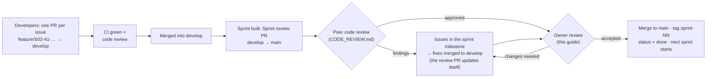

# Reviewing a sprint

How the product owner checks a finished sprint and accepts it (or sends it back). **Sprint 05 is being built now; its
pull request into `develop` is the place to review it.** Before you accept, the second developer does a code review of the same PR:
[CODE_REVIEW.md](CODE_REVIEW.md). You need the setup from [../GETTING_STARTED.md](../GETTING_STARTED.md).

## How a sprint reaches you



- **`develop`** = everything merged so far, including unreviewed sprint work.
- **`main`** = only sprints you have accepted.
- The **Sprint review PR** (`develop → main`) shows exactly what you're accepting: every file changed since the
  last accepted sprint.

## Part A — Review on GitHub (20–40 minutes)

Open the repo → **Pull requests** → the PR titled **"Sprint 01 + 02 review — …"**
([#74](https://github.com/Prathamesh27702/resort-os/pull/74)).

> Sprint 01 only: its code came in the repository's first commit, which is on both `main` and `develop`, so *Files
> changed* shows only later additions. The PR description links the Sprint 01 code folders. From Sprint 02 the
> review PR shows every file.

1. **Conversation tab.** Read the summary. It links the sprint guide and lists what to check.
2. **Checks.** At the bottom of the Conversation tab every check must be ✅ green (*Backend*, *Frontend*,
   *Migrations*, *Security*). Click **Details** on *Backend — build, lint, test* to see the test count
   (e.g. *Backend tests: 30 passed, 0 failed*). A red ❌ means don't accept.
3. **Files changed tab.** Everything that would go into `main`.
   - Use the file tree on the left; filter by extension (e.g. only `.sql`, only `.md`).
   - Read in this order: `docs/sprints/sprint-NN-*.md` (what was promised) → `database/migrations/*.sql`
     (the new schema) → `backend/Resort.Api/Endpoints/*` (the API surface) → tests in `backend/Resort.Tests`
     → `frontend/src/app/features/*`.
   - Tick **Viewed** on each file as you go; GitHub remembers.
   - To ask about a line, hover it → click the blue **+** → write a comment → **Start a review**.
4. **Finish your review** (top-right button) with **Comment** (questions only) or **Request changes**.
   GitHub doesn't let a PR's author approve their own PR. Review PRs opened by Claude show under your account,
   so for those you comment and then merge. Your developers' PRs you can **Approve**.

You don't need to understand every line of C#. You're checking that what was promised was built, that it's tested,
and that it does what the resort needs.

## Part B — Try it yourself (20–30 minutes)

```powershell
cd C:\dev\resort-os
git switch develop
git pull
pwsh -ExecutionPolicy Bypass -File scripts/db-reset.ps1     # start clean (answer y)
```

Start the API and web app (Getting started, Step 6) and run the tests (Step 7). Then follow each sprint's
**acceptance script**. Want to watch it done automatically first, or check the API and the stored data too? See
[../testing/VERIFYING.md](../testing/VERIFYING.md): browser tests, `check-api.mjs`, and SQL checks per feature.

### Sprint 01 — sign-in, staff, roles, audit


| # | Do | You should see |
|---|---|---|
| 1 | Open http://localhost:4300, sign in as `owner@demo.local` with the password from `.env` | *Good morning/afternoon, Demo*, today's date in IST, and a 3-step setup checklist |
| 2 | Click **Edit property**. Fill address line 1, PIN code, phone and email; check **State (GST)** shows Goa (30). **Save changes** | *Changes saved*; back on **Today** the first two checklist steps are ticked |
| 3 | **Staff accounts → Add staff**: name *Riya Naik*, email `riya@demo.local`, temporary password `Welcome12345`, role **Receptionist** at **Palm Grove Beach Resort**. **Create account** | Riya appears with *Awaiting first sign-in* |
| 4 | **Roles & permissions** | A grid of 117 permissions × 17 roles; salary rows only for Owner and HR |
| 5 | **Audit trail** | Your property edit (old → new values) and Riya's creation, with your name and IST time |
| 6 | Open a **private/incognito window**, sign in as `riya@demo.local` / `Welcome12345` | Forced to **Choose your own password**. Set one, then sign in again with it |
| 7 | As Riya | Menu shows only **Today** and **Properties**. Typing `localhost:4300/users` sends her back to Today |
| 8 | Back as owner: **Staff accounts → Riya** → reason *"Testing deactivation"* → **Deactivate** | *Account deactivated* |
| 9 | In Riya's window, click anything | She's sent to the sign-in page and can't sign in |
| 10 | Owner → **Audit trail** | The deactivation, with your reason in quotes |
| 11 | Shrink the browser to phone width (F12 → device toolbar, 390 px) | Menu collapses behind ☰; pages still usable |
| 12 | Add another staff account (e.g. `test@demo.local`). Sign out, then enter a **wrong password 5 times** for it, then the right one | *Too many failed attempts. Try again later or ask a manager to reset your password.* (locked 15 minutes) |

### Sprint 02 — rooms, dormitory and blocks

Continue as the owner after the Sprint 01 script. The demo rooms come from the dev seed
([what it adds](../database/schema-sprint-02.md#development-seed-data)). Screenshots of each screen:
[sprint-02-screens/](sprint-02-screens/).

| # | Do | You should see |
|---|---|---|
| 1 | **Today** | A 4th checklist step *Set up rooms*, already ticked (demo rooms exist). Menu has **Rooms**, **Room status**, **Room types** |
| 2 | **Rooms** | *6 rooms and 10 dorm beds*. Three groups: Deluxe room (101, 102 · up to 3 guests per room), Standard room (103–106 · up to 2), Dormitory bed (DORM · 10 beds). All *Available* |
| 3 | On the **103** row click the ⦸ (Block) icon. Why: *Maintenance*. First night: today. Available again on: the day after tomorrow. Reason: *AC compressor replacement*. **Block** | The dialog says *2 nights: (today) – (tomorrow)* before you save. After: *Room 103 blocked for 2 nights*, 103 shows **Blocked**, and the **Blocks** list at the bottom shows it with your name |
| 4 | Block **103** again for tomorrow → the day after, reason *Painting* | Refused inside the dialog: *Room 103 is already blocked … (AC compressor replacement)*. Nothing is saved |
| 5 | **Room status** | A tile per room. 103 is orange with the reason and *Free from …*. Use › to step to the day after tomorrow: 103 is green again (the end date isn't included, like a check-out) |
| 6 | **Rooms → DORM** | Its bed list B01–B10 (bunk lower/upper). Untick **In use** on B10 → **Save** | *Bed B10 saved*; Rooms now says *9 dorm beds* |
| 7 | Block → Room *Dormitory*, Bed *B01*, 1 night, reason *Mattress replacement* | Room status: DORM is amber *1 of 9 beds blocked*. Now try blocking the **whole dormitory** for the same night: refused, because a bed in it is already blocked |
| 8 | Try to add beds to a normal room: open **Rooms → 101** | No bed section: beds exist only in rooms whose type is sold per bed (the database refuses it too) |
| 9 | **Room types → Add room type**: *Per room*, name *Garden cottage*, code *garden cottage*, max guests 4, tick *Balcony*. **Add room type** | Code becomes `GARDEN_COTTAGE`. You land on **Add room** with the type preselected. Add code *C1*, name *Cottage 1* → it appears on Rooms |
| 10 | **Room types → Garden cottage**, untick **Active** → **Save** | Refused: *Deactivate or move the rooms of this type first.* Open **Rooms → C1**, switch off *Room is in use*, save; then the type can be deactivated |
| 11 | **Rooms → Blocks** list → **Release** on the 103 block, reason *Fixed early* | *Block released*; 103 is *Available* again |
| 12 | **Audit trail** | The type, room and bed changes with old → new values; the block and the release, each with its reason (*AC compressor replacement*, *Fixed early*) |
| 13 | Sign in as the receptionist in a private window (re-activate Riya first: **Staff accounts → Riya → Activate**) | Riya sees **Rooms**, **Room status**, **Room types**, but no *Add room*, *Block* or *Release* buttons, and fields are read-only. Typing `localhost:4300/rooms/new` sends her back |
| 14 | Phone width (390 px) → **Room status** | Two tiles per row, no sideways scrolling |
| 15 | Acceptance timing: on a fresh database with `DevSeed__Enabled=false` in `.env`, time yourself setting up 2 types, 6 rooms and a 10-bed dorm (**Add beds** → 10, bunk pairs) | Under 10 minutes |

### Sprint 03 — guests, ID documents, privacy

Continue as the owner. The 20 demo guests come from the dev seed
([what it adds](../database/schema-sprint-03.md#development-seed-data)). Screenshots: [sprint-03-screens/](sprint-03-screens/).
The browser tests do all of this for you: `cd frontend; npm run e2e:headed` (names S03-1 … S03-13).

| # | Do | You should see |
|---|---|---|
| 1 | **Guests** (new in the menu) | 20 demo guests: 14 Indian, 6 international; Rohan Fernandes, Vihaan Reddy and Ava Johnson marked **VIP** |
| 2 | Type **90000 00104** in the search box (any format works: `9000000104`, `+91 90000 00104`, `00104`) | Exactly one guest: **Ananya Iyer**, phone shown as *+91 90000 00104*. That's the acceptance test: a returning guest found by phone in one search |
| 3 | **Add guest**: first name *Ananya*, last name *Iyer*, phone *090000 00104*, then click into Email | A yellow box: *This guest may already have a profile* → Ananya Iyer · *Same phone, Same name*. The button now says *Create a new profile anyway*. Don't save; click Cancel |
| 4 | **Add guest**: your own test guest (e.g. *Kavya Desai*, phone *98765 43210*, city *Panaji*, State **Goa**, PIN *403001*), add preference **Dietary** → *Jain food* → **Add**, then **Add guest** | *Guest added*; the profile shows the phone as *+91 98765 43210*, the address *Panaji, Goa, 403001*, and *Dietary: Jain food* |
| 5 | On her profile → **Add document** → Passport, number *Z 1234 567*, attach any photo or PDF → **Save document** | The list shows **•••• 4567** (masked). **Show number** reveals *Z1234567*; **View scan** opens the file in a new tab |
| 6 | **Audit trail** | *Opened (sensitive) · ID document* rows: every Show number / View scan is recorded with your name and time |
| 7 | **Add document** → Aadhaar, number *2345 6789 0123* | Shows **•••• 0123** and no *Show number* button: only the last 4 digits are ever stored |
| 8 | Consent: **Offers on WhatsApp → Yes** | *Consent recorded*, with the date and your name |
| 9 | Private window: sign in as a **receptionist** limited to the resort (e.g. Riya) → Guests → search her phone | She finds and opens the guest and sees the ID documents (masked) |
| 10 | Private window: a **Waiter** account (Staff accounts → Add staff → role Waiter) → open the guest's link | The profile, but **no ID documents section** and no Edit. `localhost:4300/guests/new` sends them back |
| 11 | A **Housekeeper** account | No **Guests** in the menu; `localhost:4300/guests` sends them back |
| 12 | Owner: add a second profile for the same person with a different email (*Create a new profile anyway*), then on the first one → **More → Merge a duplicate into this profile** → find the second → reason → **Merge** | *Profiles merged*; the email (and company) from the duplicate fill the empty fields; searching the duplicate's email finds nothing |
| 13 | **More → Anonymise**, reason *Guest asked to be forgotten* | *Anonymised guest*, a grey banner, phone/email/address gone, documents *Purged*. Searching her phone finds nothing. The Audit trail has the reason, and personal fields show *\*\*\** instead of values |
| 14 | Phone width (390 px) → Guests → a guest | One column, no sideways scrolling |

### Sprint 04 — rate plans, rate grid, quotes and packages

Continue as the owner. The demo rates come from the dev seed ([what it adds](../database/schema-sprint-04.md#development-seed-data)):
BAR with Standard rooms at ₹3,500 a night and ₹4,200 on Friday and Saturday nights. Screenshots:
[sprint-04-screens/](sprint-04-screens/). The browser tests do all of this for you: `cd frontend; npm run e2e:headed -- e2e/sprint-04.spec.ts`
(names S04-01 … S04-06). Database checks: `database/queries/check-sprint-04.sql`.

| # | Do | You should see |
|---|---|---|
| 1 | **Rates** (new in the menu) | Plan *Best available rate (BAR) — default*; a grid of room types × 14 nights from today. Friday and Saturday columns are shaded and cost more (Standard ₹4,200, Deluxe ₹6,000, Dormitory bed ₹950) |
| 2 | Set the first night shown to **next Thursday** | Thursday ₹3,500, Friday ₹4,200, Saturday ₹4,200, Sunday ₹3,500 for the Standard room |
| 3 | **Set prices**: Room types *Standard room*, first night next Thursday, last night two weeks later, click **Weekend (Fri, Sat)**, price *4500*, extra adult *1000*, extra child *500* → **Apply prices** | *Prices saved in Best available rate: 4 changed*; the four weekend cells now show ₹4,500, weekdays unchanged |
| 4 | **Quote a stay**: *Room 103 · Standard room*, arrival next Thursday, 3 nights, 2 adults → **Get quote** | Three rows: ₹3,500, ₹4,500, ₹4,500 and **Total before tax ₹12,500** — the same numbers as the grid. That's the acceptance test |
| 5 | Same quote with **3 adults** | Under the button: *Standard room sleeps at most 2 guests; this quote has 3 (3 adults).* |
| 6 | Quote a **Deluxe** room (Room 101) for 2 adults and 1 child | Each night adds *1 × ₹600* for the child |
| 7 | Price **-5** → **Apply prices** | Under the price field: *Price can't be negative.* (no generic message anywhere) |
| 8 | **Audit trail** → Show *Rate price* | *Changed · Rate price* rows with the old and new price (*Price 4200 → 4500*) of each night you changed |
| 9 | **Packages** | *Couple getaway* ₹14,999 split Room ₹10,499.30, Food ₹2,249.85, Transport ₹749.95, Activity ₹1,499.90, and *Room + breakfast* ₹4,100 |
| 10 | **Add package**: *Monsoon escape*, code *MONSOON*, Deluxe room, 2 nights, price *9999.99*; parts Room 60 %, then **Add part** Food 25.5 % → **Add package** | Under the parts: *The shares add up to 85.5%; they must add up to exactly 100%.* |
| 11 | **Add part** (it fills in the 14.5 % left), category Activity → **Add package** | Amounts ₹5,999.99 + ₹2,550.00 + ₹1,450.00 = ₹9,999.99 exactly; the list shows the split |
| 12 | Private window: a **receptionist** → Rates | The grid and the quote, but no *Set prices*, *Add rate plan* or *Add package* |
| 13 | Phone width (390 px) → Rates | The grid scrolls sideways inside its box; the room-type column stays put; forms are one column |

Write down anything that's wrong or confusing, with the step number. A screenshot helps; never include passwords
or real guest data.

### Sprint 05 — availability, bookings and the last room

Continue as the owner, on a **freshly reset database** (`bash scripts/db-reset.sh` or `pwsh -File scripts/db-reset.ps1`,
then restart the API): the six demo bookings start from today. R00001 has **Room 101** tonight, so **Room 102** is the
last Deluxe room tonight. Screenshots: [sprint-05-screens/](sprint-05-screens/). The browser tests do all of this for you:
`cd frontend; npm run e2e:headed -- e2e/sprint-05.spec.ts` (names S05-01 … S05-07). Database checks:
`database/queries/check-sprint-05.sql`. How booking stays race-free: [booking-algorithm.md](../architecture/booking-algorithm.md).

| # | Do | You should see |
|---|---|---|
| 1 | **Reservations** (new in the menu) | R00001 … R00004 with guest, dates, rooms (*Dormitory · 2 beds* for R00004), source and total. **Enquiries** shows R00005; **All** adds the cancelled R00006 |
| 2 | **New booking** → check-in **yesterday** → **Check availability** | Under the check-in field: *Check-in can't be before today (… at the property).* |
| 3 | Check-in today, check-out tomorrow, 2 adults → **Check availability** | Step 2 *Room*: Deluxe room *1 of 2 rooms free* with the price, Standard room *4 of 4*, Dormitory bed *8 of 10 beds free* |
| 4 | **The acceptance test.** Open a second browser (or a private window) signed in as a **receptionist**. In **both**: same dates → **Choose** on *Deluxe room* → find a guest (e.g. *Diya* in one, *Ishita* in the other) → **Continue** → stop at **Confirm** | Both show *Deluxe room · Room 102* and the price |
| 5 | Click **Book** in the first browser, then in the second | First: *Booked: R00007* and its booking page. Second, next to the Book button: *No Deluxe room is free for the night of 14 Oct 2026. Choose another room type or other dates.* (with your date), and *See what's free now* shows *0 of 2 rooms free*. Never two bookings for Room 102 |
| 6 | In the second browser: **Choose Dormitory bed** for 2 nights, 2 adults → add a **new guest** (first name, phone) → **Continue** → **Book** | A booking with two free beds of the dormitory (e.g. *bed B01* and *bed B02*), each night priced as *2 beds ×* the per-bed price |
| 7 | On R00007: **Add a note** *Advance received by UPI* | The note with your name and the time |
| 8 | **Change dates or guests** → check-out = check-in → **Save and re-price** | Under check-out: *The check-out date must be after check-in.* |
| 9 | Check-out = day after tomorrow → **Save and re-price** | *R00007 updated · new total …*: 2 nights, still Room 102, two rows in *Price night by night* |
| 10 | **Cancel booking** → reason *Guest changed plans* | Status *Cancelled*; History shows *Confirmed → Cancelled “Guest changed plans”*; New booking for tonight shows Deluxe *1 of 2* again |
| 11 | **Guests** → Diya Patel | *Stays* lists R00007 (a link) with *Cancelled* |
| 12 | **Rooms** → Room 105 → block it for tomorrow | Refused with the reason: *Room 105 is booked on R00002 … Move that booking to another room or cancel it first.* |
| 13 | Phone width (390 px) → New booking | The steps stack vertically; every field is full width |

### Sprint 06 — reservation calendar

Continue on a **freshly reset database** (then restart the API): the demo bookings start from today and **Room 106** is
blocked for maintenance from tomorrow for two nights (*Plumbing repair*). Sign in as a **receptionist** in a second
browser for steps 4–7. Screenshots: [sprint-06-screens/](sprint-06-screens/). The browser tests do all of this for you:
`cd frontend; npm run e2e:headed -- e2e/sprint-06.spec.ts` (names S06-01 … S06-08). Database checks:
`database/queries/check-sprint-06.sql`. How a move stays safe: [system-design.md → 4.16](../architecture/system-design.md#416-moving-a-guest-to-another-room).

| # | Do | You should see |
|---|---|---|
| 1 | **Calendar** (new in the menu) | This week, Monday to Sunday, today highlighted. Rows grouped by room type: Room 101 … 106, then *Dormitory · B01* … *B10*. R00001 in Room 101 from today (green, confirmed), R00002 in Room 105 from tomorrow, R00003 in Room 104 (amber dashed, pending), R00004 on two dorm beds. Room 106 has a striped red bar *Maintenance: Plumbing repair*. The enquiry R00005 and the cancelled R00006 are not drawn |
| 2 | **Month**, then **‹** and **›**, then **Today**; then **Day** | The month's days (bookings that run past the edge are cut square); back to this month; one day, full width |
| 3 | Click **R00001** | Its details: status, dates, guests, *Source: Walk-in*, *Payment: No payment recorded* (payments come in Sprint 10), the booking total, and **Open booking** |
| 4 | As the receptionist: **drag R00002** (Room 105) **down onto Room 106** | Nothing moves. A red line above the calendar: *Can't move R00002 to Room 106: Room 106 isn't free for the nights of …: it is blocked (Plumbing repair). Choose another room.* |
| 5 | **The acceptance test.** Drag **R00001** from Room 101 **down to Room 102** (action 1) | A window with *Move to: Room 102 · Deluxe room* already chosen. Press **Move** with no reason: under the Reason field *Say why the guest is moving (at least 3 characters).* |
| 6 | Type *AC not working in 101* → **Move** (action 2) | *R00001 moved to Room 102*; the bar is now on Room 102. Open R00001: Rooms shows Room 102, the price is unchanged, and a note *Moved from Room 101 to Room 102 (for the nights of …). Reason: AC not working in 101* with the receptionist's name |
| 7 | **Audit trail** (as the owner) | Two *Reserved room* entries by the receptionist with *“AC not working in 101”* |
| 8 | Click **R00003** (Room 104) → **Move to** → open the list | Rooms that aren't free say *not free*; choosing one shows why (e.g. *it is booked on R00002*). Choose **Room 106**, reason *Quieter room* → **Move** |
| 9 | Drag a **dorm bed** booking (R00004) onto **Room 101** | *This guest has a dormitory bed; Room 101 is a private room …* |
| 10 | As a **housekeeper** | No **Calendar** in the menu |
| 11 | Phone width (390 px) → Calendar | A list by day: *Arrives*, *In house*, *Leaves* and *Blocked* lines per room; tap a booking for its details and **Move** |

### Sprint 07 — front desk

Continue on a **freshly reset database** (then restart the API). The demo data adds: **R00007** in Room 105 leaving
today, **R00008** in Room 104 for two more nights, and **Room 101 dirty**, so today's arrival R00001 can't go straight
in. Sign in as a **receptionist** (the account from Sprint 01) for steps 1–10. Screenshots: [sprint-07-screens/](sprint-07-screens/).
The browser tests do all of this for you: `cd frontend; npm run e2e:headed -- e2e/sprint-07.spec.ts` (names S07-01 …
S07-09). Database checks: `database/queries/check-sprint-07.sql`. How it stays safe:
[system-design.md → 4.17](../architecture/system-design.md#417-the-front-desk).

| # | Do | You should see |
|---|---|---|
| 1 | **Front desk** (new in the menu) | Today's date at the resort, four tiles (*Arrivals checked in 0 / 2*, *Departures checked out 0 / 1*, *In house 2*, *Ready to sell …*) and the **Arrivals** tab: R00001 (Room 101, chip *Dirty*, and the line *Room 101 is dirty, not ready.*) and R00004 (two dorm beds, *Ready*) |
| 2 | **The demo.** R00001 → **Check in** | A window: *Room 101 is dirty, not ready. Ask housekeeping to mark it ready, assign a ready room, or check in anyway with a reason.* |
| 3 | **Choose another room** → open the list → **Room 102 · Deluxe room · Ready** → **Assign room** | The guest is put in Room 102 and checked in straight away: *Checked in: R00001, Room 102*. The row now says *Checked in* |
| 4 | **In house** tab | R00001 (Room 102), R00007 (Room 105) and R00008 (Room 104), each with **Move** and **Check out** |
| 5 | **Departures** → R00007 → **Check out** | *Room 105 · Nothing owed* (bills arrive in Sprint 8) and *The room is marked dirty for housekeeping.* → **Check out** → *Checked out: R00007*; the row says *Left* |
| 6 | **Rooms** tab (as the owner: the receptionist can't change cleaning states) | Room 105 *Vacant · Dirty* with **Mark ready**; Room 102 *Occupied* by R00001. Press **Mark ready** on Room 105 → *Room 105: Ready* |
| 7 | **In house** → R00008 → **Check out** → **Check out** with no reason | Under the field: *Say why the guest is leaving early (at least 3 characters).* Type *Family emergency* → **Check out**. Open R00008: *Left early on … instead of …; 2 nights released (₹… less). Reason: Family emergency*, and the total is lower |
| 8 | **The acceptance test.** **Walk-in** → leave *Leaving on* as tomorrow, 1 adult → **Find a room** → **Choose** (e.g. Dormitory bed) → type a first name and phone → **Use this new guest** → **Check in** | Three steps on one screen. You land on the new booking: *Checked in*, source *Walk-in*, *Checked in* time shown. On Front desk the *In house* tile went up by one |
| 9 | Walk-in again with *Leaving on* = today | Under the field: *Leaving must be after today (…).* Nothing is booked |
| 10 | Open **R00002** (arrives tomorrow) | No **Check in** button. (The API would refuse: *R00002 arrives on …; it is … at the property.*) |
| 11 | As a **housekeeper** | No **Front desk** in the menu (the room-cleaning screens come in Sprint 13) |
| 12 | Phone width (390 px) → Front desk | The tiles and tabs fit the screen and each guest keeps their buttons |

### Sprint 08 — folio

Continue on a **freshly reset database** (then restart the API). The demo data adds bills: **R00008** (Room 104, in
house) with its room nights, an airport pick-up and dinner; **R00007** (Room 105, leaving today) with its room night and
laundry. Sign in as a **receptionist** for steps 1–5, then as the **owner**. Screenshots: [sprint-08-screens/](sprint-08-screens/).
The browser tests do all of this for you: `cd frontend; npm run e2e:headed -- e2e/sprint-08.spec.ts` (names S08-01 …
S08-07). Database checks: `database/queries/check-sprint-08.sql`. How it stays safe:
[system-design.md → 4.18](../architecture/system-design.md#418-folios-the-bill-of-a-stay).

| # | Do | You should see |
|---|---|---|
| 1 | **Folios** (new in the menu, after Calendar) | The bills of the guests in house: R00007 and R00008, each with its folio number (F0000…), lines, total and balance. **All** also shows the confirmed bookings still to arrive |
| 2 | Open **R00008** | *Balance* in red, the sums (*Charges*, *Reversals 0*, *Tax 0*, *Paid 0*), chips per category (*Room*, *Food ₹1,450.00*, *Transport ₹1,200.00*) and the lines: one *Room night: Room 104* per night, *Airport pick-up (Goa airport)*, *Dinner at the beach shack*, each with who posted it and when |
| 3 | **Post charge** → *What for* Food, leave *Description* empty, 1 × 1450 → **Post charge** | Under the field: *Say what the charge is for, e.g. Dinner at the beach shack.* Nothing is posted |
| 4 | **The demo.** Post three charges: *Food · Lunch at the shack · 1 × 900*, *Transport · Taxi to Panjim · 1 × 800*, *Activity · Kayaking · 2 × 650* (the window shows ₹1,300.00 before you post) | After each one: *Posted to F0000…. Balance ₹…*; the balance grows by ₹900, ₹800 and ₹1,300. Kayaking shows *2 × ₹650.00* |
| 5 | Look for a **Reverse** button | There is none: a receptionist can post but not reverse |
| 6 | As the **owner**, open the same bill → **Reverse** on *Taxi to Panjim* → **Reverse** with no reason | Under the field: *Say why the charge is reversed (at least 3 characters), e.g. Posted to the wrong guest.* |
| 7 | Type *Posted to the wrong guest* → **Reverse** | The taxi line is struck through with *Reversed: Posted to the wrong guest*; a new line *Reversal: Taxi to Panjim −₹800.00*; the balance drops by ₹800; *Reversals −₹800.00* |
| 8 | **Move lines** → tick *Kayaking* → **A new folio** → name it *Paid by Arjun (friend)* → **Move lines** | *Moved to F0000… (Paid by Arjun (friend))*. The main bill shows Kayaking as *Moved to F0000…* and is ₹1,300 lower; the two bills appear as buttons on top; the new one has *Kayaking ₹1,300.00 · Moved from F0000…* |
| 9 | Open the booking **R00008** → **Bill · ₹…** | The main bill opens. On **Front desk → In house**, the **Bill** button on a row does the same |
| 10 | **Front desk → Departures** → R00007 → **Check out** | The window now shows *₹… still owed* (room night and laundry). The demo property allows checking out with a balance until payments arrive (Sprint 10), so **Check out** goes through; a real property refuses with *R00007 still owes ₹…* |
| 11 | As a **housekeeper** | No **Folios** in the menu |
| 12 | Phone width (390 px) → a bill | The balance, sums and lines fit the screen |

### Sprint 09 — GST and the tax engine

Continue on a **freshly reset database** (then restart the API and watch for `Applying migration V011__tax` and
`Dev seed S008__gst`). The demo property is now registered for GST in Goa (made-up GSTIN *30AABCT1234C1Z9*), and every
organisation has the accommodation and restaurant rules as data. Sign in as the **owner** (or an accountant: the
*Accountant* role has the GST permissions for the whole organisation). Screenshots: [sprint-09-screens/](sprint-09-screens/).
The browser tests do all of this for you: `cd frontend; npm run e2e:headed -- e2e/sprint-09.spec.ts` (names S09-01 …
S09-07). Database checks: `database/queries/check-sprint-09.sql`. Worked examples: [GST.md](../GST.md#worked-examples).
How it works: [system-design.md → 4.19](../architecture/system-design.md#419-gst-rules-as-data-the-tax-engine).

| # | Do | You should see |
|---|---|---|
| 1 | **GST** (new in the menu, after Packages) | *Registration*: 30AABCT1234C1Z9, Goa (30), Regular, from 1 Jul 2017. *What is taxed*: **Accommodation** (SAC 996311, room charges) with two rules, *Up to ₹7,500: 12% with ITC · Above ₹7,500: 18% with ITC* until 21 Sep 2025 and *Up to ₹7,500: 5% · Above ₹7,500: 18% with ITC* from 22 Sep 2025 (chip *Now*); **Restaurant service** (SAC 996331, food) 5% from 15 Nov 2017. Each rule shows its notification. A note says *2 rules are not verified yet* |
| 2 | **The demo, before.** *Try a charge*: What *Room*, Day *2025-09-21*, Amount *3500* → **Calculate** | *12%*: CGST 6% ₹210.00, SGST 6% ₹210.00, total ₹3,920.00, with the rule it used |
| 3 | **The demo, after.** Same, Day *2025-09-22* | *5%*: CGST 2.5% ₹87.50, SGST 2.5% ₹87.50, total ₹3,675.00, *Same state: CGST + SGST* |
| 4 | Amount *7500* then *7500.01* (Day today) | ₹7,500.00 is still 5% (₹375.00); ₹7,500.01 is 18% (₹1,350.00) |
| 5 | What *Food*, Amount *1000*, Place of supply *Maharashtra (27)* | IGST 5% ₹50.00 instead of CGST + SGST. Set it back to *This property's state* |
| 6 | What *Transport*, Amount *1200* | *Transport charges carry no GST: no tax category covers them.* |
| 7 | **The acceptance test.** **Add rule** → *Restaurant service*, Applies from = the 1st of next month, rate *18*, tick *With input tax credit*, leave *Source* empty → **Add rule** | Under *Source*: *Say where the rule comes from …* Nothing is saved |
| 8 | Rate *0.25*, Source *Accountant's note: restaurant now in specified premises* → **Add rule** | Under the rate: *The rate is split evenly into CGST and SGST, so it must be a multiple of 0.02% (e.g. 5, 18 or 0.1).* |
| 9 | Rate *18* → **Add rule** | *The rule before it now ends on* the last day of this month. Restaurant service shows the new rule with chip *Upcoming*, and the 2017 rule now has that end date. No deployment |
| 10 | *Try a charge*: Food, Amount 1000, today, then the 1st of next month | Today ₹1,050.00 (5%); next month ₹1,180.00 (18%) |
| 11 | **Add rule** with *Applies from* yesterday | Under the field: *A new rule can start today (…) or later. Charges already posted keep the GST they were posted with …* |
| 12 | **Verify** on the Accommodation rule from 22 Sep 2025 | *Verified: Accommodation …*; the rule shows *✓* and your name; the note now counts one rule fewer |
| 13 | **Folios** → a guest in house → **Post charge**: *Food · Seafood thali · 1 × 1450* | The line shows *₹1,450.00 + GST 5% ₹72.50* and a total of ₹1,522.50; *Tax* in the sums goes up by ₹72.50. Room nights posted from now show their GST (5% or 18% by the room's nightly price). The demo lines posted before this sprint keep no GST |
| 14 | **Reverse** that dinner (as the owner) | The reversal line carries GST 5% −₹72.50: the same tax rows, copied, not recalculated |
| 15 | **Add registration** → GSTIN *30AABCT1234C1Z8* → **Save registration** | Under the GSTIN: *The last character (check digit) should be 9 for this GSTIN; check it for a typing mistake.* **Cancel** |
| 16 | As a **receptionist** | No **GST** in the menu (the bill still shows the GST of each line) |
| 17 | Phone width (390 px) → GST | Registration, rules and *Try a charge* fit the screen |
| 18 | **Before go-live** (not part of the review) | Your accountant checks every seeded rule against its notification and presses **Verify**; the notification numbers and dates were entered from public sources and must be confirmed |

### Sprint 10 — payments, refunds and the cash drawer

Continue on a **freshly reset database** (then restart the API and watch for `Applying migration V012__payments` and
`Dev seed S009__payments`). The demo data has yesterday's closed drawer shift (float ₹5,000, R00007 paid ₹500 in cash,
counted ₹5,500) and a ₹2,000 UPI advance on account for R00002 (arriving tomorrow). No shift is open. Sign in as a
**receptionist** (the account from Sprint 01) for steps 1–7, then as the **owner** (or a manager) in a second window.
Screenshots: [sprint-10-screens/](sprint-10-screens/). The browser tests do the demo for you:
`cd frontend; npm run e2e:headed -- e2e/sprint-10.spec.ts` (names S10-01 … S10-07). Database checks:
`database/queries/check-sprint-10.sql`. How it works:
[system-design.md → 4.20](../architecture/system-design.md#420-refunds-that-cant-overspend-and-a-cash-drawer-that-balances).

| # | Do | You should see |
|---|---|---|
| 1 | **Front desk** | A *Cash drawer* panel above the lists: *Front desk drawer closed*, *Last shift closed* yesterday, and **Open drawer** |
| 2 | **Open drawer** → Cash in the drawer *5000* → **Open drawer** | *Drawer open with ₹5,000.00*; the panel says *open*, since now, with your name, and *Should hold ₹5,000.00* |
| 3 | **Folios** → R00008's main bill → **Take payment** | A dialog with what the bill owes; methods *Cash, UPI, Card, Bank transfer*; *Pay this bill* or *On account (advance)*; the amount filled with what is owed |
| 4 | **The demo.** *Cash*, Amount *1000* → **Take ₹1,000.00** | *P000… : ₹1,000.00 paid*; the balance drops by ₹1,000; under *Payments* the line *Payment · Cash* with your name |
| 5 | **Take payment** → *Card*, Approval code *4111 1111 1111 1111* → **Take** | Under the field: *This looks like a card number, and card details are never stored. Take it out.* Nothing is sent. Card details are never stored anywhere |
| 6 | Switch to *UPI*, UPI transaction id *428915736012* (amount: the rest) → **Take** | The balance is **₹0.00**; two payment lines; the UPI one shows the UTR |
| 7 | Click the cash payment's number | The payment page: *Received*, on the bill, *Can still be refunded ₹1,000.00*; **no Refund button** (receptionists can't refund) |
| 8 | **As the owner**, the same payment → **Refund** → Amount *200* → **Refund** with no reason | Under *Reason*: *Say why the money is refunded (at least 3 characters), e.g. Guest cancelled the airport transfer.* |
| 9 | Reason *Guest cancelled the airport transfer*, Paid back by *Cash* → **Refund** | *Refunded. ₹800.00 can still be refunded*; status *Part refunded*; the refund with its reason, your name and the time. The bill now owes ₹200.00 and shows the refund as *− ₹200.00* |
| 10 | **Refund** again with Amount *900* | Under *Amount*: *Enter an amount from ₹0.01 to ₹800.00.* (the API refuses it too: *… so at most ₹800 can be refunded*). **Cancel** |
| 11 | **As the receptionist**, Front desk | *Should hold ₹5,800.00* (₹5,000 + ₹1,000 − ₹200) |
| 12 | **Close drawer** → Cash counted now *5750* | *Short ₹50.00* as you type; the note field becomes *Why it is short* |
| 13 | **Close drawer** with no reason | Under the field: *Say why the drawer is short (at least 3 characters).* |
| 14 | *Gave too much change to a guest* → **Close drawer** | *Drawer closed ₹50.00 short; waiting for a manager to approve*; the panel shows *₹50.00 short* with your note and *Waiting for a manager*; the drawer is closed |
| 15 | **The acceptance test.** As the owner: **Payments** (new in the menu, after Folios) | The drawer panel lists the ₹50 short shift; **Approve** → *Your note* → **Approve**: *Variance approved; the shift is closed*, and it leaves the list |
| 16 | Payments, *Today* | *Taken, less refunds* and a tile per method: *Cash · 1* ₹800.00 (₹200.00 refunded), *UPI · 1* the rest; each payment with its status; search by *P00002* or *R00002* finds the advance |
| 17 | **P00002** (the advance) | ₹2,000.00 *On account* for R00002, *Not on a bill yet*. **Put on a bill** appears once R00002 is checked in and its bill owes money |
| 18 | **Take payment** with *Cash* while the drawer is closed | Under the methods: *The Front desk cash drawer isn't open, so a payment in cash can't be recorded. Open it on the front desk …* |
| 19 | A payment entered by mistake: take ₹1 by UPI on account, open it → **Void** → a reason | *Voided*; it counts for nothing on the bill. After a refund, or once its cash shift is closed, **Void** is gone and the page says why |
| 20 | Phone width (390 px) → Payments and a payment | Totals, rows and buttons fit the screen |

### Sprint 11 — Razorpay

Continue on a **freshly reset database** (then restart the API and watch for `Applying migration V013__razorpay`). There
is no new demo data: R00003 (arriving in 3 days, *Pending*, note *Will send the advance by UPI*) is the booking to send a
link for. Steps 1–12 need **no Razorpay account**: with the `Razorpay__…` values empty in `.env` the API uses a built-in
test Razorpay and the guest's page shows test buttons. Steps 13–15 are the real test-mode demo; set it up first with
[RAZORPAY.md → Setting it up](../RAZORPAY.md#setting-it-up-test-mode) (test keys and webhook secret in `.env`, a
cloudflared tunnel for the webhook). Sign in as a **receptionist** for steps 1–9, then as the **owner**.
Screenshots: [sprint-11-screens/](sprint-11-screens/). The browser tests do steps 1–11 for you:
`cd frontend; npm run e2e:headed -- e2e/sprint-11.spec.ts` (names S11-01 … S11-06). Database checks:
`database/queries/check-sprint-11.sql`. How it works:
[system-design.md → 4.21](../architecture/system-design.md#421-razorpay-the-webhook-is-the-only-writer).

| # | Do | You should see |
|---|---|---|
| 1 | **Reservations** → **R00003** | A new panel *Online payment links*: *Owes ₹8,400.00 of ₹8,400.00*, *Test mode: no Razorpay keys are set …*, *No links sent*, and **Send payment link** |
| 2 | **Send payment link** → Amount *9000* → **Create link** | Under *Amount*: *The link can be for at most ₹8,400.00: what R00003 still owes, less open links.* Nothing is sent |
| 3 | Amount *2000*, Note *Advance to hold your booking* → **Create link** | *Link for ₹2,000.00 created and copied. Send it to the guest.*; the link *Waiting for the guest*, with your name and the note; *links ask for ₹2,000.00* |
| 4 | **Send payment link** again → Amount *7000* | Under *Amount*: at most ₹6,400.00 (what is owed less the open link). **Cancel** |
| 5 | Paste the copied link in a **private window** (or on your phone if it can reach your PC) | The guest's page, no sign-in and no staff menu: *Palm Grove Beach Resort*, **₹2,000.00**, *Booking R00003 · Ananya*, the dates, and a *Test mode* note with *UPI / Card* and two buttons |
| 6 | *Card* → **Fail the payment (test)** | In red: *… Your last try didn't go through: Payment was declined by the bank (test). Try another card or UPI app.* The **Pay** button is still there |
| 7 | Back on R00003 → refresh (↻) | The link shows *Last try failed (1 so far): Payment was declined …*; still *Waiting for the guest* |
| 8 | **The demo.** Guest's page: *UPI* → **Pay ₹2,000.00 (test)** | *Paid. Thank you, Ananya: Palm Grove Beach Resort has received ₹2,000 for booking R00003.* Reload: still paid, no Pay button |
| 9 | **The acceptance test.** R00003 → refresh the page | Status **Confirmed** (it was Pending); the link *Paid* with its payment number; *Owes ₹6,400.00*; in *History* (the booking's): *Pending → Confirmed “Paid online: P… ₹2,000 (Razorpay pay_…)”* |
| 10 | The link's **History** | What Razorpay sent: *payment.failed* (Done, the bank's reason), *payment.authorized* (Done: *P… captured; R00003 confirmed …*), *payment.captured* and *order.paid* (*Nothing to do: … changes nothing*): each notification is used once |
| 11 | Click the payment number | *Received*, *Paid: Online (Razorpay), by UPI, on the guest's payment link*, the Razorpay payment id; no **Void** (*… paid online through Razorpay, so the money really came in and it can't be voided. Refund it instead.*) |
| 12 | **As the owner** → **Refund** → Amount *500*, Reason *Guest changed to a smaller room* | *Paid back by: Online (Razorpay)* is chosen, with a note that Razorpay sends it back to the guest's card or UPI. **Refund** → *Refunded. ₹1,500.00 can still be refunded*; *Part refunded* |
| 13 | **Real test mode.** Keys and webhook secret in `.env`, tunnel running, API restarted → R00003's open link, or a new one on another pending booking (Reservations → New, status *Pending*) | The panel no longer says *Test mode* |
| 14 | Open the link → **Pay ₹…** | Razorpay Checkout opens. Pay with card *4111 1111 1111 1111*, any future expiry, any CVV (or UPI *success@razorpay*) → the page says *confirming* and turns *Paid* within seconds |
| 15 | The booking | **Confirmed**; History shows the events Razorpay sent to your tunnel; in Razorpay's dashboard (Test mode) the payment is *Captured* |
| 16 | Cancel a link: send one for *1000*, then **Cancel** → **Cancel link** with no reason, then *Guest will pay at the desk* | First under *Reason*: *Say why the link is cancelled (at least 3 characters) …*; then the link is *Cancelled* with the reason, and its page tells the guest it was cancelled |
| 17 | Phone width (390 px) → the guest's page | Everything fits; the buttons are full width |

### Sprint 12 — GST invoices, credit and debit notes, receipts

Continue on a **freshly reset database** (then restart the API and watch for `Applying migration V014__invoicing`). There
is no new demo data: **R00007** (Ishita Banerjee, Room 105, leaving today, ₹500 cash P00001 on her bill F00004) is the
stay to check out. Its room night and laundry were put on the bill by the demo data before GST existed (Sprint 9), so
they carry no tax; step 1 adds a dinner that does. Sign in as the **owner** (credit notes need the accountant's
permissions). Screenshots: [sprint-12-screens/](sprint-12-screens/). The browser tests do the same on their own stay:
`cd frontend; npm run e2e:headed -- e2e/sprint-12.spec.ts` (names S12-01 … S12-05). Database checks:
`database/queries/check-sprint-12.sql`. How it works:
[system-design.md → 4.22](../architecture/system-design.md#422-gst-invoices-gap-free-numbers-and-corrections-only-by-note).

| # | Do | You should see |
|---|---|---|
| 1 | **Reservations** → **R00007** → **Bill** → **Post charge**: *Food*, *Dinner at the beach shack*, price *1450* | The line ₹1,522.50 (₹1,450.00 + CGST 2.5% SGST 2.5% ₹72.50). At the top, a new **Issue invoice** button |
| 2 | **Front desk** → **Departures** → R00007 → **Check out** | The dialog says the bill's GST invoice is issued with a receipt for each payment. **Check out** → *Checked out* |
| 3 | **The acceptance test.** **Reservations** → **R00007** | Next to **Bill**, **Invoice BEACH/2627/00001**. Click it: *Tax invoice*, *Issued*; supplier *Demo Resorts Pvt Ltd*, GSTIN 30AABCT1234C1Z9, Goa (30); billed to *Ishita Banerjee*, *Unregistered (B2C)*, West Bengal (19); place of supply **Goa (30)**; lines Room night ₹3,500.00 (SAC 996311), Laundry ₹320.00, Dinner ₹1,450.00 + ₹72.50; CGST ₹36.25, SGST ₹36.25, **Invoice total ₹5,342.50**, *Rupees Five Thousand Three Hundred Forty Two and Fifty Paise Only*; under *Receipts* **BEACH/R2627/00001** for P00001, ₹500.00 |
| 4 | **PDF** (top), then **PDF** on the receipt. Then **Print** (top) | `BEACH-2627-00001.pdf`: an A4 *TAX INVOICE* with both parties, each line with its SAC and taxes, a tax summary, *Payments received* with the receipt number, the amount in words and *For Demo Resorts Pvt Ltd · Authorised signatory*. `BEACH-R2627-00001.pdf`: a *RECEIPT* for ₹500.00 cash. **Print** opens the browser's print dialog on the same A4 invoice |
| 5 | Click **F00004** (the bill) | Each charge has a small *BEACH/2627/00001* tag and no **Reverse** button. **Invoice BEACH/2627/00001** at the top instead of Issue invoice |
| 6 | Back on the invoice → **Credit note** → tick *Dinner at the beach shack* → Amount *2000* → Reason *One main course was not served* → **Issue credit note** | Under the amount: *Enter ₹0.01 to ₹1,450.00.* Nothing is issued |
| 7 | Amount *450* → **Issue credit note** | Before issuing: *Credits ₹450.00 + GST ₹22.50 = ₹472.50*. Then *Credit note BEACH/C2627/0001 issued: ₹472.50*; status **Partly credited**; *Billed ₹5,342.50 · Credited ₹472.50 · Stands at ₹4,870.00*; the dinner line says *₹450.00 credited*. On the bill: a line *Credit note BEACH/C2627/0001: Dinner …* −₹472.50 with the reason; the balance drops by ₹472.50 |
| 8 | On the bill → **Post charge**: *Beverage*, *Minibar found after check-out*, *400* → open the invoice | A note: *1 charge was posted to F00004 after this invoice (₹400.00)* and a **Debit note** button. **Debit note** → **Issue debit note** with no reason: *Say why the debit note is issued …*; with *Minibar found after check-out* → *Debit note BEACH/D2627/0001 issued: ₹400.00*; the minibar line says *on debit note BEACH/D2627/0001* |
| 9 | **Credit note** → **Cancel the invoice** → Reason *Company asked for the invoice in its name* → **Issue credit note** | *BEACH/C2627/0002*; status **Cancelled**: *Cancelled by credit note BEACH/C2627/0002 … Its charges can be invoiced again from the bill.* No more Credit or Debit note buttons |
| 10 | The bill → **Issue invoice** → Customer name *Acme Travels Pvt Ltd*, GSTIN *27AAPFU0939F1ZX*, Address *Baner Road, Pune* → **Issue tax invoice** | A preview of the lines first (the dinner *₹1,450.00 less ₹450.00 credited*). Under the GSTIN: *The last character (check digit) should be V for this GSTIN; check it for a typing mistake.* Nothing is issued |
| 11 | Change the last letter to **V** | *Customer's state* turns to *Maharashtra (27)* by itself. **Issue tax invoice** → *Tax invoice BEACH/2627/00002 issued: ₹5,270.00* → **Open** |
| 12 | The new invoice | Billed to *Acme Travels Pvt Ltd*, *GSTIN 27AAPFU0939F1ZV*, Maharashtra (27), **B2B**; place of supply still **Goa (30)**, so **CGST ₹25.00 + SGST ₹25.00, no IGST**; the minibar is on it; total ₹5,270.00 |
| 13 | **Invoices** (menu) → **All** | BEACH/2627/00002 (Issued, Acme, its GSTIN) and BEACH/2627/00001 (Cancelled, struck through, *− ₹5,742.50 credited*, 2 credit notes · 1 debit note). Search *27AAPFU0939F1ZV* finds only the B2B one |
| 14 | **Payments** → **P00001** → **Receipt** | `BEACH-R2627-00001.pdf` again: the same number as at check-out (a payment gets one receipt) |
| 15 | Sign in as a **receptionist** → the invoice | **PDF** and **Print** only: no Credit note or Debit note (accountants and managers above them issue those) |
| 16 | Phone width (390 px) → **Invoices** and an invoice | Everything fits; the parties stack under each other |

### Sprint 13 — Housekeeping and maintenance (mobile-first)

Continue on a **freshly reset database** (then restart the API and watch for `Applying migration V015__housekeeping`).
Demo data (S010): Room 101 is dirty with a *Departure clean* task, equipment AC-101, GEYSER-106 and POOL-PUMP, and two
open tickets, **M00001** (pool pump, High) and **M00002** (tap in Room 104). **R00007** (Room 105) leaves today and is the
stay to check out. Use two browser windows: the **owner** on a desktop, and a **housekeeper** in a phone-sized window
(Chrome DevTools → device toolbar → 360 × 780). Screenshots: [sprint-13-screens/](sprint-13-screens/). The browser tests do
the same on their own stay, on a 360 px phone: `cd frontend; npm run e2e:headed -- e2e/sprint-13.spec.ts` (names S13-01 …
S13-07). Database checks: `database/queries/check-sprint-13.sql`. How it works:
[system-design.md → 4.23](../architecture/system-design.md#423-housekeeping-one-task-per-check-out-and-out-of-order-rooms).

| # | Do | You should see |
|---|---|---|
| 1 | Owner: **Staff accounts** → **New** → *Hema Housekeeper*, role **Housekeeper** at Palm Grove Beach Resort, a temporary password. Sign in as Hema in the phone window and set her password | Hema's menu has **Today**, **Rooms**, **Room status**, **Housekeeping** and **Maintenance**, nothing about bookings or money |
| 2 | Hema: **Housekeeping** | *My rooms*: **101** *Dirty*, *Departure clean · Not assigned · 0/7*, one big **Start** button. If a guest arrives in 101 today the card has an orange edge and *Guest arrives today*, and comes first. Nothing scrolls sideways; no guest names anywhere |
| 3 | Owner: **Front desk** → **Departures** → **R00007** → **Check out** (if it says a balance is due, take that payment on the bill first) | *Checked out* |
| 4 | Hema: refresh (top right) | A card **105** *Dirty*, *Guest left today* |
| 5 | **The acceptance test, tap 1.** Hema: **Start** on 105 | *105: cleaning started.* The card turns *Being cleaned*, *Started HH:mm by Hema* and the button is **Done** |
| 6 | Tap 2: **Done** | *Room 105 cleaned — waiting for inspection.* The card says *To inspect* |
| 7 | Owner: **Room status** | 105 shows *To inspect*. Until it is *Ready*, checking a guest into it is refused as not ready (Sprint 7's rule) |
| 8 | Owner: **Housekeeping** → **To inspect** → tap the 105 card → **Send back** with the box empty | Under the field: *Say what needs redoing (at least 3 characters), e.g. Bathroom mirror smeared.* Nothing changes |
| 9 | Type *Bathroom mirror smeared* → **Send back** | Hema's card (refresh): 105 *Dirty* again, *Sent back: Bathroom mirror smeared*, still hers |
| 10 | Hema: **Start**, **Done**. Owner: **To inspect** → **Mark ready** on 105 | *105 is ready for the next guest.* **Room status**: 105 *Ready* |
| 11 | Hema: tap the 105 card (*All* tab) → open the checklist | The 7 lines of *Departure clean* (none required in the default list; a supervisor can mark lines required in **Checklists**, and then **Done** with one unticked says which, under the checklist) |
| 12 | Hema: on 105 → **Report a problem** | *Report a problem* with *Room 105* filled in. **Send report** with nothing typed: *Say what is wrong in 3–120 characters, e.g. AC not cooling.* under the field |
| 13 | *AC not cooling*, Kind *AC*, *High*, switch on **Take 105 out of order** (the date fills in for the day after tomorrow), **Add photo** (camera on a phone, a file on a PC) → **Send report** | *M00003 reported.* and the ticket: *Out of order*, the photo, the timeline. **Room status** (owner): 105 *Blocked*, *Out of order*, *1 open repair*; it can't be booked or checked into |
| 14 | Owner: try the same on **Room 104** (a guest is in it) with Out of order | Refused: *Room 104 can't be taken out of order from tonight: Room 104 is booked on R00008 …. Move that booking to another room first, or report the problem without taking the room out of order.* |
| 15 | Owner: **Maintenance** → **M00003** → **Give it to** → **Start work** with the note empty | Under the note: *Say what was done (at least 3 characters).* |
| 16 | Note *Gas leak found* → **Start work**; then *Leak fixed and gas refilled* → **Resolved** | *In progress*, then *Resolved*, each on the timeline. **Housekeeping**: 105 *Dirty* with **Clean after repair**; **Room status**: no longer blocked |
| 17 | **Close ticket** | *Closed*; no more buttons. **Maintenance** → *Open* still lists M00001 and M00002, most urgent first |
| 18 | Owner: **Housekeeping** → **Checklists** → *Departure clean* → **Edit** → remove every line → **Save checklist** | *Add at least one line to tick.* Nothing is saved |

### Sprint 14 — Menu, restaurant POS and KOT

Continue on a **freshly reset database** (then restart the API and watch for `Applying migration V016__restaurant`).
Demo data (S011): a menu in five sections (prices before GST); **Paneer Tikka** has *Half ₹160 / Full ₹280*, a *Spice
level* to pick and *Add-ons*; **Masala Chai** is sold out. Tables **T1–T4** (Garden) and **B1, B2** (Beach). **O00001**
at T2 is already with the kitchen as **K00001**. **R00008** (Room 104) is in house and is the room to charge (the plan
said Room 103, which is kept free for Sprint 2's review). Use three browser windows: the **owner** on a desktop, a
**waiter** in a phone-sized window (Chrome DevTools → device toolbar → 360 × 780), and the **kitchen** in a wide window
(a tablet on the kitchen wall). Screenshots: [sprint-14-screens/](sprint-14-screens/). The browser tests do the same on
their own, the waiter on a 360 px phone: `cd frontend; npm run e2e:headed -- e2e/sprint-14.spec.ts` (names S14-01 …
S14-09). Database checks: `database/queries/check-sprint-14.sql`. How it works:
[system-design.md → 4.24](../architecture/system-design.md#424-restaurant-orders-two-waiters-one-order-and-the-room-charge).

| # | Do | You should see |
|---|---|---|
| 1 | Owner: **Staff accounts** → **New** → *Wasim Waiter*, role **Waiter**; *Wendy Waiter*, role **Waiter**; *Kavya Kitchen*, role **Kitchen**, all at Palm Grove Beach Resort. Sign in as Wasim in the phone window and Kavya in the wide window | Wasim's menu has **Restaurant** and **Kitchen** (to look, not to change); Kavya's has **Kitchen** only |
| 2 | Kavya: **Kitchen** | Three columns, *New*, *Preparing*, *Ready*; **K00001** *Table T2* in *New* with *1× Paneer Tikka (Full), Less spicy*, *1× Goan Fish Curry*, *2× Butter Naan* and how many minutes ago it was sent. *Refreshes every 10 seconds* |
| 3 | Wasim: **Restaurant** | The floor: T1–T4 under *Garden*, B1, B2 under *Beach*. **T2** shows *O00001* and *3 cooking*; the others say *Free*. Nothing scrolls sideways |
| 4 | **The acceptance test.** Wasim: tap **T4** | A new order *O00002 Table T4*, *Open*, and *Add dishes* with the menu sections |
| 5 | *Starters* → **Paneer Tikka** → **Add** straight away | Under the choices: *Choose the portion: Half or Full.* Choose **Full** and **Add** again: *Choose the spice level.* |
| 6 | Tick **Less spicy**, tap **+** once (2), **Add · ₹560** | *2× Paneer Tikka added.*, the line says *Less spicy* and *Not sent yet* |
| 7 | *Mains* → **Dal Makhani**, **Veg Biryani**; *Breads and rice* → **Butter Naan** (one tap each) | Each added with one tap (a dish with nothing to choose has a ⊕, one with choices a slider icon). *Drinks* → **Masala Chai** is greyed out with *Sold out* and can't be tapped |
| 8 | **Two waiters at once.** Sign in as Wendy in a second phone window and open the same order (**Restaurant** → **T4**). Wasim taps **+** on *Butter Naan*; then Wendy, still seeing one naan, taps **+** on it too | Wasim: *2× Butter Naan*. Wendy is refused: *Someone else changed O00002 a moment ago (another waiter, or the kitchen). Reload it to see their change, then make yours again.* and her page now shows 2, not 3 |
| 9 | Wasim: the bill | *Food and drinks ₹1,250.00*, CGST 2.5% ₹31.25, SGST 2.5% ₹31.25, *Total ₹1,312.50* (no GST lines if the property has no GSTIN). No *Paid* or *Charge to room* yet: *Send every dish to the kitchen before settling the bill.* |
| 10 | **Send to kitchen (6)** | *Sent to the kitchen.* Each line says *K00002 · New*. Kavya's screen, without touching it: **K00002** *Table T4* appears in *New* within 10 seconds |
| 11 | Kavya: **Start** on K00002, then **Ready** | It moves to *Preparing*, then *Ready*. A ticket waiting 15 minutes or more turns red |
| 12 | Wasim (no reload) | Within 10 seconds the ticket says *Ready* and a **Served** button appears. Tap it: *K00002 served.* Now **Charge to room** and **Paid** show |
| 13 | Wasim: is there a **Discount** or **Void** button? | No: a waiter has neither (`pos.discount`, `pos_order.void`). The API refuses them too (403) |
| 14 | **Charge to room** → **Room 104** · *R00008* → **Charge to room** | *Charged to the room.* The order says *Settled*, *Charged to Room 104 on folio F…* (a link), and nothing can be added any more |
| 15 | Owner: open that folio | One new line, *Restaurant O00002 · Table T4: 2× Paneer Tikka (Full), 1× Dal Makhani, 1× Veg Biryani, 2× Butter Naan*, category *Food*, **₹1,250.00** plus its GST; the balance went up by the order's total |
| 16 | Owner: **Restaurant** → **Menu** → switch **Bebinca** off | *Bebinca is sold out.* Waiters see it greyed out with *Sold out* at once; switch it back on afterwards |
| 17 | Owner: **Restaurant** → **Takeaway** → add **Gulab Jamun** → **Send to kitchen** → **Void order** → **Void order** with the reason empty | Under the field: *Say why (at least 3 characters), e.g. Guest left before ordering.* |
| 18 | Type *Guest left before ordering* → **Void order** | *O00003 voided.* The order says *Voided: Guest left before ordering*. Kavya's screen: the ticket is gone (cancelled) |
| 19 | Owner: **Today's orders** | O00001 *Open*, O00002 *Charged to room*, O00003 *Voided*; *Settled ₹1,312.50* |
| 20 | Owner: on a new **Takeaway** with one dish sent and served, **Paid** → **Card** with reference *4111 1111 1111 1111* | Under the reference: *Don't type the card number: card details are never stored. Enter the approval code from the terminal slip (up to 12 digits), or leave it empty.* **Cash** with no cash drawer open: *The Front desk cash drawer isn't open, so …* telling you to open it on the front desk first; with the drawer open, the cash shows in the drawer as a restaurant sale |

### Sprint 15 — Inventory and recipe costing

Continue on a **freshly reset database** (then restart the API and watch for `Applying migration V017__inventory`).
Demo data (S012): a **Main store** (STORE) and the **Kitchen** (KITCHEN, where served dishes take their ingredients
from); 21 stock items in 6 groups with opening stock (**Paneer** 5 kg in the kitchen at ₹400/kg; **Fresh cream** 2 l, at
its reorder level); recipes for 8 dishes, **Paneer Tikka** Half (₹63) and Full (₹105: 200 g paneer, 50 g curd, 20 g tikka
masala, 100 g onion and capsicum, 10 g butter); one wastage, SA00001. Prices and costs are before GST. Use two browser
windows: the **owner** on a desktop and the **kitchen** in a phone-sized window (360 × 780). Screenshots:
[sprint-15-screens/](sprint-15-screens/). The browser tests do the same on their own: `cd frontend; npm run e2e:headed --
e2e/sprint-15.spec.ts` (names S15-01 … S15-07). Database checks: `database/queries/check-sprint-15.sql`. How it works:
[system-design.md → 4.25](../architecture/system-design.md#425-the-stock-ledger-recipes-and-food-cost).

| # | Do | You should see |
|---|---|---|
| 1 | Owner: **Inventory** | *Stock worth ₹…* · *1 to reorder*; the items by group, each with its code, cost per unit and what each store holds (*Paneer … KITCHEN 5 kg*). **Fresh cream** says *Reorder (at 2 l)* |
| 2 | **Recipes** | Every dish on the menu. **Paneer Tikka (Full)**: *200 g Paneer, …*, **₹105**, *food cost 37.5 %*, *margin 62.5 %*. Dishes without a recipe say *No recipe: uses nothing from stock* |
| 3 | Open **Paneer Tikka (Full)**, open the unit of the first line | The total under the lines: *Cost ₹105 · food cost 37.5 % · margin ₹175*. The unit list offers only *kg* and *g* (paneer is weighed); **Cancel** |
| 4 | **The demo.** **Restaurant** → **Takeaway** → **Paneer Tikka** → **Full**, a spice level, 3 → **Add** → **Send to kitchen** | *Sent to the kitchen.* **Inventory**: paneer still *KITCHEN 5 kg* (nothing is used until the dish is served) |
| 5 | **Kitchen** → **Start** → **Ready**; back on the order **Served** → **Paid** → **Cash** or **UPI** | *K… served.* and the order is settled |
| 6 | **Inventory** | **Paneer** now *KITCHEN 4.4 kg* (3 × 200 g); curd, tikka masala, onion and butter went down the same way |
| 7 | Tap **Paneer** (its name) | The **Ledger** of paneer: on top *Used (served)* *−0.6 kg*, *₹240 · left 4.4 kg*, with *O… · K… · 3× Paneer Tikka (Full)*; below it the opening stock |
| 8 | **Food cost** | This month so far: *Sold 3*, *Sales before GST ₹840*, *Cost of sales ₹315*, *Food cost 37.5 %*, *Written off ₹12* (SA00001). **Highest margin**: Butter Naan 85 %, Veg Biryani, Dal Makhani. **Lowest margin**: Goan Fish Curry 59.22 %, Paneer Tikka (Half), Paneer Tikka (Full). In the table, *Paneer Tikka (Full)* sold 3, ₹840, ₹315 (37.5 %) |
| 9 | Change **From** to a date after **To** | Under *From*: *The start date must be on or before the end date.* (a period of more than a year is refused under *To*) |
| 10 | **Stock** → the ✎ list button on **Fresh cream** (*Record for Fresh cream*), *Wastage*, quantity *50*, **Save** with no reason | Under the reason: *Say why, in 3–300 characters. Every stock change needs a reason.* |
| 11 | Reason *Left out of the fridge*, **Save** | Under the quantity: *Kitchen has only 2 l of Fresh cream, so 50 l can't be taken out.* |
| 12 | Quantity *0.25*, **Save** | *SA00002 saved: 0.25 l Fresh cream — Kitchen now has 1.75 l.* Fresh cream still says *Reorder (at 2 l)*; *Written off* on **Food cost** goes up by ₹62.50 |
| 13 | **Record** → *Stock received*, **Paneer**, into **Main store**, 2 kg at ₹450, reason *Supplier bill 4411* | *SA00003 saved: 2 kg Paneer — Main store now has 2 kg.* Paneer's cost becomes the average of what was on hand and what came in: 4.4 kg at ₹400 and 2 kg at ₹450 → *₹415.63/kg*; the recipes' costs follow |
| 14 | **Record** → *Transfer to another store*, **Paneer**, from **Main store** to **Kitchen**, 1 kg, reason *For tonight's service* | Main store 1 kg, Kitchen 5.4 kg; the ledger shows *Moved out* and *Moved in*, with the reason |
| 15 | **Count** → store **Kitchen** → *Paneer counted* 5.3 → **Save count** | Under Paneer: *Paneer: the system has 5.4 kg and you counted 5.3 kg. Say why they differ …* |
| 16 | Reason *Trimmings not recorded* → **Save count** | *Count of Kitchen saved: 1 counted, 1 changed (…).* Paneer *KITCHEN 5.3 kg*; the ledger has a *Count* row of −0.1 kg with the reason |
| 17 | Owner: **Staff accounts** → **New** → *Kiran Kitchen*, role **Kitchen**. Sign in as Kiran in the phone window → **Inventory** | Stock, Recipes, Food cost and Ledger to look at, with no **Record**, **Count** or edit buttons; nothing scrolls sideways. The API refuses a change from Kiran (403) |
| 18 | Owner: **Recipes** → **Masala Omelette** (*No recipe*) → **Ingredient** → *Butter* 10 *g*, **Ingredient** → *Onion and capsicum* 50 *g* → **Save** | *Recipe of Masala Omelette saved: ₹8, food cost 5 %.* (₹5 butter + ₹3 onion of ₹160). The API refuses a unit of another kind under that line's unit: *Butter is kept in kg, so its quantity must be in kg or g.* |

### Sprint 16 — Suppliers and purchasing

Continue on a **freshly reset database** (then restart the API and watch for `Applying migration V018__purchasing`).
Demo data (S013): four suppliers, **Mapusa Fresh Vegetables** (FRESH-VEG, GSTIN 30AAACF1234A1ZS, Goa, pays after 7 days),
**Goa Dairy Co-operative** (DAIRY, Goa), **Konkan Spice Traders** (SPICES, a Maharashtra GSTIN, so IGST) and **Anjuna
Fishermen** (FISH, no GSTIN: unregistered, no GST); and an open request **PR00001** for the Main store: 15 kg onion and
capsicum, 10 kg mixed vegetables, 100 limes. The approval limit is ₹10,000 (with GST). Vegetables are at 0 % GST. Use two
browser windows: the **owner** on a desktop and a **purchasing clerk** in a phone-sized window (360 × 780); the clerk is
needed because nobody may approve an order they raised. Screenshots: [sprint-16-screens/](sprint-16-screens/). The
browser tests do the same on their own: `cd frontend; npm run e2e:headed -- e2e/sprint-16.spec.ts` (names S16-01 …
S16-08). Database checks: `database/queries/check-sprint-16.sql`. How it works:
[system-design.md → 4.26](../architecture/system-design.md#426-purchasing-approval-goods-received-and-supplier-bills).

| # | Do | You should see |
|---|---|---|
| 1 | Owner: **Suppliers** | Four cards. *Mapusa Fresh Vegetables · GSTIN 30AAACF1234A1ZS · Goa (30) · pays after 7 days*; *Konkan Spice Traders* in *Maharashtra (27)*; *Anjuna Fishermen* says *Unregistered: no GST · Goa (30)*. Each says *Nothing owed* |
| 2 | **Supplier** → name *Calangute Bakery*, code *BAKERY*, GSTIN *30AAACF1234A1ZT* → **Save** | Under the GSTIN: *The last character (check digit) should be S for this GSTIN; check it for a typing mistake.* **Cancel** |
| 3 | Owner: **Staff accounts** → **New** → *Priya Purchase*, role **Purchasing**. Sign in as Priya in the phone window → **Purchasing** → **Requests** | *PR00001 for Main store · Open*, *15 kg Onion and capsicum, 10 kg Mixed vegetables, 100 pcs Lime*; nothing scrolls sideways |
| 4 | **The demo.** **Raise order** on PR00001 → **Supplier** *Mapusa Fresh Vegetables* | Under the supplier: *Goa (30) · CGST + SGST*. The lines come from the request at each item's current cost (₹60/kg, ₹60/kg, ₹5/pc) |
| 5 | Change mixed vegetables to **160** | The total under the lines: *Before GST ₹11,000.00 · GST ₹0.00 · Total ₹11,000.00* → **Save draft** |
| 6 | (on PO00001) | *Draft*, and *Over the ₹10,000 limit: once submitted, someone else with purchase approval must approve it.* → **Submit** → *PO00001 sent for approval.*, status *Waiting for approval*. Priya has no **Approve** button |
| 7 | Owner: **Purchasing** → **Waiting for approval** → PO00001 | *Waiting for approval: ₹11,000 is over the ₹10,000 limit. Submitted by Priya Purchase …* → **Approve** → *PO00001 approved.*, *Approved … by* you. (Had the owner raised it, the API would refuse: *You raised PO00001, so you can't approve it yourself. …*) |
| 8 | Priya: open PO00001 → **Goods received** → onion and capsicum **All**, mixed vegetables *200*, lime *100*, challan *MFV-C-0412* → **Save delivery** | Under mixed vegetables: *Only 160 kg of Mixed vegetables is still to come on PO00001 (0 kg of 160 kg already in). Record the extra on a new order, or as stock received in Inventory with the reason.* |
| 9 | Mixed vegetables *100* → **Save delivery** | *GRN00001 saved: 15 kg Onion and capsicum, 100 kg Mixed vegetables, 100 pcs Lime into Main store.* Status *Partly received*; mixed vegetables *Received 100 kg · To come 60 kg*; **Goods received** lists GRN00001 with the challan |
| 10 | Owner: **Inventory** | The Main store holds 15 kg more onion and capsicum, 100 kg more mixed vegetables and 100 more limes. The **Ledger** shows *Received* rows with source *GRN00001* and *PO00001 · Mapusa Fresh Vegetables*. (The cost stays ₹60/kg: it came in at the same price.) |
| 11 | Priya: **Goods received** again | Only mixed vegetables is offered: *Still to come 60 kg of 160 kg* → **All** → **Save delivery** → *GRN00002 saved: 60 kg Mixed vegetables into Main store. Everything has come in.* Status *Received* |
| 12 | Owner: on PO00001 **Record bill** → their bill number *MFV/2210* | The lines that came in, at the order's prices; *Total ₹11,000.00* → **Record bill** → *SI00001 recorded: ₹11,000, due …* (7 days on). The order lists the bill *Unpaid*, *₹11,000 left* |
| 13 | **Record bill** is gone (everything is billed). Owner: **Purchasing** → **Bills** | *Still to pay ₹11,000*; SI00001 *Mapusa Fresh Vegetables · bill MFV/2210* |
| 14 | Priya: **Bills** → **Pay** → **Paid by** *UPI* → **Record payment** with no reference | Under the reference: *Enter the UTR (bank transfer or UPI) or the cheque number, 3–60 characters, so the payment can be matched to the bank statement.* |
| 15 | UTR *UPI-430211987654* → **Record payment** | *SI00001 is paid in full.* The bill says *Paid* with no **Pay** button; nothing scrolls sideways |
| 16 | Owner: **Suppliers** and **Requests** | Mapusa Fresh Vegetables *Nothing owed*; PR00001 *Ordered*, *On PO00001* |
| 17 | Owner: a new order to **Anjuna Fishermen** with a line at **5 %** GST → **Save draft** | Under that line: *Anjuna Fishermen has no GSTIN, so they can't charge GST. Set the GST to 0 %, or add their GSTIN in Suppliers.* |
| 18 | Optional, cash: open the cash drawer (front desk), make a small order (under ₹10,000) to the fishermen, **Submit** (*approved (within the limit)*), receive it, record their bill, **Pay** → **Cash (from the drawer)** | *… is paid in full.* The cash drawer shows the payment going out (a pay-out of the same amount, linked to the payment). More than the drawer should hold is refused under the amount |

## Part C — Decide

### Accept

1. On the review PR: **Merge pull request** → choose **Create a merge commit**, not *Squash*, so `develop` and `main`
   keep the same history → **Confirm**.
2. **Tag the release** (for a combined review, tag the same merge as both `sprint-01` and `sprint-02`):
   repo home → **Releases** → **Draft a new release** → *Choose a tag* → type `sprint-01` →
   *Create new tag on publish* → target **main** → title *Sprint 01 — Foundation* → **Generate release notes** →
   **Publish release**.
3. Tell the team (or Claude) *"Sprint 01 accepted"*. They set `status: done` and `current: 2` in
   `docs/sprints/sprints.yml` and run `python3 scripts/github/sync-sprints.py github Prathamesh27702/resort-os`,
   which closes the Sprint 01 milestone and updates the guides.
4. Close the *"S01: Review and sign-off by owner"* issue with a comment *"Accepted"*.

### Send back

1. For each problem: **Issues → New issue → Bug**, set **Milestone = Sprint 01 — …**, describe it with the step
   number from Part B.
2. Comment on the review PR: *"Changes requested: #nn, #nn"*.
3. Developers fix them on `fix/S01-<issue>-…` branches merged into `develop`. **The review PR updates
   automatically**, so repeat Parts A and B on the new commits only (Files changed → *Changes from* dropdown →
   pick the commits since your last review).

## Reviewing a developer's day-to-day PR (during a sprint)

Smaller and more frequent than the sprint review:

1. **Pull requests** → the PR → read the template answers (*What / Why / How tested*). Is the linked issue
   (`Closes #nn`) in the current sprint?
2. Checks green?
3. **Files changed**: is it one concern? Tests included? New migration is a **new** `V###` file, not an edit?
   Any secrets, real names or phone numbers? (There must be none.)
4. Pull it locally if it changes screens: `gh pr checkout 41` (or VS Code → GitHub Pull Requests panel →
   *Checkout*), run, click through.
5. **Review changes → Approve** (or Request changes). The author then squash-merges into `develop`.

## Repository settings to do once (owner only)

These need the owner's GitHub account; Claude's access can't change repository settings.

| Where | Set | Why |
|---|---|---|
| Settings → General → **Default branch** | `develop` | New PRs target `develop` automatically |
| Settings → General → Pull Requests | ✅ Allow merge commits · ✅ Allow squash merging · ☐ Allow rebase merging · ✅ Automatically delete head branches | Matches CONTRIBUTING.md |
| Settings → **Collaborators** → **Add people** | Each developer's GitHub username (full steps: [../ONBOARDING.md](../ONBOARDING.md)) | So they can push branches and open PRs |
| Settings → Branches → Branch protection *(needs GitHub Pro, see [../COSTS.md](../COSTS.md))* | `main` and `develop`: require PR, 1 approval, status checks *Backend*, *Frontend*, *Migrations*, *Security* | Stops anyone pushing straight to `main`/`develop` |
